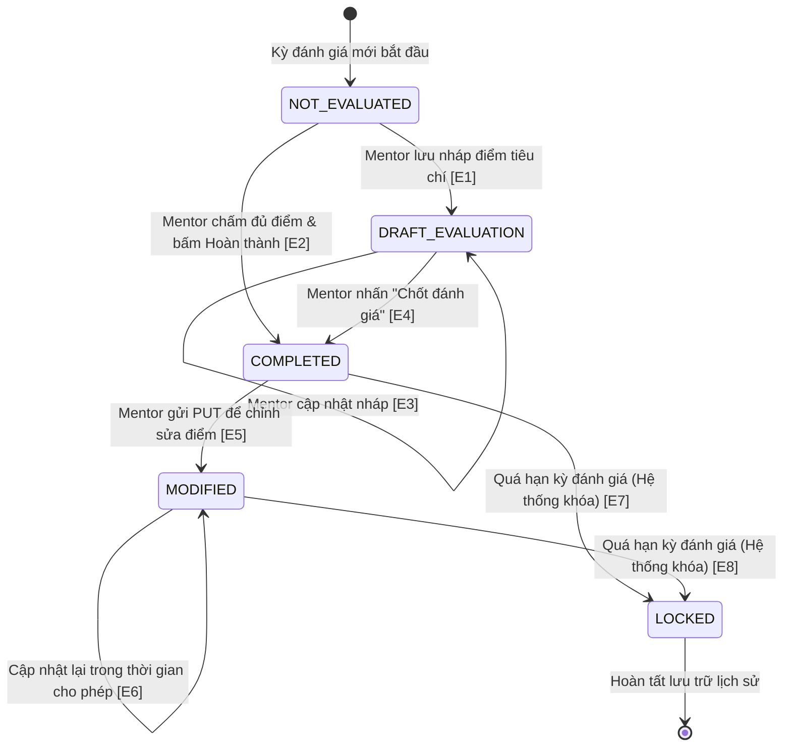

# BẢNG CHUYỂN ĐỔI TRẠNG THÁI (STATE TRANSITION TABLE)
## MODULE: FR-MEN-003 - ĐÁNH GIÁ TALENT (EVALUATE TALENTS)

> **Người thực hiện:** Nguyễn Minh Hiển  
> **Dự án:** ODC Software Testing (LabODC)  
> **Tài liệu tham chiếu:** Giáo trình Kiểm thử phần mềm - Chương IV (Slide 36 - 40), `docs/SRS_LabOdc.md`  

---

### I. XÁC ĐỊNH CÁC TRẠNG THÁI CỦA ĐÁNH GIÁ
1. **$S_0$: NOT_EVALUATED** (Chưa được đánh giá trong kỳ này).
2. **$S_1$: DRAFT_EVALUATION** (Đang chấm điểm dở dang / Bản nháp đánh giá).
3. **$S_2$: COMPLETED** (Đã hoàn tất đánh giá và công bố điểm cho Talent & Lab Admin).
4. **$S_3$: MODIFIED** (Đã chỉnh sửa / cập nhật lại sau phúc khảo hoặc bổ sung nhận xét).
5. **$S_4$: LOCKED** (Khóa đánh giá sau khi hết thời hạn kỳ báo cáo, không thể sửa đổi).

---

### II. SƠ ĐỒ CHUYỂN ĐỔI TRẠNG THÁI (STATE TRANSITION DIAGRAM)

---

### III. BẢNG CHUYỂN ĐỔI TRẠNG THÁI CHUẨN (SLIDE TRANG 39)

| Test Case No. | Start State (Trạng thái bắt đầu) | Event / Input (Sự kiện / Hành động kích hoạt) | End State / Expected Output (Trạng thái đích & Đầu ra mong đợi) | Ghi chú kiểm thử |
| :---: | :--- | :--- | :--- | :--- |
| **ST-MEN-01** | NOT_EVALUATED | Mentor nhập một phần tiêu chí và bấm "Lưu nháp" | **DRAFT_EVALUATION** Bản ghi được tạo ở chế độ Draft, talent chưa xem được điểm. | Chuyển trạng thái hợp lệ |
| **ST-MEN-02** | NOT_EVALUATED | Mentor nhập đầy đủ tất cả các trường và bấm "Hoàn thành" | **COMPLETED** Lưu chính thức, công bố điểm lên hệ thống, gửi email cho Talent. | Chuyển trạng thái hợp lệ |
| **ST-MEN-03** | DRAFT_EVALUATION | Mentor bổ sung thêm nhận xét điểm mạnh/yếu và lưu | **DRAFT_EVALUATION** Cập nhật nội dung nháp, giữ nguyên trạng thái. | Vòng lặp hợp lệ |
| **ST-MEN-04** | DRAFT_EVALUATION | Mentor kiểm tra lại và bấm "Nộp đánh giá chính thức" | **COMPLETED** Chuyển sang trạng thái hoàn thành, ghi nhận điểm số. | Chuyển trạng thái hợp lệ |
| **ST-MEN-05** | COMPLETED | Mentor phát hiện nhầm lẫn, gửi request PUT cập nhật điểm | **MODIFIED** Cập nhật điểm thành công, lưu lại log lịch sử chỉnh sửa. | Chuyển trạng thái cập nhật |
| **ST-MEN-06** | COMPLETED / MODIFIED | Hết thời gian kỳ đánh giá, hệ thống thực hiện batch job | **LOCKED** Khóa vĩnh viễn kỳ đánh giá này, chỉ cho phép đọc. | Chuyển trạng thái tự động |
| **ST-MEN-07** | LOCKED | Mentor cố gắng gửi PUT chỉnh sửa điểm khi đã bị khóa | **LOCKED (Giữ nguyên)** HTTP 400/403: "Kỳ đánh giá đã khóa, không thể chỉnh sửa". | Chuyển trạng thái không hợp lệ (Invalid) |
| **ST-MEN-08** | NOT_EVALUATED | Cố gắng gọi PUT chỉnh sửa trước khi bản ghi được tạo | **NOT_EVALUATED (Giữ nguyên)** HTTP 404 Not Found: "Chưa có bản ghi đánh giá để cập nhật". | Chuyển trạng thái không hợp lệ (Invalid) |