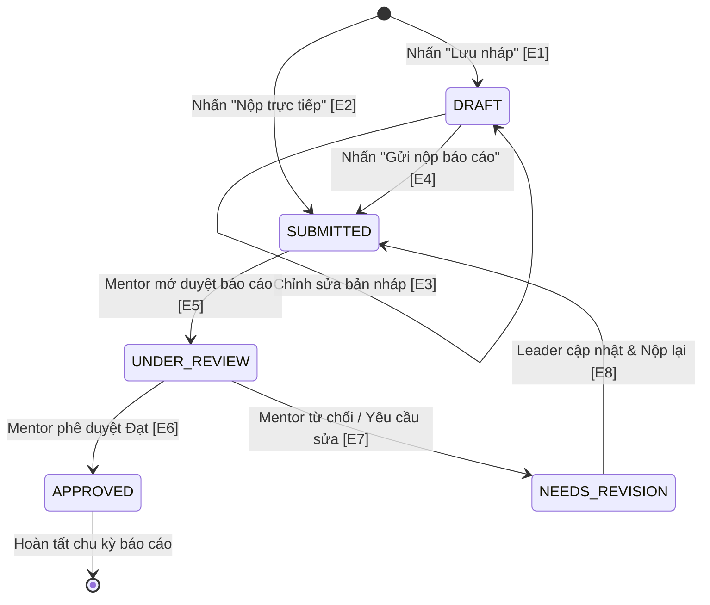

# BẢNG CHUYỂN ĐỔI TRẠNG THÁI (STATE TRANSITION TABLE)
## MODULE: FR-TL-002 — NỘP BÁO CÁO NHÓM (SUBMIT TEAM REPORT)

> **Người thực hiện:** Nguyễn Minh Hiển  
> **Dự án:** ODC Software Testing (LabODC)  
> **Tài liệu tham chiếu:** Giáo trình Kiểm thử phần mềm - Chương IV (Slide 36 - 40), `docs/SRS_LabOdc.md`  

---

### I. XÁC ĐỊNH CÁC TRẠNG THÁI CỦA BÁO CÁO NHÓM
Trong quy trình quản lý dự án LabODC, một báo cáo tiến độ nhóm trải qua các trạng thái vòng đời sau:
1. **$S_0$: NON_EXISTENT** (Chưa khởi tạo báo cáo).
2. **$S_1$: DRAFT** (Bản nháp - Trưởng nhóm đang soạn thảo nội dung, chưa gửi đi).
3. **$S_2$: SUBMITTED** (Đã nộp - Báo cáo đã gửi lên hệ thống, chờ Mentor tiếp nhận).
4. **$S_3$: UNDER_REVIEW** (Đang xem xét - Mentor đang đọc, kiểm tra và đánh giá tiến độ).
5. **$S_4$: APPROVED** (Đã phê duyệt - Báo cáo đạt yêu cầu, tiến độ được ghi nhận chính thức).
6. **$S_5$: REJECTED / NEEDS_REVISION** (Yêu cầu chỉnh sửa / Bị từ chối - Báo cáo chưa đạt, Mentor yêu cầu Leader sửa đổi).

---

### II. SƠ ĐỒ CHUYỂN ĐỔI TRẠNG THÁI (STATE TRANSITION DIAGRAM)

---

### III. BẢNG CHUYỂN ĐỔI TRẠNG THÁI CHUẨN (SLIDE TRANG 39)

| Test Case No. | Start State (Trạng thái bắt đầu) | Event / Input (Sự kiện / Hành động kích hoạt) | End State / Expected Output (Trạng thái đích & Đầu ra mong đợi) | Ghi chú kiểm thử |
| :---: | :--- | :--- | :--- | :--- |
| **ST-TL-01** | Non-Existent | Leader nhấn "Lưu nháp" với dữ liệu hợp lệ | **DRAFT** Báo cáo được lưu tạm, thông báo "Lưu nháp thành công". | Chuyển trạng thái hợp lệ |
| **ST-TL-02** | Non-Existent | Leader nhấn "Nộp báo cáo" trực tiếp với đầy đủ dữ liệu | **SUBMITTED** Báo cáo chuyển sang trạng thái đã nộp, gửi thông báo cho Mentor. | Chuyển trạng thái hợp lệ |
| **ST-TL-03** | DRAFT | Leader chỉnh sửa thông tin công việc và nhấn "Lưu" | **DRAFT** Cập nhật dữ liệu bản nháp, trạng thái giữ nguyên DRAFT. | Vòng lặp trạng thái hợp lệ |
| **ST-TL-04** | DRAFT | Leader bấm nút "Nộp báo cáo chính thức" | **SUBMITTED** Khóa quyền sửa tạm thời, chuyển sang SUBMITTED. | Chuyển trạng thái hợp lệ |
| **ST-TL-05** | SUBMITTED | Mentor mở chi tiết báo cáo để bắt đầu thẩm định | **UNDER_REVIEW** Trạng thái chuyển sang Đang xem xét. | Chuyển trạng thái hợp lệ |
| **ST-TL-06** | UNDER_REVIEW | Mentor đánh giá đạt chuẩn và bấm "Phê duyệt" | **APPROVED** Ghi nhận tiến độ dự án, kết thúc quy trình báo cáo kỳ này. | Trạng thái kết thúc thành công |
| **ST-TL-07** | UNDER_REVIEW | Mentor phát hiện sai sót, nhập lý do và bấm "Yêu cầu sửa" | **NEEDS_REVISION** Báo cáo bị trả về cho Leader kèm nội dung phản hồi. | Nhánh xử lý ngoại lệ hợp lệ |
| **ST-TL-08** | NEEDS_REVISION | Leader chỉnh sửa theo góp ý và nhấn "Nộp lại" (Resubmit) | **SUBMITTED** Báo cáo nộp lại thành công, chờ thẩm định lần 2. | Chuyển trạng thái hợp lệ |
| **ST-TL-09** | SUBMITTED | Leader cố tình gửi request PUT để sửa nội dung khi đã nộp | **SUBMITTED (Giữ nguyên)** HTTP 400/403: "Không thể chỉnh sửa báo cáo đang chờ duyệt". | Chuyển trạng thái không hợp lệ (Invalid) |
| **ST-TL-10** | APPROVED | Leader hoặc Mentor cố tình bấm sửa/nộp lại báo cáo đã duyệt | **APPROVED (Giữ nguyên)** HTTP 400: "Báo cáo đã được phê duyệt, không thể thay đổi". | Chuyển trạng thái không hợp lệ (Invalid) |
