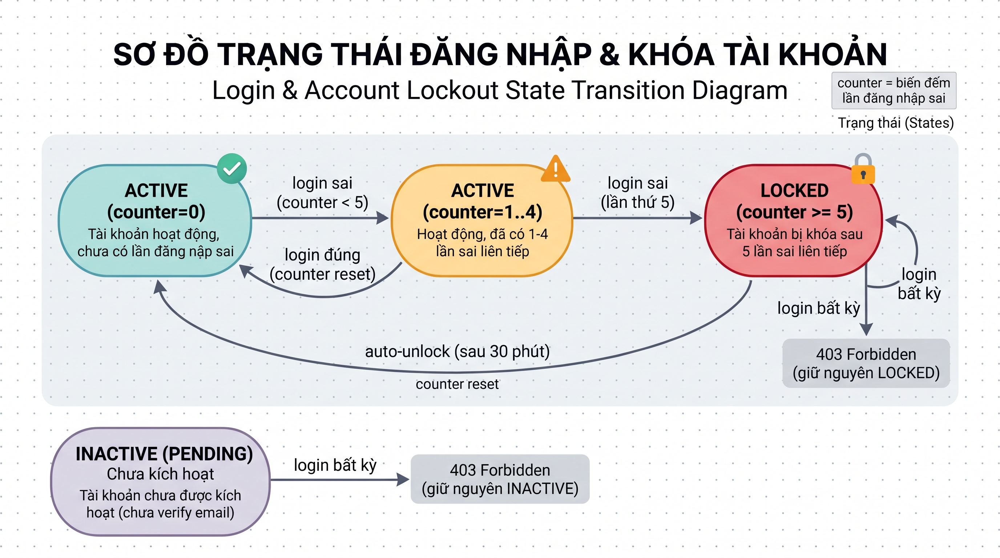

# Test Cases: FR-AUTH-001 - Đăng nhập (Login)

**Module:** Authentication  
**Chức năng:** User Login (`POST /auth/login`)  
**Người thực hiện:** Đặng Thành Đình Phát  
**Ngày tạo:** 27/10/2026  
**Ngày cập nhật:** 06/11/2026  
**Nguồn đặc tả:** `docs/SRS_LabOdc.md` - mục FR-AUTH-001  
**Source code tham chiếu:** `labodc-backend/.../dto/auth/LoginRequest.java`, `labodc-backend/.../service/AuthService.java`, `labodc-backend/.../model/entity/User.java`

---

## Mô tả chức năng

Người dùng gửi request `POST /auth/login` với body JSON gồm `email` và `password`. Hệ thống validate đầu vào, xác thực thông tin, kiểm tra trạng thái tài khoản, và trả về JWT token nếu thành công.

**Điều kiện hợp lệ:** Yêu cầu login được chấp nhận khi **tất cả** các điều kiện sau đồng thời thỏa mãn:

| Biến đầu vào | Ý nghĩa | Kiểu dữ liệu | Ràng buộc hợp lệ |
|---|---|---|---|
| `email` | Email đăng nhập | String | Không rỗng, đúng format email (RFC), đúng case, tồn tại trong DB |
| `password` | Mật khẩu | String | Không rỗng, khớp với password đã hash trong DB |
| `account.status` | Trạng thái tài khoản | Enum | Phải là `ACTIVE` (không `LOCKED`, không `INACTIVE/PENDING`) |

**Giả định:**

1. Chỉ xét đầu vào gửi qua API (`Content-Type: application/json`). Các trường hợp thiếu field hoặc sai kiểu JSON không nằm trong phạm vi test này.
2. Validation tầng controller do Spring `@Valid` xử lý: `@NotBlank` và `@Email` trên `LoginRequest`.
3. Xác thực nghiệp vụ (email tồn tại, password khớp) do `AuthService.login()` xử lý, trả về message chung `"Invalid email or password"` cho cả hai trường hợp sai email lẫn sai password (bảo mật).
4. Account locking (sau 5 lần sai liên tiếp) và auto-unlock (sau 30 phút) theo SRS quy định - chi tiết expected behavior xem Section 3 (State Transition). Xem Section 6 để biết trạng thái implementation hiện tại trong code.

---

## 1. Phân hoạch lớp tương đương (Equivalence Partitioning)

### 1.1 Email

| Lớp | Mô tả | Tag | Giá trị đại diện |
|---|---|---|---|
| Hợp lệ | Email đúng format, đúng case, không rỗng, tồn tại trong DB | V-EM1 | `testlogin@labodc.com` |
| Không hợp lệ (a) | Email rỗng / chỉ có khoảng trắng | X-EM1 | `""` |
| Không hợp lệ (b) | Email sai format - thiếu `@` | X-EM2 | `testloginlabodc.com` |
| Không hợp lệ (c) | Email sai format - thiếu domain | X-EM3 | `testlogin@` |
| Không hợp lệ (d) | Email đúng format nhưng không tồn tại trong DB | X-EM4 | `ghost@labodc.com` |
| Không hợp lệ (e) | Email đúng format, tồn tại nhưng sai case (hoa/thường) | X-EM5 | `TESTLOGIN@LABODC.COM` |

### 1.2 Password

| Lớp | Mô tả | Tag | Giá trị đại diện |
|---|---|---|---|
| Hợp lệ | Password không rỗng, khớp với DB | V-PW1 | `Secure@123` (10 ký tự) |
| Không hợp lệ (a) | Password rỗng / chỉ có khoảng trắng | X-PW1 | `""` |
| Không hợp lệ (b) | Password không rỗng nhưng sai (không khớp DB) | X-PW2 | `WrongPass999!` |

### 1.3 Account Status

| Lớp | Mô tả | Tag | Giá trị đại diện |
|---|---|---|---|
| Hợp lệ | Account status = ACTIVE | V-ACC1 | Tài khoản đã verify, đang hoạt động |
| Không hợp lệ (a) | Account status = LOCKED | X-ACC1 | Tài khoản bị khóa sau 5 lần sai |
| Không hợp lệ (b) | Account status = INACTIVE/PENDING | X-ACC2 | Tài khoản chưa verify email |

### Tổng hợp tag lớp tương đương

| Loại | Tags | Số lượng |
|---|---|---|
| Hợp lệ | V-EM1, V-PW1, V-ACC1 | 3 |
| Không hợp lệ | X-EM1, X-EM2, X-EM3, X-EM4, X-EM5, X-PW1, X-PW2, X-ACC1, X-ACC2 | 9 |
| **Tổng** | | **12 tag** |

---

## 2. Phân tích giá trị biên (Boundary Value Analysis)

Biến có biên số học rõ ràng là **độ dài password** (SRS quy định min = 8 ký tự ở tầng đăng ký). Tại login, hệ thống không validate độ dài mà chỉ so khớp hash - do đó BVA chỉ áp dụng **phía hợp lệ**: kiểm tra rằng tài khoản đã đăng ký với password tại các giá trị biên có thể login thành công.

Email không có ràng buộc độ dài cụ thể trong SRS nên không áp dụng BVA cho email.

### 2.1 Độ dài Password (phía hợp lệ)

| Ký hiệu | Ý nghĩa | Giá trị | Mô tả | Tag |
|---|---|---:|---|---|
| `min` | Giá trị nhỏ nhất hợp lệ | 8 | `Abcdef1!` - 8 ký tự | B-PW1 |
| `min+` | Ngay trên min | 9 | `Abcdefg1!` - 9 ký tự | B-PW2 |
| `nominal` | Giá trị đại diện giữa miền | 10 | `Secure@123` - 10 ký tự | B-PW3 |

> **Ghi chú:** Giá trị biên `min-` (7 ký tự) không áp dụng cho login vì login không validate độ dài password - password dưới 8 ký tự tại login chỉ đơn giản là "sai password" (không khớp hash), bản chất giống lớp X-PW2. Ràng buộc min = 8 được ràng buộc ở tầng đăng ký. Phía max không quy định trong SRS nên BVA cũng không áp dụng.

### Tổng hợp tag biên

| Tags | Số lượng |
|---|---|
| B-PW1, B-PW2, B-PW3 | 3 tag |

---

## 3. Chuyển đổi trạng thái (State Transition Testing)

### 3.1 Sơ đồ trạng thái Account (liên quan đến Login)

**Trạng thái:**
- **ACTIVE (counter=0)** - Tài khoản hoạt động, chưa có lần đăng nhập sai
- **ACTIVE (counter=1..4)** - Tài khoản hoạt động, đã có 1-4 lần đăng nhập sai liên tiếp
- **LOCKED** - Tài khoản bị khóa sau 5 lần sai liên tiếp
- **INACTIVE/PENDING** - Tài khoản chưa được kích hoạt (chưa verify email)

### 3.2 Bảng chuyển đổi trạng thái

| Test Case | Start State | Event/Input | Expected End State | Expected Output |
|---|---|---|---|---|
| ST-01 | ACTIVE (counter=0) | Login đúng email + đúng password | ACTIVE (counter=0) | 200 - Login thành công, trả về JWT token |
| ST-02 | ACTIVE (counter=0) | Login đúng email + sai password | ACTIVE (counter=1) | 401 - "Invalid email or password", counter tăng lên 1 |
| ST-03 | ACTIVE (counter=4) | Login đúng email + sai password (lần thứ 5) | LOCKED | 403 - "Tài khoản đã bị khóa", account status = LOCKED |
| ST-04 | ACTIVE (counter=4) | Login đúng email + đúng password | ACTIVE (counter=0) | 200 - Login thành công, counter reset về 0 |
| ST-05 | LOCKED | Login đúng email + đúng password | LOCKED (không đổi) | 403 - "Tài khoản đã bị khóa" |
| ST-06 | LOCKED (sau 30 phút) | Hệ thống tự động unlock | ACTIVE (counter=0) | Auto-unlock, counter reset |
| ST-07 | INACTIVE/PENDING | Login đúng email + đúng password | INACTIVE (không đổi) | 403 - "Tài khoản chưa được kích hoạt" |

---

## 4. Bảng quyết định (Decision Table)

### 4.1 Điều kiện và hành động

**Conditions:**
- C1: Email format hợp lệ? (không rỗng, đúng format `@Email`)
- C2: Email tồn tại trong DB?
- C3: Password không rỗng? (`@NotBlank`)
- C4: Password khớp với hash trong DB?
- C5: Account status = ACTIVE? (không LOCKED, không INACTIVE)

**Actions:**
- A1: 200 - Login thành công, trả về JWT token + user info
- A2: 400 Bad Request - email format không hợp lệ hoặc password rỗng
- A3: 401 Unauthorized - "Invalid email or password"
- A4: 403 Forbidden - tài khoản bị khóa hoặc chưa kích hoạt

### 4.2 Bảng quyết định

| | R1 | R2 | R3 | R4 | R5 | R6 |
|---|:---:|:---:|:---:|:---:|:---:|:---:|
| **C1:** Email format hợp lệ | Y | N | Y | Y | Y | Y |
| **C2:** Email tồn tại trong DB | Y | - | N | Y | Y | Y |
| **C3:** Password không rỗng | Y | - | - | N | Y | Y |
| **C4:** Password khớp hash | Y | - | - | - | N | Y |
| **C5:** Account ACTIVE | Y | - | - | - | - | N |
| | | | | | | |
| **A1:** 200 - Login thành công | X | - | - | - | - | - |
| **A2:** 400 - Validation error | - | X | - | X | - | - |
| **A3:** 401 - Sai credentials | - | - | X | - | X | - |
| **A4:** 403 - Account locked/inactive | - | - | - | - | - | X |

> **Ghi chú:** Bảng rút gọn theo nguyên tắc: khi một condition = N (fail), các condition phía dưới không cần xét (ký hiệu "-"). R1 = tất cả conditions đều Y = happy path. R2 và R4 cùng trả về 400 nhưng lý do khác nhau (email format vs password rỗng).

---

## 5. Bảng Test Cases

### Nguyên tắc thiết kế

- **Test case hợp lệ:** Tất cả biến đều hợp lệ (email đúng format + đúng case + tồn tại, password đúng, account ACTIVE).
- **Test case không hợp lệ:** Tuân thủ nguyên tắc **single fault** - mỗi test chỉ có đúng **một** biến sai, biến còn lại giữ hợp lệ, để xác định chính xác nguyên nhân gây lỗi.
- **Test case State Transition và Decision Table:** Có thể kết hợp nhiều điều kiện để verify transition / rule - vẫn giữ nguyên tắc single fault trong từng test.

### Preconditions (áp dụng cho tất cả test case)

- Auth-service đang chạy và kết nối DB.
- Tài khoản test `testlogin@labodc.com` đã đăng ký với password `Secure@123` (10 ký tự), trạng thái ACTIVE.
- Tài khoản test `testmin@labodc.com` đã đăng ký với password `Abcdef1!` (8 ký tự).
- Tài khoản test `testminplus@labodc.com` đã đăng ký với password `Abcdefg1!` (9 ký tự).
- **ACC-LOCKED:** Tài khoản `testlocked@labodc.com` ở trạng thái LOCKED (status column = LOCKED trong DB).
- **ACC-INACTIVE:** Tài khoản `testinactive@labodc.com` ở trạng thái PENDING (chưa verify email).
- **ACC-4FAILS:** Cần giả lập counter `failed_login_attempts` = 4 cho tài khoản `testlogin@labodc.com` trước khi chạy TC-14, TC-17.

### Bảng test case

| STT | TC ID | Tên test case | Pre-condition | Email | Password | Expected HTTP | Expected Result | Tag / ST / Rule |
|---:|---|---|---|---|---|---:|---|---|
| 1 | TC-LOGIN-01 | Login thành công - tất cả hợp lệ (nominal) | ACTIVE, cnt=0 | `testlogin@labodc.com` | `Secure@123` (10 ký tự, đúng) | 200 | Trả về JSON: `token`, `tokenType: "Bearer"`, `email`, `role` | V-EM1, V-PW1, V-ACC1, B-PW3, ST-01, R1 |
| 2 | TC-LOGIN-02 | Login thành công - password tại biên min (8 ký tự) | ACTIVE, cnt=0 | `testmin@labodc.com` | `Abcdef1!` (8 ký tự, đúng) | 200 | Login thành công, trả về token | V-EM1, V-PW1, V-ACC1, B-PW1, R1 |
| 3 | TC-LOGIN-03 | Login thành công - password tại biên min+ (9 ký tự) | ACTIVE, cnt=0 | `testminplus@labodc.com` | `Abcdefg1!` (9 ký tự, đúng) | 200 | Login thành công, trả về token | V-EM1, V-PW1, V-ACC1, B-PW2, R1 |
| 4 | TC-LOGIN-04 | Email rỗng (single fault) | - | `""` | `Secure@123` | 400 | Lỗi validation `@NotBlank` - email không được rỗng | X-EM1, R2 |
| 5 | TC-LOGIN-05 | Email sai format - thiếu @ (single fault) | - | `testloginlabodc.com` | `Secure@123` | 400 | Lỗi validation `@Email` - email không hợp lệ | X-EM2, R2 |
| 6 | TC-LOGIN-06 | Email sai format - thiếu domain (single fault) | - | `testlogin@` | `Secure@123` | 400 | Lỗi validation `@Email` - email không hợp lệ | X-EM3, R2 |
| 7 | TC-LOGIN-07 | Email không tồn tại trong DB (single fault) | - | `ghost@labodc.com` | `Secure@123` | 401 | `"Invalid email or password"` | X-EM4, R3 |
| 8 | TC-LOGIN-08 | Password rỗng (single fault) | - | `testlogin@labodc.com` | `""` | 400 | Lỗi validation `@NotBlank` - password không được rỗng | X-PW1, R4 |
| 9 | TC-LOGIN-09 | Password sai - đủ dài nhưng không khớp (single fault) | ACTIVE, cnt=0 | `testlogin@labodc.com` | `WrongPass999!` (14 ký tự) | 401 | `"Invalid email or password"` | X-PW2, R5 |
| 10 | TC-LOGIN-10 | Email chỉ có khoảng trắng | - | `"   "` | `Secure@123` | 400 | Lỗi validation - email rỗng sau trim | X-EM1, R2 |
| 11 | TC-LOGIN-11 | Password chỉ có khoảng trắng | - | `testlogin@labodc.com` | `"   "` | 400 | Lỗi validation `@NotBlank` | X-PW1, R4 |
| 12 | TC-LOGIN-12 | Email có khoảng trắng đầu/cuối (edge case) | - | `" testlogin@labodc.com "` | `Secure@123` | 400 hoặc 401 | Tùy implementation: lỗi format hoặc không tìm thấy user | X-EM2, R2 |
| 13 | TC-LOGIN-13 | Email viết hoa - case sensitivity (single fault) | - | `TESTLOGIN@LABODC.COM` | `Secure@123` | 401 | `"Invalid email or password"` - hệ thống phân biệt hoa/thường email | X-EM5, R3 |
| 14 | TC-LOGIN-14 | **[ST-03]** Login sai lần thứ 5 - khóa tài khoản | ACC-4FAILS (cnt=4) | `testlogin@labodc.com` | `WrongPass5th!` (sai) | 403 | Tài khoản bị khóa, status chuyển sang LOCKED | ST-03, X-PW2 |
| 15 | TC-LOGIN-15 | **[ST-05]** Login khi tài khoản đã bị khóa | ACC-LOCKED | `testlocked@labodc.com` | password đúng | 403 | `"Tài khoản đã bị khóa"` - không cho login dù password đúng | ST-05, X-ACC1, R6 |
| 16 | TC-LOGIN-16 | **[ST-07]** Login khi tài khoản chưa kích hoạt | ACC-INACTIVE | `testinactive@labodc.com` | password đúng | 403 | `"Tài khoản chưa được kích hoạt"` | ST-07, X-ACC2, R6 |
| 17 | TC-LOGIN-17 | **[ST-04]** Login đúng khi đã có 4 lần sai - reset counter | ACC-4FAILS (cnt=4) | `testlogin@labodc.com` | `Secure@123` (đúng) | 200 | Login thành công, counter reset về 0 | ST-04, V-EM1, V-PW1 |
| 18 | TC-LOGIN-18 | **[ST-02]** Login sai lần đầu - tăng counter | ACTIVE, cnt=0 | `testlogin@labodc.com` | `WrongFirst!` (sai) | 401 | `"Invalid email or password"`, counter tăng lên 1 | ST-02, X-PW2 |
| 19 | TC-LOGIN-19 | **[ST-06]** Login sau khi auto-unlock (30 phút) | ACC-LOCKED, đợi 30 phút | `testlocked@labodc.com` | password đúng | 200 | Login thành công - tài khoản đã tự động mở khóa | ST-06 |
| 20 | TC-LOGIN-20 | **[R6]** Login tài khoản bị khóa với password sai | ACC-LOCKED | `testlocked@labodc.com` | `WrongPass!` (sai) | 403 | `"Tài khoản đã bị khóa"` - trả 403 chứ không phải 401 | ST-05, X-ACC1, R6 |

### Kiểm tra bao phủ

**Lớp tương đương:**

| Tag | Bao phủ bởi |
|---|---|
| V-EM1 | TC-LOGIN-01, 02, 03, 17 |
| V-PW1 | TC-LOGIN-01, 02, 03, 17 |
| V-ACC1 | TC-LOGIN-01, 02, 03 |
| X-EM1 | TC-LOGIN-04, 10 |
| X-EM2 | TC-LOGIN-05, 12 |
| X-EM3 | TC-LOGIN-06 |
| X-EM4 | TC-LOGIN-07 |
| X-EM5 | TC-LOGIN-13 |
| X-PW1 | TC-LOGIN-08, 11 |
| X-PW2 | TC-LOGIN-09, 14, 18 |
| X-ACC1 | TC-LOGIN-15, 20 |
| X-ACC2 | TC-LOGIN-16 |

**Giá trị biên:**

| Tag | Bao phủ bởi |
|---|---|
| B-PW1 (min = 8) | TC-LOGIN-02 |
| B-PW2 (min+ = 9) | TC-LOGIN-03 |
| B-PW3 (nominal = 10) | TC-LOGIN-01 |

**Chuyển đổi trạng thái:**

| ST | Transition | Bao phủ bởi |
|---|---|---|
| ST-01 | ACTIVE (cnt=0) + đúng → Login success | TC-LOGIN-01 |
| ST-02 | ACTIVE (cnt=0) + sai → ACTIVE (cnt=1) | TC-LOGIN-18 |
| ST-03 | ACTIVE (cnt=4) + sai → LOCKED | TC-LOGIN-14 |
| ST-04 | ACTIVE (cnt=4) + đúng → ACTIVE (cnt=0) | TC-LOGIN-17 |
| ST-05 | LOCKED + login → 403 | TC-LOGIN-15, 20 |
| ST-06 | LOCKED + 30 phút → ACTIVE | TC-LOGIN-19 |
| ST-07 | INACTIVE + login → 403 | TC-LOGIN-16 |

**Bảng quyết định:**

| Rule | Mô tả | Bao phủ bởi |
|---|---|---|
| R1 | Tất cả hợp lệ → 200 Login success | TC-LOGIN-01, 02, 03, 17, 19 |
| R2 | Email format sai → 400 | TC-LOGIN-04, 05, 06, 10, 12 |
| R3 | Email không tồn tại → 401 | TC-LOGIN-07, 13 |
| R4 | Password rỗng → 400 | TC-LOGIN-08, 11 |
| R5 | Password sai → 401 | TC-LOGIN-09, 14, 18 |
| R6 | Account locked/inactive → 403 | TC-LOGIN-15, 16, 20 |

> **Kết luận:** 12/12 EP tags, 3/3 BVA tags, 7/7 state transitions, 6/6 decision rules - bao phủ **100%**.

---

### Các trường hợp chưa test (nằm ngoài scope hiện tại)

- JWT token content validation (thuộc FR-AUTH-003 Validate).
- Rate limiting / brute force protection (thuộc infrastructure/middleware).
- SQL injection trong email field.
- Password rất dài / stress test - thuộc non-functional testing, ngoài scope EP/BVA.
- Password dưới 8 ký tự tại login - ràng buộc độ dài thuộc tầng đăng ký.
- Suspended account (`UserStatus.SUSPENDED`) - SRS chưa quy định rõ, chưa có use case.