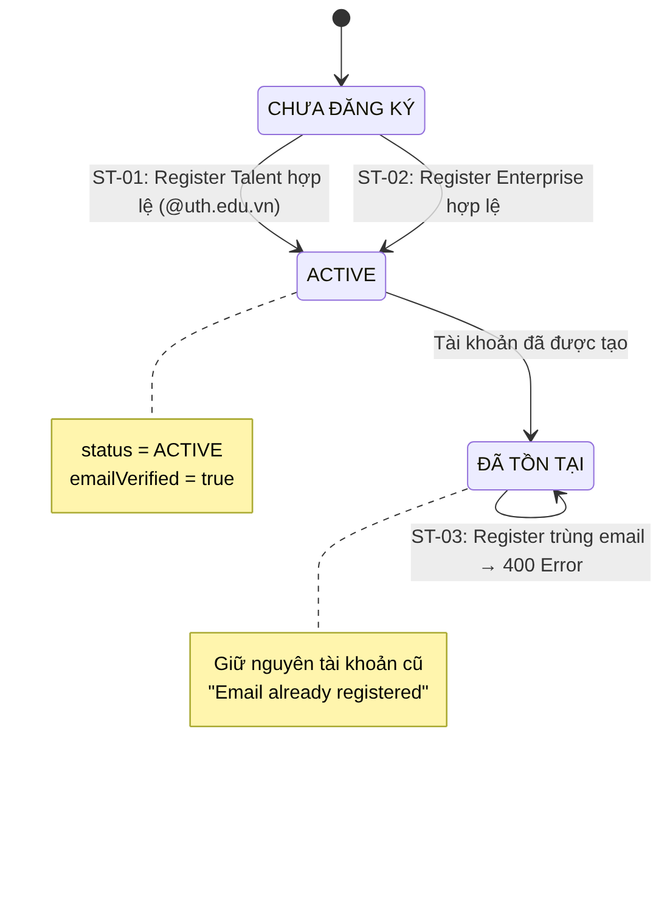

# Test Cases: FR-AUTH-002 - Đăng ký tài khoản (Registration)

**Module:** Authentication
**Chức năng:** User Registration (`POST /api/auth/register`)
**Người thực hiện:** Đặng Thành Đình Phát
**Ngày tạo:** 06/11/2026
**Nguồn đặc tả:** `docs/SRS_LabOdc.md` - mục FR-AUTH-002
**Source code tham chiếu:** `labodc-backend/.../dto/auth/RegisterRequest.java`, `labodc-backend/.../service/AuthService.java`, `labodc-backend/.../controller/AuthController.java`

---

## Mô tả chức năng

Người dùng mới gửi request `POST /api/auth/register` để đăng ký tài khoản. Hệ thống hỗ trợ 2 loại đăng ký:
- **Talent (sinh viên):** Email bắt buộc domain `@uth.edu.vn` (theo SRS)
- **Enterprise (doanh nghiệp):** Email bất kỳ domain hợp lệ

**Điều kiện hợp lệ:** Yêu cầu đăng ký được chấp nhận khi **tất cả** các điều kiện sau đồng thời thỏa mãn:

| Biến đầu vào | Ý nghĩa | Kiểu dữ liệu | Ràng buộc hợp lệ |
|---|---|---|---|
| `email` | Email đăng ký | String | Không rỗng, đúng format email, chưa tồn tại trong DB |
| `password` | Mật khẩu | String | Không rỗng, tối thiểu 8 ký tự, có chữ hoa + chữ thường + số + ký tự đặc biệt |
| `confirmPassword` | Xác nhận mật khẩu | String | Không rỗng, khớp với `password` |
| `role` | Vai trò | Enum (UserRole) | Không null, giá trị hợp lệ: `TALENT` hoặc `ENTERPRISE` |

**Giả định:**

1. Chỉ xét đầu vào gửi qua API (`Content-Type: application/json`). Các trường hợp thiếu field hoặc sai kiểu JSON không nằm trong phạm vi test này.
2. Validation tầng controller do Spring `@Valid` xử lý: `@NotBlank`, `@Email`, `@Size(min=8)` trên `RegisterRequest`.
3. Validation nghiệp vụ (email tồn tại, passwords match) do `AuthService.register()` xử lý.
4. Theo SRS, Talent phải dùng email `@uth.edu.vn` và password phải đủ mạnh (uppercase + lowercase + number + special char).

---

## 1. Phân hoạch lớp tương đương (Equivalence Partitioning)

### 1.1 Email

| Lớp | Mô tả | Tag | Giá trị đại diện |
|---|---|---|---|
| Hợp lệ (a) | Email đúng format, chưa tồn tại, domain @uth.edu.vn (Talent) | V-EM1 | `newtalent@uth.edu.vn` |
| Hợp lệ (b) | Email đúng format, chưa tồn tại, domain khác (Enterprise) | V-EM2 | `newcompany@example.com` |
| Không hợp lệ (a) | Email rỗng / chỉ có khoảng trắng | X-EM1 | `""` |
| Không hợp lệ (b) | Email sai format - thiếu `@` | X-EM2 | `newtalentuth.edu.vn` |
| Không hợp lệ (c) | Email sai format - thiếu domain | X-EM3 | `newtalent@` |
| Không hợp lệ (d) | Email đã tồn tại trong DB | X-EM4 | `sv1@uth.edu.vn` (đã đăng ký) |
| Không hợp lệ (e) | Talent dùng email domain không phải @uth.edu.vn | X-EM5 | `talent@gmail.com` (role=TALENT) |

### 1.2 Password

| Lớp | Mô tả | Tag | Giá trị đại diện |
|---|---|---|---|
| Hợp lệ | Password đủ mạnh: >= 8 ký tự, có uppercase + lowercase + số + ký tự đặc biệt | V-PW1 | `SecurePass123!` (14 ký tự) |
| Không hợp lệ (a) | Password rỗng / chỉ có khoảng trắng | X-PW1 | `""` |
| Không hợp lệ (b) | Password < 8 ký tự (đủ các loại ký tự) | X-PW2 | `Ab1!xyz` (7 ký tự) |
| Không hợp lệ (c) | Password thiếu uppercase (>= 8 ký tự) | X-PW3 | `securepass123!` |
| Không hợp lệ (d) | Password thiếu lowercase (>= 8 ký tự) | X-PW4 | `SECUREPASS123!` |
| Không hợp lệ (e) | Password thiếu số (>= 8 ký tự) | X-PW5 | `SecurePass!!!` |
| Không hợp lệ (f) | Password thiếu ký tự đặc biệt (>= 8 ký tự) | X-PW6 | `SecurePass123` |

### 1.3 ConfirmPassword

| Lớp | Mô tả | Tag | Giá trị đại diện |
|---|---|---|---|
| Hợp lệ | Khớp chính xác với password | V-CP1 | `SecurePass123!` (giống password) |
| Không hợp lệ (a) | ConfirmPassword rỗng | X-CP1 | `""` |
| Không hợp lệ (b) | ConfirmPassword không khớp với password | X-CP2 | `DifferentPass123!` |

### 1.4 Role

| Lớp | Mô tả | Tag | Giá trị đại diện |
|---|---|---|---|
| Hợp lệ (a) | Role = TALENT | V-RL1 | `TALENT` |
| Hợp lệ (b) | Role = ENTERPRISE | V-RL2 | `ENTERPRISE` |
| Không hợp lệ (a) | Role null / thiếu | X-RL1 | `null` |
| Không hợp lệ (b) | Role không hợp lệ (không nằm trong enum cho phép) | X-RL2 | `"STUDENT"` |

### Tổng hợp tag lớp tương đương

| Loại | Tags | Số lượng |
|---|---|---|
| Hợp lệ | V-EM1, V-EM2, V-PW1, V-CP1, V-RL1, V-RL2 | 6 |
| Không hợp lệ | X-EM1..5, X-PW1..6, X-CP1..2, X-RL1..2 | 15 |
| **Tổng** | | **21 tag** |

---

## 2. Phân tích giá trị biên (Boundary Value Analysis)

Biến có biên số học rõ ràng: **độ dài password** (SRS quy định min = 8 ký tự).

### 2.1 Độ dài password

| Ký hiệu | Ý nghĩa | Giá trị | Số ký tự | Kết quả mong đợi | Tag |
|---|---|---|---:|---|---|
| min- | Ngay dưới min | `Ab1!xyz` | 7 | 400 - Password quá ngắn | B-PW1 |
| min | Giá trị nhỏ nhất hợp lệ | `Abcdef1!` | 8 | 200 - Đăng ký thành công | B-PW2 |
| min+ | Ngay trên min | `Abcdefg1!` | 9 | 200 - Đăng ký thành công | B-PW3 |
| nominal | Giá trị thông thường | `SecurePass123!` | 14 | 200 - Đăng ký thành công | B-PW4 |

> **Ghi chú:** Không có biên trên (max) được quy định trong SRS hay DTO validation. Các giá trị BVA đều thỏa mãn yêu cầu độ mạnh (uppercase + lowercase + số + ký tự đặc biệt) để chỉ test biên độ dài.

---

## 3. Chuyển đổi trạng thái (State Transition Testing)

### 3.1 Sơ đồ trạng thái Account (Registration Flow)

**Trạng thái:**
- **CHƯA ĐĂNG KÝ** - Email chưa tồn tại trong hệ thống
- **ACTIVE** - Tài khoản đã kích hoạt (trạng thái mặc định khi đăng ký)
- **ĐÃ TỒN TẠI** - Email đã có trong hệ thống, không cho phép đăng ký trùng

### 3.2 Bảng chuyển đổi trạng thái

| Test Case | Start State | Event/Input | Expected End State | Expected Output |
|---|---|---|---|---|
| ST-01 | CHƯA ĐĂNG KÝ | Register Talent hợp lệ (@uth.edu.vn) | ACTIVE | 200 - Đăng ký thành công, tạo tài khoản |
| ST-02 | CHƯA ĐĂNG KÝ | Register Enterprise hợp lệ | ACTIVE | 200 - Đăng ký thành công, tạo tài khoản |
| ST-03 | ĐÃ TỒN TẠI | Register trùng email | Giữ nguyên | 400 - "Email already registered" |

---

## 4. Bảng quyết định (Decision Table)

### 4.1 Điều kiện và hành động

**Conditions (điều kiện đầu vào):**
- C1: Email format hợp lệ? (@NotBlank + @Email)
- C2: Email chưa tồn tại trong DB?
- C3: Email domain hợp lệ? (Talent: @uth.edu.vn; Enterprise: bất kỳ)
- C4: Password hợp lệ? (@NotBlank + @Size(min=8))
- C5: Password đủ mạnh? (uppercase + lowercase + số + ký tự đặc biệt)
- C6: ConfirmPassword khớp với password?
- C7: Role hợp lệ? (TALENT hoặc ENTERPRISE)

**Actions (kết quả):**
- A1: 200 - Đăng ký thành công, tạo tài khoản ACTIVE
- A2: 400 Bad Request - Email format không hợp lệ
- A3: 400 Bad Request - Email đã tồn tại
- A4: 400 Bad Request - Email domain không hợp lệ (Talent)
- A5: 400 Bad Request - Password không hợp lệ (rỗng hoặc quá ngắn)
- A6: 400 Bad Request - Password không đủ mạnh
- A7: 400 Bad Request - Passwords do not match
- A8: 400 Bad Request - Role không hợp lệ

### 4.2 Bảng quyết định

| | R1 | R2 | R3 | R4 | R5 | R6 | R7 | R8 |
|---|:---:|:---:|:---:|:---:|:---:|:---:|:---:|:---:|
| **C1:** Email format hợp lệ | Y | N | Y | Y | Y | Y | Y | Y |
| **C2:** Email chưa tồn tại | Y | - | N | Y | Y | Y | Y | Y |
| **C3:** Email domain hợp lệ | Y | - | - | N | Y | Y | Y | Y |
| **C4:** Password hợp lệ | Y | - | - | - | N | Y | Y | Y |
| **C5:** Password đủ mạnh | Y | - | - | - | - | N | Y | Y |
| **C6:** ConfirmPassword khớp | Y | - | - | - | - | - | N | Y |
| **C7:** Role hợp lệ | Y | - | - | - | - | - | - | N |
| | | | | | | | | |
| **A1:** 200 - Đăng ký thành công | X | - | - | - | - | - | - | - |
| **A2:** 400 - Email format lỗi | - | X | - | - | - | - | - | - |
| **A3:** 400 - Email đã tồn tại | - | - | X | - | - | - | - | - |
| **A4:** 400 - Domain sai (Talent) | - | - | - | X | - | - | - | - |
| **A5:** 400 - Password lỗi | - | - | - | - | X | - | - | - |
| **A6:** 400 - Password yếu | - | - | - | - | - | X | - | - |
| **A7:** 400 - Password không khớp | - | - | - | - | - | - | X | - |
| **A8:** 400 - Role lỗi | - | - | - | - | - | - | - | X |

> **Ghi chú:** Bảng rút gọn theo nguyên tắc: khi một condition = N (fail), các condition phía dưới không cần xét (ký hiệu "-"). R1 = tất cả conditions đều Y = happy path. R4 (domain validation) và R6 (password strength) hiện chưa được implement trong code.

---

## 5. Test cases (TC-REG-01 đến TC-REG-25)

### Preconditions

| Ký hiệu | Mô tả |
|---|---|
| DB-CLEAN | Email test chưa tồn tại trong DB |
| DB-EXISTS | Email `sv1@uth.edu.vn` đã đăng ký trong DB (tài khoản ACTIVE) |

### 5.1 Equivalence Partitioning - Happy path

| STT | TC ID | Tên test case | Email | Password | ConfirmPassword | Role | Expected HTTP | Expected Result | Tag / ST / Rule |
|---:|---|---|---|---|---|---|---:|---|---|
| 1 | TC-REG-01 | Đăng ký Talent thành công - happy path | `newtalent@uth.edu.vn` | `SecurePass123!` | `SecurePass123!` | TALENT | 200 | Đăng ký thành công, tạo user với status ACTIVE | V-EM1, V-PW1, V-CP1, V-RL1, B-PW4, ST-01, R1 |
| 2 | TC-REG-02 | Đăng ký Enterprise thành công - happy path | `newcompany@example.com` | `SecurePass123!` | `SecurePass123!` | ENTERPRISE | 200 | Đăng ký thành công, tạo user với status ACTIVE | V-EM2, V-PW1, V-CP1, V-RL2, ST-02, R1 |

### 5.2 Equivalence Partitioning - Email không hợp lệ (single fault)

| STT | TC ID | Tên test case | Email | Password | ConfirmPassword | Role | Expected HTTP | Expected Result | Tag / ST / Rule |
|---:|---|---|---|---|---|---|---:|---|---|
| 3 | TC-REG-03 | Email rỗng | `""` | `SecurePass123!` | `SecurePass123!` | TALENT | 400 | "Email is required" | X-EM1, R2 |
| 4 | TC-REG-04 | Email chỉ có khoảng trắng | `"   "` | `SecurePass123!` | `SecurePass123!` | TALENT | 400 | Lỗi validation email | X-EM1, R2 |
| 5 | TC-REG-05 | Email thiếu @ | `newtalentuth.edu.vn` | `SecurePass123!` | `SecurePass123!` | TALENT | 400 | "Email must be valid" | X-EM2, R2 |
| 6 | TC-REG-06 | Email thiếu domain | `newtalent@` | `SecurePass123!` | `SecurePass123!` | TALENT | 400 | "Email must be valid" | X-EM3, R2 |
| 7 | TC-REG-07 | Email đã tồn tại | `sv1@uth.edu.vn` | `SecurePass123!` | `SecurePass123!` | TALENT | 400 | "Email already registered" | X-EM4, ST-03, R3 |
| 8 | TC-REG-08 | Talent dùng email domain không phải @uth.edu.vn | `talent@gmail.com` | `SecurePass123!` | `SecurePass123!` | TALENT | 400 | "Talent phải dùng email @uth.edu.vn" | X-EM5, R4 |

### 5.3 Equivalence Partitioning - Password không hợp lệ (single fault)

| STT | TC ID | Tên test case | Email | Password | ConfirmPassword | Role | Expected HTTP | Expected Result | Tag / ST / Rule |
|---:|---|---|---|---|---|---|---:|---|---|
| 9 | TC-REG-09 | Password rỗng | `newtalent2@uth.edu.vn` | `""` | `""` | TALENT | 400 | "Password is required" | X-PW1, R5 |
| 10 | TC-REG-10 | Password chỉ có khoảng trắng | `newtalent3@uth.edu.vn` | `"   "` | `"   "` | TALENT | 400 | Lỗi validation password | X-PW1, R5 |
| 11 | TC-REG-11 | Password < 8 ký tự | `newtalent4@uth.edu.vn` | `Ab1!xyz` | `Ab1!xyz` | TALENT | 400 | "Password must be at least 8 characters" | X-PW2, B-PW1, R5 |
| 12 | TC-REG-12 | Password thiếu uppercase | `newtalent5@uth.edu.vn` | `securepass123!` | `securepass123!` | TALENT | 400 | Lỗi password không đủ mạnh | X-PW3, R6 |
| 13 | TC-REG-13 | Password thiếu lowercase | `newtalent6@uth.edu.vn` | `SECUREPASS123!` | `SECUREPASS123!` | TALENT | 400 | Lỗi password không đủ mạnh | X-PW4, R6 |
| 14 | TC-REG-14 | Password thiếu số | `newtalent7@uth.edu.vn` | `SecurePass!!!` | `SecurePass!!!` | TALENT | 400 | Lỗi password không đủ mạnh | X-PW5, R6 |
| 15 | TC-REG-15 | Password thiếu ký tự đặc biệt | `newtalent8@uth.edu.vn` | `SecurePass123` | `SecurePass123` | TALENT | 400 | Lỗi password không đủ mạnh | X-PW6, R6 |

### 5.4 Equivalence Partitioning - ConfirmPassword không hợp lệ (single fault)

| STT | TC ID | Tên test case | Email | Password | ConfirmPassword | Role | Expected HTTP | Expected Result | Tag / ST / Rule |
|---:|---|---|---|---|---|---|---:|---|---|
| 16 | TC-REG-16 | ConfirmPassword rỗng | `newtalent9@uth.edu.vn` | `SecurePass123!` | `""` | TALENT | 400 | "Confirm password is required" | X-CP1, R7 |
| 17 | TC-REG-17 | ConfirmPassword không khớp | `newtalent10@uth.edu.vn` | `SecurePass123!` | `DifferentPass1!` | TALENT | 400 | "Passwords do not match" | X-CP2, R7 |

### 5.5 Equivalence Partitioning - Role không hợp lệ (single fault)

| STT | TC ID | Tên test case | Email | Password | ConfirmPassword | Role | Expected HTTP | Expected Result | Tag / ST / Rule |
|---:|---|---|---|---|---|---|---:|---|---|
| 18 | TC-REG-18 | Role null | `newtalent11@uth.edu.vn` | `SecurePass123!` | `SecurePass123!` | `null` | 400 | "Role is required" | X-RL1, R8 |
| 19 | TC-REG-19 | Role không hợp lệ | `newtalent12@uth.edu.vn` | `SecurePass123!` | `SecurePass123!` | `"STUDENT"` | 400 | Lỗi role không nằm trong enum | X-RL2, R8 |

### 5.6 Boundary Value Analysis - Độ dài password

| STT | TC ID | Tên test case | Email | Password | ConfirmPassword | Role | Expected HTTP | Expected Result | Tag / ST / Rule |
|---:|---|---|---|---|---|---|---:|---|---|
| 20 | TC-REG-20 | Password = 8 ký tự (min) | `newtalent13@uth.edu.vn` | `Abcdef1!` | `Abcdef1!` | TALENT | 200 | Đăng ký thành công | V-EM1, V-CP1, V-RL1, B-PW2 |
| 21 | TC-REG-21 | Password = 9 ký tự (min+) | `newtalent14@uth.edu.vn` | `Abcdefg1!` | `Abcdefg1!` | TALENT | 200 | Đăng ký thành công | V-EM1, V-CP1, V-RL1, B-PW3 |

> **Ghi chú:** TC-REG-11 (7 ký tự, min-) đã bao phủ B-PW1 trong phần EP. TC-REG-01 (14 ký tự) đã bao phủ B-PW4 (nominal).

### 5.7 State Transition Testing

| STT | TC ID | Tên test case | Pre-condition | Email | Password | ConfirmPassword | Role | Expected HTTP | Expected Result | Tag / ST / Rule |
|---:|---|---|---|---|---|---|---|---:|---|---|
| 22 | TC-REG-22 | [ST-03] Đăng ký trùng email đang ACTIVE | DB-EXISTS (`sv1@uth.edu.vn` ACTIVE) | `sv1@uth.edu.vn` | `SecurePass123!` | `SecurePass123!` | TALENT | 400 | "Email already registered", tài khoản cũ giữ nguyên | ST-03, X-EM4, R3 |
| 23 | TC-REG-23 | [ST-01] Kiểm tra status sau đăng ký Talent | DB-CLEAN | `checkstatus@uth.edu.vn` | `SecurePass123!` | `SecurePass123!` | TALENT | 200 | Đăng ký thành công, kiểm tra DB: status = ACTIVE, emailVerified = true | ST-01 |
| 24 | TC-REG-24 | [ST-02] Kiểm tra status sau đăng ký Enterprise | DB-CLEAN | `checkstatus@company.com` | `SecurePass123!` | `SecurePass123!` | ENTERPRISE | 200 | Đăng ký thành công, kiểm tra DB: status = ACTIVE, emailVerified = true | ST-02 |

### 5.8 Decision Table - Bổ sung

| STT | TC ID | Tên test case | Email | Password | ConfirmPassword | Role | Expected HTTP | Expected Result | Tag / ST / Rule |
|---:|---|---|---|---|---|---|---:|---|---|
| 25 | TC-REG-25 | [R1] Happy path Enterprise với domain .com.vn | `newent@company.com.vn` | `StrongPass1!` | `StrongPass1!` | ENTERPRISE | 200 | Đăng ký thành công - Enterprise chấp nhận mọi domain | V-EM2, V-PW1, V-CP1, V-RL2, R1 |

---

## 6. Kiểm tra bao phủ

### 6.1 Lớp tương đương

| Tag | Mô tả | Bao phủ bởi |
|---|---|---|
| V-EM1 | Email hợp lệ domain @uth.edu.vn (Talent) | TC-REG-01, 20, 21, 23 |
| V-EM2 | Email hợp lệ domain khác (Enterprise) | TC-REG-02, 24, 25 |
| V-PW1 | Password đủ mạnh | TC-REG-01, 02, 25 |
| V-CP1 | ConfirmPassword khớp | TC-REG-01, 02, 20, 21, 25 |
| V-RL1 | Role = TALENT | TC-REG-01, 20, 21, 23 |
| V-RL2 | Role = ENTERPRISE | TC-REG-02, 24, 25 |
| X-EM1 | Email rỗng/khoảng trắng | TC-REG-03, 04 |
| X-EM2 | Email sai format thiếu @ | TC-REG-05 |
| X-EM3 | Email thiếu domain | TC-REG-06 |
| X-EM4 | Email đã tồn tại | TC-REG-07, 22 |
| X-EM5 | Talent domain sai | TC-REG-08 |
| X-PW1 | Password rỗng/khoảng trắng | TC-REG-09, 10 |
| X-PW2 | Password < 8 ký tự | TC-REG-11 |
| X-PW3 | Password thiếu uppercase | TC-REG-12 |
| X-PW4 | Password thiếu lowercase | TC-REG-13 |
| X-PW5 | Password thiếu số | TC-REG-14 |
| X-PW6 | Password thiếu ký tự đặc biệt | TC-REG-15 |
| X-CP1 | ConfirmPassword rỗng | TC-REG-16 |
| X-CP2 | ConfirmPassword không khớp | TC-REG-17 |
| X-RL1 | Role null | TC-REG-18 |
| X-RL2 | Role không hợp lệ | TC-REG-19 |

### 6.2 Giá trị biên

| Tag | Giá trị | Bao phủ bởi |
|---|---|---|
| B-PW1 | min- = 7 ký tự | TC-REG-11 |
| B-PW2 | min = 8 ký tự | TC-REG-20 |
| B-PW3 | min+ = 9 ký tự | TC-REG-21 |
| B-PW4 | nominal = 14 ký tự | TC-REG-01 |

### 6.3 Chuyển đổi trạng thái

| ST | Transition | Bao phủ bởi |
|---|---|---|
| ST-01 | CHƯA ĐĂNG KÝ + Talent register → ACTIVE | TC-REG-01, 23 |
| ST-02 | CHƯA ĐĂNG KÝ + Enterprise register → ACTIVE | TC-REG-02, 24 |
| ST-03 | ĐÃ TỒN TẠI + register trùng email → Error | TC-REG-07, 22 |

### 6.4 Bảng quyết định

| Rule | Mô tả | Bao phủ bởi |
|---|---|---|
| R1 | Tất cả hợp lệ → 200 Đăng ký thành công | TC-REG-01, 02, 20, 21, 25 |
| R2 | Email format sai → 400 | TC-REG-03, 04, 05, 06 |
| R3 | Email đã tồn tại → 400 | TC-REG-07, 22 |
| R4 | Domain sai (Talent) → 400 | TC-REG-08 |
| R5 | Password lỗi → 400 | TC-REG-09, 10, 11 |
| R6 | Password yếu → 400 | TC-REG-12, 13, 14, 15 |
| R7 | Password không khớp → 400 | TC-REG-16, 17 |
| R8 | Role lỗi → 400 | TC-REG-18, 19 |

> **Kết luận:** 21/21 EP tags, 4/4 BVA tags, 3/3 state transitions, 8/8 decision rules - bao phủ 100%.