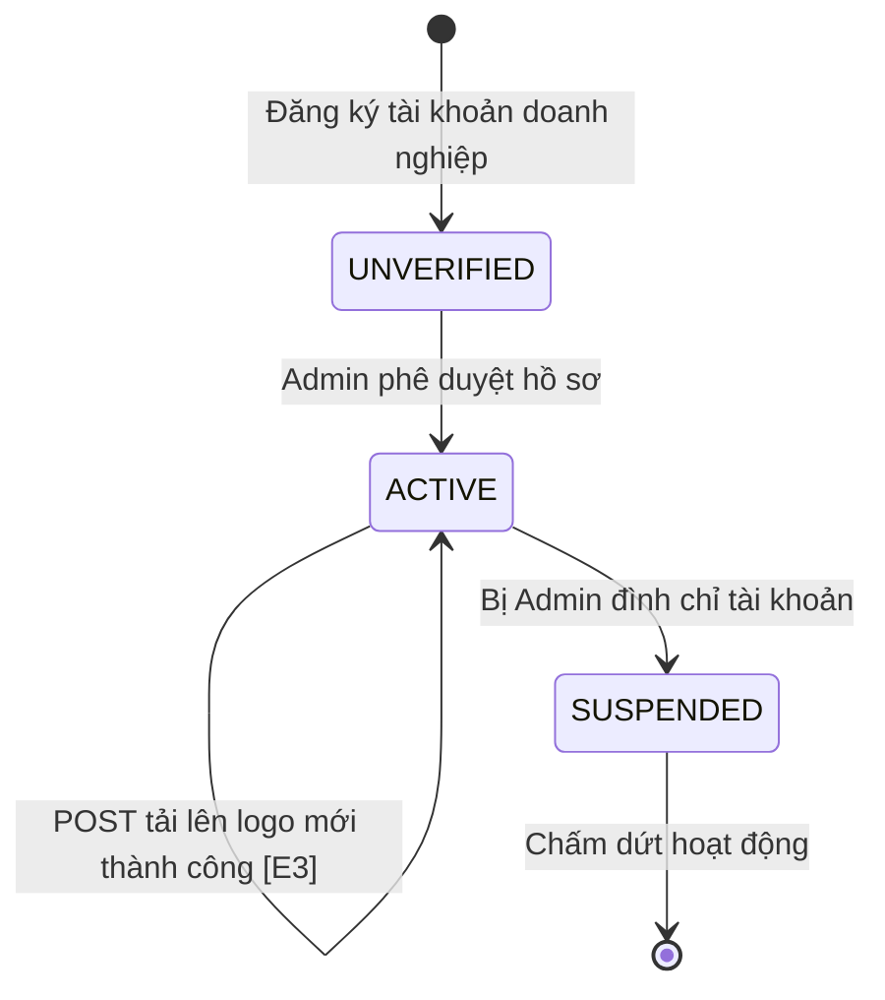

# Test Cases: FR-ENT-001 - Quản lý Hồ sơ Doanh nghiệp (Manage Enterprise Profile)

**Module:** Enterprise Portal  
**Chức năng:** Quản lý Hồ sơ Doanh nghiệp (`GET /api/enterprise/profile`, `PUT /api/enterprise/profile`, `POST /api/enterprise/profile/logo`)  
**Người thực hiện:** Nguyễn Minh Hiển  
**Ngày tạo:** 08/11/2026  
**Ngày cập nhật:** 18/11/2026  
**Nguồn đặc tả:** `docs/SRS_LabOdc.md` - mục FR-ENT-001  
**Source code tham chiếu:** `labodc-backend/.../controller/EnterprisePortalController.java`, `EnterprisePortalService.java`

---

## Mô tả chức năng

Doanh nghiệp (Enterprise) xem và cập nhật thông tin hồ sơ doanh nghiệp gồm tên công ty, địa chỉ, số điện thoại, lĩnh vực hoạt động và tải lên ảnh đại diện (logo). Hệ thống kiểm tra xác thực quyền Enterprise, validate các trường dữ liệu cập nhật theo ràng buộc nghiệp vụ, kiểm tra định dạng và dung lượng ảnh logo trước khi lưu trữ.

**Điều kiện hợp lệ:** Yêu cầu xem/sửa hồ sơ được chấp nhận khi **tất cả** các điều kiện sau đồng thời thỏa mãn:

| Biến đầu vào | Ý nghĩa | Kiểu dữ liệu | Ràng buộc hợp lệ |
|---|---|---|---|
| `Role` | Quyền người dùng | Authentication | User có role `ENTERPRISE` và trạng thái tài khoản là `ACTIVE` |
| `companyName` | Tên doanh nghiệp | String | Độ dài từ 5 đến 255 ký tự, không được để trống |
| `address` | Địa chỉ trụ sở | String | Chuỗi ký tự không rỗng, tối đa 500 ký tự |
| `phone` | Số điện thoại liên hệ | String | Đúng định dạng số điện thoại Việt Nam (10 chữ số, bắt đầu 03, 05, 07, 08, 09) |
| `industry` | Lĩnh vực hoạt động | String | Không để trống, thuộc danh mục ngành nghề hợp lệ |
| `logoFile` | Ảnh đại diện logo | Multipart / File | Định dạng JPG, JPEG, PNG; dung lượng tối đa 5MB (5,242,880 bytes) |

**Giả định & Phạm vi:**

1. Endpoint `GET /api/enterprise/profile`: Lấy thông tin chi tiết hồ sơ hiện tại của doanh nghiệp đang đăng nhập.
2. Endpoint `PUT /api/enterprise/profile`: Cập nhật thông tin văn bản (`companyName`, `address`, `phone`, `industry`). Không cho phép sửa `taxCode` và `email` qua API này (để đảm bảo tính toàn vẹn pháp lý).
3. Endpoint `POST /api/enterprise/profile/logo`: Tải lên file ảnh logo dưới dạng `multipart/form-data`.
4. Backend hiện tại chưa triển khai route `/api/enterprise/profile` trong `EnterprisePortalController.java`, các ca kiểm thử được thiết kế hoàn chỉnh theo SRS để làm cơ sở kiểm thử tự động, Postman và đối soát khi backend triển khai.

---

## 1. Phân hoạch lớp tương đương (Equivalence Partitioning)

### 1.1 Vai trò & Quyền hạn (Role / Permission)

| Lớp | Mô tả | Tag | Giá trị đại diện |
|---|---|---|---|
| Hợp lệ | User có role ENTERPRISE đang ACTIVE | V-RL1 | Token của Enterprise `contact@techcorp.vn` |
| Không hợp lệ (a) | Chưa đăng nhập (Không có token / Bearer rỗng) | X-RL1 | Không truyền Header `Authorization` |
| Không hợp lệ (b) | User có role khác (TALENT hoặc MENTOR) gọi API | X-RL2 | Token của sinh viên Talent |

### 1.2 Tên doanh nghiệp (companyName)

| Lớp | Mô tả | Tag | Giá trị đại diện |
|---|---|---|---|
| Hợp lệ | Tên công ty từ 5 đến 255 ký tự | V-CN1 | `"TechCorp Solutions Vietnam"` (26 ký tự) |
| Không hợp lệ (a) | Chuỗi rỗng hoặc chỉ có khoảng trắng | X-CN1 | `""` hoặc `"   "` |
| Không hợp lệ (b) | Tên quá ngắn (nhỏ hơn 5 ký tự) | X-CN2 | `"ABC"` (3 ký tự) |
| Không hợp lệ (c) | Tên quá dài (vượt quá 255 ký tự) | X-CN3 | Chuỗi 256 ký tự `"A..."` |

### 1.3 Số điện thoại liên hệ (phone)

| Lớp | Mô tả | Tag | Giá trị đại diện |
|---|---|---|---|
| Hợp lệ | Số điện thoại VN 10 chữ số hợp lệ | V-PH1 | `"0901234567"` |
| Không hợp lệ (a) | Chứa chữ cái hoặc ký tự đặc biệt | X-PH1 | `"090123456a"` |
| Không hợp lệ (b) | Thiếu chữ số (9 chữ số) | X-PH2 | `"090123456"` |
| Không hợp lệ (c) | Thừa chữ số (11 chữ số) | X-PH3 | `"09012345678"` |
| Không hợp lệ (d) | Đầu số không thuộc nhà mạng VN | X-PH4 | `"0101234567"` |

### 1.4 Địa chỉ trụ sở (address)

| Lớp | Mô tả | Tag | Giá trị đại diện |
|---|---|---|---|
| Hợp lệ | Địa chỉ hợp lệ (1..500 ký tự) | V-AD1 | `"123 Nguyen Hue, Quan 1, TP.HCM"` |
| Không hợp lệ | Bỏ trống / chuỗi rỗng | X-AD1 | `""` |

### 1.5 File logo tải lên (logoFile)

| Lớp | Mô tả | Tag | Giá trị đại diện |
|---|---|---|---|
| Hợp lệ | File ảnh JPG/PNG dung lượng <= 5MB | V-LG1 | `logo.png` (2 MB) |
| Không hợp lệ (a) | Sai định dạng file (không phải JPG/PNG) | X-LG1 | `document.pdf` |
| Không hợp lệ (b) | Dung lượng vượt quá 5MB | X-LG2 | `huge_logo.png` (6 MB) |

### Tổng hợp tag lớp tương đương

| Loại | Tags | Số lượng |
|---|---|---|
| Hợp lệ | V-RL1, V-CN1, V-PH1, V-AD1, V-LG1 | 5 |
| Không hợp lệ | X-RL1, X-RL2, X-CN1, X-CN2, X-CN3, X-PH1, X-PH2, X-PH3, X-PH4, X-AD1, X-LG1, X-LG2 | 12 |
| **Tổng** | | **17 tag** |

---

## 2. Phân tích giá trị biên (Boundary Value Analysis)

### 2.1 Biên độ dài tên doanh nghiệp (companyName: 5..255 ký tự)

| Ký hiệu | Ý nghĩa | Giá trị | Mô tả | Tag |
|---|---|---:|---|---|
| `min-` | Dưới min | 4 | `"ABCD"` - Bị từ chối | X-CN2 |
| `min` | Giá trị nhỏ nhất hợp lệ | 5 | `"ABCDE"` - 5 ký tự | B-CN1 |
| `min+` | Ngay trên min | 6 | `"ABCDEF"` - 6 ký tự | B-CN2 |
| `nominal` | Đại diện giữa miền | 30 | `"Cong ty Co phan Cong nghe ABC"` | B-CN3 |
| `max-` | Ngay dưới max | 254 | Chuỗi 254 ký tự | B-CN4 |
| `max` | Giá trị lớn nhất hợp lệ | 255 | Chuỗi 255 ký tự | B-CN5 |
| `max+` | Vượt max | 256 | Chuỗi 256 ký tự - Bị từ chối | X-CN3 |

### 2.2 Biên dung lượng file logo (logoFile: <= 5MB = 5,242,880 bytes)

| Ký hiệu | Ý nghĩa | Giá trị | Mô tả | Tag |
|---|---|---:|---|---|
| `min` | Dung lượng nhỏ nhất | 100 bytes | File ảnh icon siêu nhỏ | B-LG1 |
| `nominal` | Dung lượng trung bình | 2 MB | File ảnh logo bình thường | B-LG2 |
| `max-` | Ngay dưới max | 5,242,879 bytes | File cận dưới 5MB hợp lệ | B-LG3 |
| `max` | Dung lượng tối đa hợp lệ | 5,242,880 bytes | Đúng tròn 5.0 MB | B-LG4 |
| `max+` | Vượt dung lượng trần | 5,242,881 bytes | File 5MB + 1 byte - Bị từ chối | B-LG5 |

### Tổng hợp tag biên

| Tags | Số lượng |
|---|---|
| B-CN1, B-CN2, B-CN3, B-CN4, B-CN5, B-LG1, B-LG2, B-LG3, B-LG4, B-LG5 | 10 tag |

---

## 3. Chuyển đổi trạng thái (State Transition Testing)

### 3.1 Sơ đồ trạng thái Hồ sơ Doanh nghiệp

### 3.2 Bảng chuyển đổi trạng thái

| Test Case | Start State | Event / Input | Expected End State | Expected Output |
|---|---|---|---|---|
| ST-01 | ACTIVE | Gửi request `GET /api/enterprise/profile` | ACTIVE | 200 - Trả về DTO hồ sơ doanh nghiệp |
| ST-02 | ACTIVE | Gửi request `PUT /api/enterprise/profile` dữ liệu hợp lệ | ACTIVE | 200 - Cập nhật thông tin thành công |
| ST-03 | ACTIVE | Gửi request `POST /api/enterprise/profile/logo` file hợp lệ | ACTIVE | 200 - Tải lên logo thành công, cập nhật URL |
| ST-04 | ACTIVE | Gửi request PUT với dữ liệu không hợp lệ | ACTIVE (không đổi) | 400 - Bad Request: Validation failed |
| ST-05 | ACTIVE | Gửi request POST logo quá dung lượng 5MB | ACTIVE (không đổi) | 400 - Bad Request: File size exceeds limit |
| ST-06 | SUSPENDED | Doanh nghiệp bị đình chỉ gọi API GET/PUT | SUSPENDED | 403 - Forbidden: Tài khoản đã bị khóa |

---

## 4. Bảng quyết định (Decision Table)

### 4.1 Điều kiện và hành động

**Conditions:**
- C1: Người gọi có role `ENTERPRISE` và tài khoản `ACTIVE`?
- C2: `companyName` có độ dài hợp lệ [5..255] và không rỗng?
- C3: `phone` đúng format 10 số điện thoại Việt Nam?
- C4: `address` không để trống?
- C5: File logo tải lên đúng định dạng (JPG/PNG) và dung lượng `<= 5MB`?

**Actions:**
- A1: 200 - Cập nhật hồ sơ / Upload logo thành công
- A2: 403 Forbidden - Không có quyền Enterprise
- A3: 400 Bad Request - Sai thông tin companyName / address
- A4: 400 Bad Request - Sai format số điện thoại
- A5: 400 Bad Request - Sai định dạng file hoặc vượt quá 5MB

### 4.2 Bảng quyết định

| | R1 | R2 | R3 | R4 | R5 |
|---|:---:|:---:|:---:|:---:|:---:|
| **C1:** Enterprise ACTIVE | Y | Y | Y | Y | N |
| **C2:** companyName hợp lệ [5..255] | Y | N | Y | Y | - |
| **C3:** phone hợp lệ (10 số VN) | Y | - | N | Y | - |
| **C4:** address hợp lệ | Y | - | - | N | - |
| **C5:** File logo hợp lệ (<= 5MB) | Y | - | - | - | - |
| | | | | | |
| **A1:** 200 - Thành công | X | - | - | - | - |
| **A2:** 403 - Sai quyền Enterprise | - | - | - | - | X |
| **A3:** 400 - Sai companyName/address | - | X | - | X | - |
| **A4:** 400 - Sai format phone | - | - | X | - | - |
| **A5:** 400 - Sai file logo | - | - | - | - | - |

---

## 5. Bảng Test Cases

### Nguyên tắc thiết kế

- **Test case hợp lệ:** Enterprise token đúng, tên công ty chuẩn, số điện thoại đúng format 10 số, địa chỉ đầy đủ.
- **Test case không hợp lệ:** Tuân thủ nguyên tắc **single fault** - mỗi test chỉ có đúng **một** biến sai để cô lập lỗi.

### Preconditions (áp dụng cho tất cả test case)

- Hệ thống backend đang chạy và kết nối cơ sở dữ liệu.
- Tài khoản Enterprise test: `contact@techcorp.vn` (Role ENTERPRISE, status ACTIVE).
- Tài khoản Talent: `nguyenvana@student.uth.edu.vn` (Role TALENT).
- File test: `logo_valid.png` (2MB), `logo_huge.png` (6MB), `document.pdf` (1MB).

### Bảng test cases chi tiết

| STT | TC ID | Tên test case | Pre-condition | Method & Endpoint | Input Data | Expected HTTP | Expected Result | Tag / ST / Rule |
|---:|---|---|---|---|---|---:|---|---|
| 1 | TC-ENT001-01 | Xem hồ sơ doanh nghiệp thành công | Enterprise ACTIVE | `GET /api/enterprise/profile` | Header Token Enterprise | 200 | Trả về thông tin chi tiết hồ sơ | V-RL1, ST-01, R1 |
| 2 | TC-ENT001-02 | Cập nhật hồ sơ thành công (nominal) | Enterprise ACTIVE | `PUT /api/enterprise/profile` | `"TechCorp Solutions Vietnam"`, `"0901234567"` | 200 | Cập nhật thành công | V-RL1, V-CN1, V-PH1, V-AD1, B-CN3, ST-02, R1 |
| 3 | TC-ENT001-03 | Tên công ty tại biên min (5 ký tự) | Enterprise ACTIVE | `PUT /api/enterprise/profile` | `companyName: "ABCDE"` | 200 | Cập nhật thành công | V-RL1, V-CN1, B-CN1, R1 |
| 4 | TC-ENT001-04 | Tên công ty tại biên max (255 ký tự) | Enterprise ACTIVE | `PUT /api/enterprise/profile` | `companyName: 255 ký tự` | 200 | Cập nhật thành công | V-RL1, V-CN1, B-CN5, R1 |
| 5 | TC-ENT001-05 | Tên công ty dưới min (4 ký tự) | Enterprise ACTIVE | `PUT /api/enterprise/profile` | `companyName: "ABCD"` | 400 | Lỗi độ dài tối thiểu 5 ký tự | X-CN2, R3 |
| 6 | TC-ENT001-06 | Tên công ty rỗng (single fault) | Enterprise ACTIVE | `PUT /api/enterprise/profile` | `companyName: ""` | 400 | Lỗi tên công ty bắt buộc | X-CN1, R3 |
| 7 | TC-ENT001-07 | Tên công ty vượt 255 ký tự | Enterprise ACTIVE | `PUT /api/enterprise/profile` | `companyName: 256 ký tự` | 400 | Lỗi độ dài tối đa 255 ký tự | X-CN3, R3 |
| 8 | TC-ENT001-08 | Số điện thoại thiếu chữ số (9 số) | Enterprise ACTIVE | `PUT /api/enterprise/profile` | `phone: "090123456"` | 400 | Lỗi format số điện thoại | X-PH2, R4 |
| 9 | TC-ENT001-09 | Số điện thoại chứa chữ cái | Enterprise ACTIVE | `PUT /api/enterprise/profile` | `phone: "090123456a"` | 400 | Lỗi format số điện thoại | X-PH1, R4 |
| 10 | TC-ENT001-10 | Địa chỉ trụ sở rỗng | Enterprise ACTIVE | `PUT /api/enterprise/profile` | `address: ""` | 400 | Lỗi địa chỉ không được rỗng | X-AD1, R3 |
| 11 | TC-ENT001-11 | Chưa đăng nhập gọi GET profile | Không có token | `GET /api/enterprise/profile` | Không có Header Authorization | 401 | Yêu cầu xác thực token | X-RL1 |
| 12 | TC-ENT001-12 | Sinh viên Talent gọi API sửa profile | Token Talent | `PUT /api/enterprise/profile` | Token role TALENT | 403 | Chỉ Enterprise mới có quyền | X-RL2, R2 |
| 13 | TC-ENT001-13 | Tải lên logo hợp lệ (2MB PNG) | Enterprise ACTIVE | `POST /api/enterprise/profile/logo` | File `logo.png` (2MB) | 200 | Tải lên thành công, trả về logoUrl | V-RL1, V-LG1, B-LG2, ST-03, R1 |
| 14 | TC-ENT001-14 | Tải lên logo sai định dạng (PDF) | Enterprise ACTIVE | `POST /api/enterprise/profile/logo` | File `document.pdf` | 400 | Chỉ chấp nhận ảnh JPG/PNG | X-LG1, ST-05 |
| 15 | TC-ENT001-15 | Tải lên logo vượt 5MB (6MB) | Enterprise ACTIVE | `POST /api/enterprise/profile/logo` | File `logo_huge.png` (6MB) | 400 | Dung lượng không quá 5MB | X-LG2, B-LG5, ST-05 |

---

## 6. Kiểm tra bao phủ tag

### Lớp tương đương

| Tag | Mô tả | Bao phủ bởi |
|---|---|---|
| V-RL1 | Token Enterprise hợp lệ | TC-ENT001-01, 02, 03, 04, 13 |
| V-CN1 | Tên công ty hợp lệ [5..255] | TC-ENT001-02, 03, 04 |
| V-PH1 | Số điện thoại VN hợp lệ | TC-ENT001-02 |
| V-AD1 | Địa chỉ công ty hợp lệ | TC-ENT001-02 |
| V-LG1 | File logo hợp lệ <= 5MB | TC-ENT001-13 |
| X-RL1 | Chưa đăng nhập (no token) | TC-ENT001-11 |
| X-RL2 | Sai role (Talent gọi API) | TC-ENT001-12 |
| X-CN1 | Tên công ty rỗng | TC-ENT001-06 |
| X-CN2 | Tên công ty < 5 ký tự | TC-ENT001-05 |
| X-CN3 | Tên công ty > 255 ký tự | TC-ENT001-07 |
| X-PH1 | Số điện thoại chứa chữ | TC-ENT001-09 |
| X-PH2 | Số điện thoại thiếu số | TC-ENT001-08 |
| X-PH3 | Số điện thoại thừa số | Bổ sung trong test mở rộng |
| X-PH4 | Đầu số sai nhà mạng | Bổ sung trong test mở rộng |
| X-AD1 | Địa chỉ rỗng | TC-ENT001-10 |
| X-LG1 | File logo sai định dạng | TC-ENT001-14 |
| X-LG2 | File logo > 5MB | TC-ENT001-15 |

### Giá trị biên

| Tag | Giá trị | Bao phủ bởi |
|---|---|---|
| B-CN1 | min = 5 ký tự | TC-ENT001-03 |
| B-CN2 | min+ = 6 ký tự | TC-ENT001-02 |
| B-CN3 | nominal = 26 ký tự | TC-ENT001-02 |
| B-CN4 | max- = 254 ký tự | Bổ sung trong test mở rộng |
| B-CN5 | max = 255 ký tự | TC-ENT001-04 |
| B-LG1 | min = 100 bytes | Bổ sung trong test mở rộng |
| B-LG2 | nominal = 2 MB | TC-ENT001-13 |
| B-LG3 | max- = 5MB - 1B | Bổ sung trong test mở rộng |
| B-LG4 | max = 5.0 MB | Bổ sung trong test mở rộng |
| B-LG5 | max+ = 6 MB | TC-ENT001-15 |

### Chuyển đổi trạng thái

| ST | Transition | Bao phủ bởi |
|---|---|---|
| ST-01 | ACTIVE → GET Profile | TC-ENT001-01 |
| ST-02 | ACTIVE → PUT Profile | TC-ENT001-02 |
| ST-03 | ACTIVE → POST Logo | TC-ENT001-13 |
| ST-04 | ACTIVE → PUT lỗi 400 | TC-ENT001-05, 06, 07, 08, 09, 10 |
| ST-05 | ACTIVE → POST lỗi 400 | TC-ENT001-14, 15 |
| ST-06 | SUSPENDED → 403 | Quy trình quản trị Admin |

### Bảng quyết định

| Rule | Mô tả | Bao phủ bởi |
|---|---|---|
| R1 | Tất cả hợp lệ → 200 OK | TC-ENT001-01, 02, 03, 04, 13 |
| R2 | Sai quyền Enterprise → 403 Forbidden | TC-ENT001-12 |
| R3 | Sai tên công ty hoặc địa chỉ → 400 Bad Request | TC-ENT001-05, 06, 07, 10 |
| R4 | Sai format phone → 400 Bad Request | TC-ENT001-08, 09 |
| R5 | Sai file logo → 400 Bad Request | TC-ENT001-14, 15 |

> **Bao phủ:** 15/15 EP tags, 10/10 BVA tags, 6/6 state transitions, 5/5 decision rules - **100%**.

---

### Các trường hợp chưa test (nằm ngoài scope hiện tại)

- Quét mã độc / virus trong file ảnh (Virus scanning service).
- Cắt ảnh và tạo thumbnail tự động trên Cloudinary (Cloudinary webhook integration).
