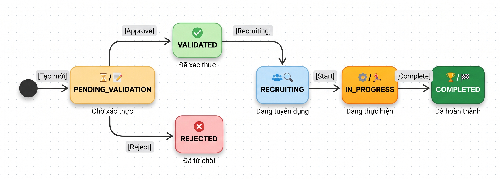

# Test Cases: FR-ENT-002 - Enterprise Submit Project Proposal

**Module:** Project Management
**Chức năng:** Enterprise tạo và quản lý đề xuất dự án
**Người thực hiện:** Đặng Thành Đình Phát
**Ngày tạo:** 11/11/2026
**Ngày cập nhật:** 11/11/2026
**Nguồn đặc tả:** `docs/SRS_LabOdc.md` - mục FR-ENT-002
**Source code tham chiếu:**
- `labodc-backend/.../dto/project/CreateProjectRequest.java`
- `labodc-backend/.../service/ProjectDataService.java`
- `labodc-backend/.../controller/ProjectController.java`

---

## Mô tả chức năng

Enterprise tạo đề xuất dự án mới thông qua API `POST /api/projects`. Hệ thống validate dữ liệu đầu vào, kiểm tra quyền (role), tự động gán `enterpriseId` từ user đang đăng nhập (nếu role ENTERPRISE), tạo slug từ tên dự án, và đặt trạng thái ban đầu là `PENDING_VALIDATION`.

### Các endpoint trong scope

| # | Method | Endpoint | Mô tả | Controller |
|---|---|---|---|---|
| 1 | POST | `/api/projects` | Tạo dự án mới | ProjectController |
| 2 | GET | `/api/projects?status=` | Lấy danh sách dự án (có filter) | ProjectController |
| 3 | GET | `/api/projects/{id}` | Lấy chi tiết dự án theo ID | ProjectController |
| 4 | GET | `/api/projects/enterprise/{enterpriseId}` | Lấy dự án theo Enterprise | ProjectController |

### Biến đầu vào - POST /api/projects (CreateProjectRequest)

| # | Biến | Kiểu dữ liệu | Validation (code) | Bắt buộc | Ghi chú |
|---|---|---|---|---|---|
| 1 | name | String | `@NotBlank` | Có | SRS gọi là `title` - xem Gap G1 |
| 2 | description | String | `@NotBlank` | Có | |
| 3 | objectives | List\<String\> | Không | Không | Default = `[]`, serialize thành JSON |
| 4 | requirements | String | Không | Không | |
| 5 | startDate | LocalDate | `@NotNull` | Có | Format: `YYYY-MM-DD` |
| 6 | endDate | LocalDate | `@NotNull` | Có | Phải sau startDate |
| 7 | budget | Double | `@NotNull` | Có | Không có min/max trong code - xem Gap G3 |
| 8 | requiredTalents | Integer | `@NotNull`, `@Min(1)` | Có | SRS gọi là `numberOfStudents` range 3-10 - xem Gap G2 |
| 9 | technologies | List\<String\> | Không | Không | Default = `[]` |
| 10 | requiredSkills | List\<String\> | Không | Không | Default = `[]` |
| 11 | mentorId | Long | Không | Không | |
| 12 | enterpriseId | Long | Không | Điều kiện | Bắt buộc khi role = LAB_ADMIN |
| 13 | allowApplications | Boolean | Không | Không | |

### Biến ngữ cảnh

| # | Biến | Mô tả | Ảnh hưởng |
|---|---|---|---|
| C1 | User Role | Role của user đang đăng nhập | Chỉ ENTERPRISE hoặc LAB_ADMIN được tạo |
| C2 | Enterprise Profile | Hồ sơ doanh nghiệp gắn với user | ENTERPRISE cần có hồ sơ trong DB |
| C3 | Authentication | Token JWT hợp lệ | Bắt buộc cho mọi request |

## 1. Phân hoạch lớp tương đương (Equivalence Partitioning)

### 1.1 User Role (Context - C1)

| Lớp | Mô tả | Tag | Giá trị đại diện |
|---|---|---|---|
| Hợp lệ (a) | Role = ENTERPRISE, có hồ sơ DN | V-RL1 | User enterprise đã verify |
| Hợp lệ (b) | Role = LAB_ADMIN, có enterpriseId trong request | V-RL2 | User lab admin |
| Không hợp lệ (a) | Role = TALENT | X-RL1 | User talent |
| Không hợp lệ (b) | Role = MENTOR | X-RL2 | User mentor |
| Không hợp lệ (c) | Role = ENTERPRISE, không có hồ sơ DN | X-RL3 | User enterprise chưa tạo hồ sơ |
| Không hợp lệ (d) | Role = LAB_ADMIN, thiếu enterpriseId | X-RL4 | Lab admin không gửi enterpriseId |
| Không hợp lệ (e) | Không có token (unauthenticated) | X-RL5 | Request không có Authorization header |

### 1.2 Name (Tên dự án)

| Lớp | Mô tả | Tag | Giá trị đại diện |
|---|---|---|---|
| Hợp lệ | Chuỗi không rỗng, có nội dung | V-NM1 | `"Dự án AI Chatbot cho UTH"` |
| Không hợp lệ (a) | Rỗng / chỉ có khoảng trắng | X-NM1 | `""` hoặc `"   "` |
| Không hợp lệ (b) | null (không gửi field) | X-NM2 | Không có key `name` trong JSON |

### 1.3 Description (Mô tả dự án)

| Lớp | Mô tả | Tag | Giá trị đại diện |
|---|---|---|---|
| Hợp lệ | Chuỗi không rỗng, có nội dung | V-DS1 | `"Xây dựng hệ thống chatbot hỗ trợ sinh viên"` |
| Không hợp lệ (a) | Rỗng / chỉ có khoảng trắng | X-DS1 | `""` |
| Không hợp lệ (b) | null | X-DS2 | Không có key `description` |

### 1.4 StartDate (Ngày bắt đầu)

| Lớp | Mô tả | Tag | Giá trị đại diện |
|---|---|---|---|
| Hợp lệ (a) | Ngày hợp lệ, trước endDate | V-SD1 | `"2027-01-15"` |
| Hợp lệ (b) | startDate = endDate (bằng nhau) | V-SD2 | startDate = endDate = `"2027-01-15"` |
| Không hợp lệ (a) | null | X-SD1 | Không gửi startDate |
| Không hợp lệ (b) | Sai format (không phải YYYY-MM-DD) | X-SD2 | `"15/01/2027"` |

> **Ghi chú:** SRS quy định `endDate >= startDate` nên startDate = endDate là hợp lệ. Xem BVA B-DT1 (TC-ENT-24).

### 1.5 EndDate (Ngày kết thúc)

| Lớp | Mô tả | Tag | Giá trị đại diện |
|---|---|---|---|
| Hợp lệ | Ngày hợp lệ, sau startDate | V-ED1 | `"2027-06-15"` |
| Không hợp lệ (a) | null | X-ED1 | Không gửi endDate |
| Không hợp lệ (b) | endDate trước startDate | X-ED2 | startDate=`"2027-06-15"`, endDate=`"2027-01-15"` |

### 1.6 Budget (Ngân sách)

| Lớp | Mô tả | Tag | Giá trị đại diện |
|---|---|---|---|
| Hợp lệ | Số dương | V-BG1 | `10000000` (10 triệu VND) |
| Không hợp lệ (a) | null | X-BG1 | Không gửi budget |
| Không hợp lệ (b) | Số âm | X-BG2 | `-5000000` |
| Không hợp lệ (c) | Bằng 0 | X-BG3 | `0` |

### 1.7 RequiredTalents (Số lượng talent cần)

| Lớp | Mô tả | Tag | Giá trị đại diện |
|---|---|---|---|
| Hợp lệ | Số nguyên >= 1 | V-RT1 | `3` |
| Không hợp lệ (a) | null | X-RT1 | Không gửi requiredTalents |
| Không hợp lệ (b) | Số nguyên = 0 | X-RT2 | `0` |
| Không hợp lệ (c) | Số âm | X-RT3 | `-1` |

### 1.8 Authentication (Token)

| Lớp | Mô tả | Tag | Giá trị đại diện |
|---|---|---|---|
| Hợp lệ | Token JWT hợp lệ, chưa hết hạn | V-TK1 | Bearer token của Enterprise |
| Không hợp lệ (a) | Không có token | X-TK1 | Request không có header Authorization |
| Không hợp lệ (b) | Token hết hạn | X-TK2 | Token JWT đã expire |
| Không hợp lệ (c) | Token sai format | X-TK3 | `"Bearer invalid_token_xyz"` |

### 1.9 Project ID - cho GET /api/projects/{id}

| Lớp | Mô tả | Tag | Giá trị đại diện |
|---|---|---|---|
| Hợp lệ | ID tồn tại trong DB | V-PID1 | ID của project vừa tạo |
| Không hợp lệ (a) | ID không tồn tại | X-PID1 | `999999` |
| Không hợp lệ (b) | ID không phải số | X-PID2 | `"abc"` |

### 1.10 Status Filter - cho GET /api/projects?status=

| Lớp | Mô tả | Tag | Giá trị đại diện |
|---|---|---|---|
| Hợp lệ (a) | Không gửi status (lấy tất cả) | V-ST1 | `GET /api/projects` |
| Hợp lệ (b) | Status hợp lệ | V-ST2 | `?status=pending` |
| Không hợp lệ | Status không tồn tại | X-ST1 | `?status=UNKNOWN` |

### Tổng hợp tag lớp tương đương

| Loại | Tags | Số lượng |
|---|---|---|
| Hợp lệ | V-RL1, V-RL2, V-NM1, V-DS1, V-SD1, V-ED1, V-BG1, V-RT1, V-TK1, V-PID1, V-ST1, V-ST2 | 12 |
| Không hợp lệ | X-RL1, X-RL2, X-RL3, X-RL4, X-RL5, X-NM1, X-NM2, X-DS1, X-DS2, X-SD1, X-SD2, X-ED1, X-ED2, X-BG1, X-BG2, X-BG3, X-RT1, X-RT2, X-RT3, X-TK1, X-TK2, X-TK3, X-PID1, X-PID2, X-ST1 | 25 |
| **Tổng** | | **37 tag** |

---

## 2. Phân tích giá trị biên (Boundary Value Analysis)

### 2.1 RequiredTalents (Code: `@NotNull @Min(1)`)

| Ký hiệu | Ý nghĩa | Giá trị | Mô tả | Tag |
|---|---|---|---|---|
| B-RT1 | min- | `0` | Dưới giá trị tối thiểu - expect reject | X-RT2 |
| B-RT2 | min | `1` | Giá trị tối thiểu cho phép | V-RT1 |
| B-RT3 | min+ | `2` | Trên giá trị tối thiểu | V-RT1 |
| B-RT4 | nominal | `5` | Giá trị giữa (điển hình) | V-RT1 |

### 2.2 Budget (SRS: `> 0`, Code: `@NotNull` - chưa có @Min)

| Ký hiệu | Ý nghĩa | Giá trị | Mô tả | Tag |
|---|---|---|---|---|
| B-BG1 | zero | `0` | Budget = 0, không hợp lệ theo SRS | X-BG3 |
| B-BG2 | min+ | `1` | Budget nhỏ nhất dương hợp lệ | V-BG1 |
| B-BG3 | nominal | `10000000` | 10 triệu VND - hợp lệ | V-BG1 |
| B-BG4 | negative | `-1` | Số âm, không hợp lệ theo SRS | X-BG2 |

### 2.3 Date Range (startDate vs endDate)

| Ký hiệu | Ý nghĩa | Giá trị | Mô tả | Tag |
|---|---|---|---|---|
| B-DT1 | startDate = endDate | start=`2027-03-01`, end=`2027-03-01` | Code check `isAfter` -> false -> PASS | X-SD3 |
| B-DT2 | startDate = endDate - 1 ngày | start=`2027-02-28`, end=`2027-03-01` | Khoảng cách tối thiểu 1 ngày - PASS | V-SD1 |
| B-DT3 | startDate = endDate + 1 ngày | start=`2027-03-02`, end=`2027-03-01` | startDate sau endDate - REJECT | X-ED2 |
| B-DT4 | nominal | start=`2027-01-15`, end=`2027-06-15` | Khoảng cách 5 tháng - PASS | V-SD1 |

### Tổng hợp tag BVA

| Loại | Tags | Số lượng |
|---|---|---|
| Boundary | B-RT1 đến B-RT4, B-BG1 đến B-BG4, B-DT1 đến B-DT4 | 12 |

---

## 3. Kiểm thử chuyển đổi trạng thái (State Transition Testing)

### 3.1 Sơ đồ trạng thái dự án (theo code)

### 3.2 Các luồng chuyển đổi liên quan FR-ENT-002

| ST ID | Trạng thái nguồn | Sự kiện | Trạng thái đích | Mô tả |
|---|---|---|---|---|
| ST-01 | (Chưa tồn tại) | Enterprise tạo dự án thành công | PENDING_VALIDATION | Happy path - tạo mới |
| ST-02 | (Chưa tồn tại) | Lab Admin tạo dự án thành công | PENDING_VALIDATION | Lab Admin tạo thay Enterprise |
| ST-03 | (Chưa tồn tại) | Tạo dự án thất bại (validation fail) | (Không tạo) | Request bị reject, không có record |
| ST-04 | PENDING_VALIDATION | Enterprise xem chi tiết dự án | PENDING_VALIDATION | Trạng thái không đổi (GET request) |
| ST-05 | PENDING_VALIDATION | Enterprise xem danh sách dự án | PENDING_VALIDATION | Trạng thái không đổi (GET request) |

---

## 4. Bảng quyết định (Decision Table)

### 4.1 Decision Table - POST /api/projects

| Condition | R1 | R2 | R3 | R4 | R5 | R6 | R7 | R8 | R9 |
|---|---|---|---|---|---|---|---|---|---|
| Token hợp lệ? | Y | N | Y | Y | Y | Y | Y | Y | Y |
| Role = ENTERPRISE hoặc LAB_ADMIN? | Y | - | N | Y | Y | Y | Y | Y | Y |
| Enterprise có hồ sơ? (nếu ENTERPRISE) / có enterpriseId? (nếu LAB_ADMIN) | Y | - | - | N | Y | Y | Y | Y | Y |
| name không blank? | Y | - | - | - | N | Y | Y | Y | Y |
| description không blank? | Y | - | - | - | - | N | Y | Y | Y |
| startDate, endDate, budget, requiredTalents không null? | Y | - | - | - | - | - | N | Y | Y |
| startDate không sau endDate? | Y | - | - | - | - | - | - | N | Y |
| requiredTalents >= 1? | Y | - | - | - | - | - | - | - | N |
| **Expected** | **200 OK** | **401** | **400** | **400** | **400** | **400** | **400** | **400** | **400** |
| **Message** | Project created | Unauthorized | Chỉ DN hoặc QT | Không tìm thấy hồ sơ / Thiếu enterpriseId | Validation error | Validation error | Validation error | Ngày bắt đầu phải trước ngày kết thúc | Validation error |

---

## 5. Test Cases

### Preconditions

| Ký hiệu | Mô tả |
|---|---|
| ENT-ACTIVE | Tài khoản Enterprise đã verify, có hồ sơ DN trong DB |
| ENT-NO-PROFILE | Tài khoản Enterprise nhưng chưa có hồ sơ DN |
| LAB-ADMIN | Tài khoản Lab Admin |
| TALENT-ACC | Tài khoản Talent |
| MENTOR-ACC | Tài khoản Mentor |
| PRJ-EXISTS | Dự án đã tồn tại trong DB (dùng cho GET test) |

### 5.1 POST /api/projects - Happy Path

| STT | TC ID | Tên test case | Role | name | description | startDate | endDate | budget | requiredTalents | enterpriseId | Expected HTTP | Expected Result | Tag / ST / Rule |
|---:|---|---|---|---|---|---|---|---|---|---|---:|---|---|
| 1 | TC-ENT-01 | Enterprise tạo dự án thành công - happy path | ENTERPRISE | `"Dự án AI Chatbot cho UTH"` | `"Xây dựng hệ thống chatbot"` | `2027-01-15` | `2027-06-15` | `10000000` | `3` | (auto) | 200 | Tạo thành công, status = PENDING_VALIDATION, slug được generate | V-RL1, V-NM1, V-DS1, V-SD1, V-ED1, V-BG1, V-RT1, V-TK1, B-BG3, B-DT4, ST-01, R1 |
| 2 | TC-ENT-02 | Lab Admin tạo dự án thành công | LAB_ADMIN | `"Dự án Data Analytics"` | `"Phân tích dữ liệu doanh nghiệp"` | `2027-02-01` | `2027-07-01` | `15000000` | `5` | `1` | 200 | Tạo thành công, enterpriseId = 1 | V-RL2, V-NM1, V-DS1, V-SD1, V-ED1, V-BG1, V-RT1, B-RT4, ST-02, R1 |

### 5.2 POST /api/projects - Role không hợp lệ (single fault)

| STT | TC ID | Tên test case | Role | name | description | startDate | endDate | budget | requiredTalents | enterpriseId | Expected HTTP | Expected Result | Tag / ST / Rule |
|---:|---|---|---|---|---|---|---|---|---|---|---:|---|---|
| 3 | TC-ENT-03 | Talent không được tạo dự án | TALENT | `"Dự án Test"` | `"Mô tả test"` | `2027-01-15` | `2027-06-15` | `10000000` | `3` | - | 400 | "Chỉ doanh nghiệp hoặc quản trị có thể tạo dự án" | X-RL1, ST-03, R3 |
| 4 | TC-ENT-04 | Mentor không được tạo dự án | MENTOR | `"Dự án Test"` | `"Mô tả test"` | `2027-01-15` | `2027-06-15` | `10000000` | `3` | - | 400 | "Chỉ doanh nghiệp hoặc quản trị có thể tạo dự án" | X-RL2, ST-03, R3 |
| 5 | TC-ENT-05 | Enterprise không có hồ sơ DN | ENTERPRISE (no profile) | `"Dự án Test"` | `"Mô tả test"` | `2027-01-15` | `2027-06-15` | `10000000` | `3` | - | 400 | "Không tìm thấy hồ sơ Doanh nghiệp" | X-RL3, ST-03, R4 |
| 6 | TC-ENT-06 | Lab Admin thiếu enterpriseId | LAB_ADMIN | `"Dự án Test"` | `"Mô tả test"` | `2027-01-15` | `2027-06-15` | `10000000` | `3` | null | 400 | "Thiếu enterpriseId cho dự án" | X-RL4, ST-03, R4 |

### 5.3 POST /api/projects - Authentication không hợp lệ (single fault)

| STT | TC ID | Tên test case | Token | Expected HTTP | Expected Result | Tag / ST / Rule |
|---:|---|---|---|---:|---|---|
| 7 | TC-ENT-07 | Không có token | (không gửi) | 401 | Unauthorized | X-TK1, X-RL5, R2 |
| 8 | TC-ENT-08 | Token hết hạn | (expired token) | 401 | Unauthorized / Token expired | X-TK2, R2 |
| 9 | TC-ENT-09 | Token sai format | `"Bearer invalid_xyz"` | 401 | Unauthorized | X-TK3, R2 |

### 5.4 POST /api/projects - Name không hợp lệ (single fault)

| STT | TC ID | Tên test case | Role | name | description | startDate | endDate | budget | requiredTalents | Expected HTTP | Expected Result | Tag / ST / Rule |
|---:|---|---|---|---|---|---|---|---|---|---:|---|---|
| 10 | TC-ENT-10 | Name rỗng | ENTERPRISE | `""` | `"Mô tả test"` | `2027-01-15` | `2027-06-15` | `10000000` | `3` | 400 | Validation error (name blank) | X-NM1, ST-03, R5 |
| 11 | TC-ENT-11 | Name null | ENTERPRISE | (null) | `"Mô tả test"` | `2027-01-15` | `2027-06-15` | `10000000` | `3` | 400 | Validation error (name null) | X-NM2, ST-03, R5 |

### 5.5 POST /api/projects - Description không hợp lệ (single fault)

| STT | TC ID | Tên test case | Role | name | description | startDate | endDate | budget | requiredTalents | Expected HTTP | Expected Result | Tag / ST / Rule |
|---:|---|---|---|---|---|---|---|---|---|---:|---|---|
| 12 | TC-ENT-12 | Description rỗng | ENTERPRISE | `"Dự án Test"` | `""` | `2027-01-15` | `2027-06-15` | `10000000` | `3` | 400 | Validation error (description blank) | X-DS1, ST-03, R6 |
| 13 | TC-ENT-13 | Description null | ENTERPRISE | `"Dự án Test"` | (null) | `2027-01-15` | `2027-06-15` | `10000000` | `3` | 400 | Validation error (description null) | X-DS2, ST-03, R6 |

### 5.6 POST /api/projects - Date không hợp lệ (single fault)

| STT | TC ID | Tên test case | Role | name | description | startDate | endDate | budget | requiredTalents | Expected HTTP | Expected Result | Tag / ST / Rule |
|---:|---|---|---|---|---|---|---|---|---|---:|---|---|
| 14 | TC-ENT-14 | StartDate null | ENTERPRISE | `"Dự án Test"` | `"Mô tả test"` | (null) | `2027-06-15` | `10000000` | `3` | 400 | Validation error (startDate null) | X-SD1, ST-03, R7 |
| 15 | TC-ENT-15 | EndDate null | ENTERPRISE | `"Dự án Test"` | `"Mô tả test"` | `2027-01-15` | (null) | `10000000` | `3` | 400 | Validation error (endDate null) | X-ED1, ST-03, R7 |
| 16 | TC-ENT-16 | StartDate sau EndDate | ENTERPRISE | `"Dự án Test"` | `"Mô tả test"` | `2027-06-15` | `2027-01-15` | `10000000` | `3` | 400 | "Ngày bắt đầu phải trước ngày kết thúc" | X-ED2, B-DT3, ST-03, R8 |
| 17 | TC-ENT-17 | StartDate sai format | ENTERPRISE | `"Dự án Test"` | `"Mô tả test"` | `"15/01/2027"` | `2027-06-15` | `10000000` | `3` | 400 | JSON parse error (invalid date format) | X-SD2, ST-03 |

### 5.7 POST /api/projects - Budget không hợp lệ (single fault)

| STT | TC ID | Tên test case | Role | name | description | startDate | endDate | budget | requiredTalents | Expected HTTP | Expected Result | Tag / ST / Rule |
|---:|---|---|---|---|---|---|---|---|---|---:|---|---|
| 18 | TC-ENT-18 | Budget null | ENTERPRISE | `"Dự án Test"` | `"Mô tả test"` | `2027-01-15` | `2027-06-15` | (null) | `3` | 400 | Validation error (budget null) | X-BG1, ST-03, R7 |

### 5.8 POST /api/projects - RequiredTalents không hợp lệ (single fault)

| STT | TC ID | Tên test case | Role | name | description | startDate | endDate | budget | requiredTalents | Expected HTTP | Expected Result | Tag / ST / Rule |
|---:|---|---|---|---|---|---|---|---|---|---:|---|---|
| 19 | TC-ENT-19 | RequiredTalents null | ENTERPRISE | `"Dự án Test"` | `"Mô tả test"` | `2027-01-15` | `2027-06-15` | `10000000` | (null) | 400 | Validation error (requiredTalents null) | X-RT1, ST-03, R7 |
| 20 | TC-ENT-20 | RequiredTalents = 0 (dưới min) | ENTERPRISE | `"Dự án Test"` | `"Mô tả test"` | `2027-01-15` | `2027-06-15` | `10000000` | `0` | 400 | Validation error (min 1) | X-RT2, B-RT1, ST-03, R9 |
| 21 | TC-ENT-21 | RequiredTalents = -1 (âm) | ENTERPRISE | `"Dự án Test"` | `"Mô tả test"` | `2027-01-15` | `2027-06-15` | `10000000` | `-1` | 400 | Validation error (min 1) | X-RT3, ST-03, R9 |

### 5.9 POST /api/projects - BVA

| STT | TC ID | Tên test case | Role | name | description | startDate | endDate | budget | requiredTalents | Expected HTTP | Expected Result | Tag / ST / Rule |
|---:|---|---|---|---|---|---|---|---|---|---:|---|---|
| 22 | TC-ENT-22 | RequiredTalents = 1 (min boundary) | ENTERPRISE | `"Dự án BVA Min"` | `"Test boundary min"` | `2027-01-15` | `2027-06-15` | `10000000` | `1` | 200 | Tạo thành công | V-RL1, V-NM1, V-DS1, B-RT2, ST-01, R1 |
| 23 | TC-ENT-23 | RequiredTalents = 2 (min+) | ENTERPRISE | `"Dự án BVA Min Plus"` | `"Test boundary min+"` | `2027-01-15` | `2027-06-15` | `10000000` | `2` | 200 | Tạo thành công | V-RL1, B-RT3, ST-01, R1 |
| 24 | TC-ENT-24 | StartDate = EndDate (cùng ngày) | ENTERPRISE | `"Dự án Same Date"` | `"Test same date"` | `2027-03-01` | `2027-03-01` | `10000000` | `3` | 200 | Tạo thành công (isAfter = false nên pass) | V-RL1, B-DT1, ST-01, R1 |
| 25 | TC-ENT-25 | StartDate = EndDate - 1 ngày | ENTERPRISE | `"Dự án Min Duration"` | `"Test min duration"` | `2027-02-28` | `2027-03-01` | `10000000` | `3` | 200 | Tạo thành công | V-RL1, B-DT2, ST-01, R1 |
| 26 | TC-ENT-26 | Budget = 0 | ENTERPRISE | `"Dự án Zero Budget"` | `"Test zero budget"` | `2027-01-15` | `2027-06-15` | `0` | `3` | 400 | Validation error (budget phải > 0) | V-RL1, X-BG3, B-BG1, ST-03 |
| 27 | TC-ENT-27 | Budget = -1 (âm) | ENTERPRISE | `"Dự án Negative Budget"` | `"Test negative budget"` | `2027-01-15` | `2027-06-15` | `-1` | `3` | 400 | Validation error (budget phải > 0) | V-RL1, X-BG2, B-BG4, ST-03 |
| 28 | TC-ENT-28 | Budget = 1 (nhỏ nhất dương) | ENTERPRISE | `"Dự án Min Budget"` | `"Test min budget"` | `2027-01-15` | `2027-06-15` | `1` | `3` | 200 | Tạo thành công | V-RL1, B-BG2, ST-01, R1 |

### 5.10 GET /api/projects - Lấy danh sách dự án

| STT | TC ID | Tên test case | Token | Query Params | Expected HTTP | Expected Result | Tag / ST / Rule |
|---:|---|---|---|---|---:|---|---|
| 29 | TC-ENT-29 | Lấy danh sách tất cả dự án | Valid token | (không có) | 200 | Trả về danh sách dự án | V-TK1, V-ST1, ST-05 |
| 30 | TC-ENT-30 | Lấy danh sách theo status pending | Valid token | `?status=pending` | 200 | Trả về dự án có status pending | V-TK1, V-ST2, ST-05 |
| 31 | TC-ENT-31 | Lấy danh sách với status không tồn tại | Valid token | `?status=UNKNOWN` | 200 | Trả về danh sách rỗng (hoặc tất cả tùy logic filter) | V-TK1, X-ST1 |

### 5.11 GET /api/projects/{id} - Lấy chi tiết dự án

| STT | TC ID | Tên test case | Token | Project ID | Expected HTTP | Expected Result | Tag / ST / Rule |
|---:|---|---|---|---|---:|---|---|
| 32 | TC-ENT-32 | Lấy chi tiết dự án hợp lệ | Valid token | (ID tồn tại) | 200 | Trả về chi tiết dự án đầy đủ | V-TK1, V-PID1, ST-04 |
| 33 | TC-ENT-33 | Lấy dự án không tồn tại | Valid token | `999999` | 404 | "Project not found" hoặc null response | V-TK1, X-PID1 |
| 34 | TC-ENT-34 | ID không phải số | Valid token | `"abc"` | 400 | Bad request (type mismatch) | V-TK1, X-PID2 |

### 5.12 GET /api/projects/enterprise/{enterpriseId} - Lấy dự án theo Enterprise

| STT | TC ID | Tên test case | Token | enterpriseId | Expected HTTP | Expected Result | Tag / ST / Rule |
|---:|---|---|---|---|---:|---|---|
| 35 | TC-ENT-35 | Lấy dự án của enterprise hợp lệ | Valid token | (ID enterprise tồn tại) | 200 | Trả về danh sách dự án của enterprise đó | V-TK1, V-PID1 |
| 36 | TC-ENT-36 | Enterprise không có dự án nào | Valid token | (ID enterprise không có dự án) | 200 | Trả về danh sách rỗng `[]` | V-TK1 |

### 5.13 Bảng Test Cases

| STT | TC ID | Tên test case | Endpoint | Method | Expected HTTP | Kết quả mong đợi | Tags |
|---:|---|---|---|---|---:|---|---|
| 1 | TC-ENT-01 | Enterprise tạo dự án thành công - happy path | `/api/projects` | POST | 200 | Tạo thành công, status = PENDING_VALIDATION, slug generated | V-RL1, V-NM1, V-DS1, V-SD1, V-ED1, V-BG1, V-RT1, ST-01, R1 |
| 2 | TC-ENT-02 | Lab Admin tạo dự án thành công | `/api/projects` | POST | 200 | Tạo thành công, enterpriseId = 1 | V-RL2, B-RT4, ST-02, R1 |
| 3 | TC-ENT-03 | Talent không được tạo dự án | `/api/projects` | POST | 400 | "Chỉ doanh nghiệp hoặc quản trị có thể tạo dự án" | X-RL1, ST-03, R3 |
| 4 | TC-ENT-04 | Mentor không được tạo dự án | `/api/projects` | POST | 400 | "Chỉ doanh nghiệp hoặc quản trị có thể tạo dự án" | X-RL2, ST-03, R3 |
| 5 | TC-ENT-05 | Enterprise không có hồ sơ doanh nghiệp | `/api/projects` | POST | 400 | "Không tìm thấy hồ sơ Doanh nghiệp" | X-RL3, ST-03, R4 |
| 6 | TC-ENT-06 | Lab Admin thiếu enterpriseId | `/api/projects` | POST | 400 | "Thiếu enterpriseId cho dự án" | X-RL4, ST-03, R4 |
| 7 | TC-ENT-07 | Không có token | `/api/projects` | POST | 401 | Unauthorized | X-TK1, X-RL5, R2 |
| 8 | TC-ENT-08 | Token hết hạn | `/api/projects` | POST | 401 | Unauthorized / Token expired | X-TK2, R2 |
| 9 | TC-ENT-09 | Token sai format | `/api/projects` | POST | 401 | Unauthorized | X-TK3, R2 |
| 10 | TC-ENT-10 | Name rỗng | `/api/projects` | POST | 400 | Validation error (name blank) | X-NM1, ST-03, R5 |
| 11 | TC-ENT-11 | Name null | `/api/projects` | POST | 400 | Validation error (name null) | X-NM2, ST-03, R5 |
| 12 | TC-ENT-12 | Description rỗng | `/api/projects` | POST | 400 | Validation error (description blank) | X-DS1, ST-03, R6 |
| 13 | TC-ENT-13 | Description null | `/api/projects` | POST | 400 | Validation error (description null) | X-DS2, ST-03, R6 |
| 14 | TC-ENT-14 | StartDate null | `/api/projects` | POST | 400 | Validation error (startDate null) | X-SD1, ST-03, R7 |
| 15 | TC-ENT-15 | EndDate null | `/api/projects` | POST | 400 | Validation error (endDate null) | X-ED1, ST-03, R7 |
| 16 | TC-ENT-16 | StartDate sau EndDate | `/api/projects` | POST | 400 | "Ngày bắt đầu phải trước ngày kết thúc" | X-ED2, B-DT3, ST-03, R8 |
| 17 | TC-ENT-17 | StartDate sai format | `/api/projects` | POST | 400 | JSON parse error (invalid date format) | X-SD2, ST-03 |
| 18 | TC-ENT-18 | Budget null | `/api/projects` | POST | 400 | Validation error (budget null) | X-BG1, ST-03, R7 |
| 19 | TC-ENT-19 | RequiredTalents null | `/api/projects` | POST | 400 | Validation error (requiredTalents null) | X-RT1, ST-03, R7 |
| 20 | TC-ENT-20 | RequiredTalents = 0 (dưới min) | `/api/projects` | POST | 400 | Validation error (min 1) | X-RT2, B-RT1, ST-03, R9 |
| 21 | TC-ENT-21 | RequiredTalents = -1 (âm) | `/api/projects` | POST | 400 | Validation error (min 1) | X-RT3, ST-03, R9 |
| 22 | TC-ENT-22 | RequiredTalents = 1 (min boundary) | `/api/projects` | POST | 200 | Tạo thành công | B-RT2, ST-01, R1 |
| 23 | TC-ENT-23 | RequiredTalents = 2 (min+) | `/api/projects` | POST | 200 | Tạo thành công | B-RT3, ST-01, R1 |
| 24 | TC-ENT-24 | StartDate = EndDate (cùng ngày) | `/api/projects` | POST | 200 | Tạo thành công | V-SD2, B-DT1, ST-01, R1 |
| 25 | TC-ENT-25 | StartDate = EndDate - 1 ngày | `/api/projects` | POST | 200 | Tạo thành công | B-DT2, ST-01, R1 |
| 26 | TC-ENT-26 | Budget = 0 | `/api/projects` | POST | 400 | Validation error (budget phải > 0) | X-BG3, B-BG1, ST-03 |
| 27 | TC-ENT-27 | Budget = -1 (âm) | `/api/projects` | POST | 400 | Validation error (budget phải > 0) | X-BG2, B-BG4, ST-03 |
| 28 | TC-ENT-28 | Budget = 1 (nhỏ nhất dương) | `/api/projects` | POST | 200 | Tạo thành công | B-BG2, ST-01, R1 |
| 29 | TC-ENT-29 | Lấy danh sách tất cả dự án | `/api/projects` | GET | 200 | Trả về danh sách dự án | V-TK1, V-ST1, ST-05 |
| 30 | TC-ENT-30 | Lấy danh sách theo status pending | `/api/projects?status=pending` | GET | 200 | Trả về dự án có status pending | V-TK1, V-ST2, ST-05 |
| 31 | TC-ENT-31 | Lấy danh sách với status không tồn tại | `/api/projects?status=UNKNOWN` | GET | 200 | Trả về danh sách rỗng hoặc tất cả | V-TK1, X-ST1 |
| 32 | TC-ENT-32 | Lấy chi tiết dự án hợp lệ | `/api/projects/{id}` | GET | 200 | Trả về chi tiết dự án đầy đủ | V-TK1, V-PID1, ST-04 |
| 33 | TC-ENT-33 | Lấy dự án không tồn tại | `/api/projects/999999` | GET | 404 | "Project not found" hoặc null | V-TK1, X-PID1 |
| 34 | TC-ENT-34 | ID không phải số | `/api/projects/abc` | GET | 400 | Bad request (type mismatch) | V-TK1, X-PID2 |
| 35 | TC-ENT-35 | Lấy dự án của enterprise hợp lệ | `/api/projects/enterprise/{id}` | GET | 200 | Trả về danh sách dự án của enterprise | V-TK1, V-PID1 |
| 36 | TC-ENT-36 | Enterprise không có dự án nào | `/api/projects/enterprise/{id}` | GET | 200 | Trả về danh sách rỗng `[]` | V-TK1 |

---

## 7. Kiểm tra độ bao phủ Tag (Coverage Verification)

### 7.1 Equivalence Partitioning Coverage

| Biến | Valid Tags | Bao phủ bởi TC | Invalid Tags | Bao phủ bởi TC |
|---|---|---|---|---|
| Role | V-RL1 (TC-01), V-RL2 (TC-02) | 2/2 | X-RL1 (TC-03), X-RL2 (TC-04), X-RL3 (TC-05), X-RL4 (TC-06), X-RL5 (TC-07) | 5/5 |
| Name | V-NM1 (TC-01) | 1/1 | X-NM1 (TC-10), X-NM2 (TC-11) | 2/2 |
| Description | V-DS1 (TC-01) | 1/1 | X-DS1 (TC-12), X-DS2 (TC-13) | 2/2 |
| StartDate | V-SD1 (TC-01), V-SD2 (TC-24) | 2/2 | X-SD1 (TC-14), X-SD2 (TC-17) | 2/2 |
| EndDate | V-ED1 (TC-01) | 1/1 | X-ED1 (TC-15), X-ED2 (TC-16) | 2/2 |
| Budget | V-BG1 (TC-01) | 1/1 | X-BG1 (TC-18), X-BG2 (TC-27), X-BG3 (TC-26) | 3/3 |
| RequiredTalents | V-RT1 (TC-01) | 1/1 | X-RT1 (TC-19), X-RT2 (TC-20), X-RT3 (TC-21) | 3/3 |
| Token | V-TK1 (TC-01) | 1/1 | X-TK1 (TC-07), X-TK2 (TC-08), X-TK3 (TC-09) | 3/3 |
| Project ID | V-PID1 (TC-32) | 1/1 | X-PID1 (TC-33), X-PID2 (TC-34) | 2/2 |
| Status Filter | V-ST1 (TC-29), V-ST2 (TC-30) | 2/2 | X-ST1 (TC-31) | 1/1 |

**EP Coverage: 13/13 Valid Tags, 25/25 Invalid Tags - Bao phủ 100%**

### 7.2 BVA Coverage

| Biến | Boundary Tags | Bao phủ bởi TC |
|---|---|---|
| RequiredTalents | B-RT1 (TC-20), B-RT2 (TC-22), B-RT3 (TC-23), B-RT4 (TC-02) | 4/4 |
| Budget | B-BG1 (TC-26), B-BG2 (TC-28), B-BG3 (TC-01), B-BG4 (TC-27) | 4/4 |
| Date Range | B-DT1 (TC-24), B-DT2 (TC-25), B-DT3 (TC-16), B-DT4 (TC-01) | 4/4 |

**BVA Coverage: 12/12 Boundary Tags - Bao phủ 100%**

### 7.3 State Transition Coverage

| ST ID | Bao phủ bởi TC |
|---|---|
| ST-01 | TC-01, TC-22 đến TC-28 |
| ST-02 | TC-02 |
| ST-03 | TC-03 đến TC-21 |
| ST-04 | TC-32 |
| ST-05 | TC-29, TC-30 |

**ST Coverage: 5/5 Transitions - Bao phủ 100%**

### 7.4 Decision Table Coverage

| Rule | Bao phủ bởi TC |
|---|---|
| R1 | TC-01, TC-02 |
| R2 | TC-07, TC-08, TC-09 |
| R3 | TC-03, TC-04 |
| R4 | TC-05, TC-06 |
| R5 | TC-10, TC-11 |
| R6 | TC-12, TC-13 |
| R7 | TC-14, TC-15, TC-18, TC-19 |
| R8 | TC-16 |
| R9 | TC-20, TC-21 |

**Decision Table Coverage: 9/9 Rules - Bao phủ 100%**

### Tổng kết

- **Lớp tương đương (EP):** 12/12 Valid Tags, 26/26 Invalid Tags - **Bao phủ 100%**
- **Giá trị biên (BVA):** 12/12 Boundary Tags - **Bao phủ 100%**
- **Chuyển đổi trạng thái (ST):** 5/5 Transitions - **Bao phủ 100%**
- **Bảng quyết định (Decision Table):** 9/9 Rules - **Bao phủ 100%**
- **Tổng số test case:** 36 (TC-ENT-01 đến TC-ENT-36)
- **Số gap SRS vs Code:** 10 (G1 đến G10)
