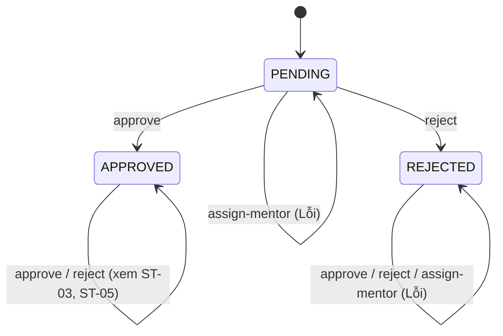

# Test Design - FR-LAB-002 (Lab Admin: Project Validation và Assign Mentor)

**Người thực hiện:** Nguyễn Duy Đức
**Module:** Lab Administrator
**Chức năng:** FR-LAB-002 Validate and Manage Projects: danh sách, chi tiết, approve, reject, assign-mentor
**Ngày tạo:** 07/11/2026

Base URL theo code: `{{base_url}}/lab-admin/project-validation/projects` (chờ xác nhận bằng Postman có tiền tố `/api` hay không). Trong bảng, `/projects` là viết tắt của base URL này. Cột Expected ghi theo SRS/REST, không ghi kết quả dự đoán từ code; cột Actual điền ở file Report. Ô ghi "chờ SRS" cần đối chiếu lại SRS.

## Giả định

1. Test case thiết kế theo SRS FR-LAB-002 để kiểm chứng hành vi mong đợi; các lệch so với code được ghi ở mục 6.2 (G1 đến G30).
2. Code thật nằm ở `ProjectValidationController` (base `/lab-admin/project-validation/projects`), khác SRS (`/api/lab-admin/projects/...`).
3. Endpoint `GET /api/lab-admin/mentors/available` (thuộc FR-LAB-002 theo SRS) nằm ở `MentorAdminController`, đã có file `TC_LabAdmin_AvailableMentors.md`, không lặp lại ở đây.
4. Dự án có hai trường song song: `status` (enum `ProjectStatus`, không có giá trị `APPROVED`) và `validated` (chuỗi `pending`/`approved`/`rejected`). Trạng thái SRS PENDING/APPROVED/REJECTED được quy ước: PENDING = `validated=pending`, APPROVED = `validated=approved`, REJECTED = `validated=rejected`.
5. Ngoài phạm vi: gửi email, `GET /stats`, `ProjectAdminController` (CRUD quản trị, không thuộc SRS FR-LAB-002), trạng thái invitation sau khi mentor phản hồi (thuộc FR-MEN-001).
6. Phạm vi số lượng sinh viên 3 đến 10 lấy từ quy tắc dự án trong SRS (FR-ENT-002), áp dụng cho `adjustments.numberOfStudents` khi approve.

## 1. Phân hoạch lớp tương đương (Equivalence Partitioning)

### 1.1 Authentication & Authorization

| Lớp | Mô tả | Tag | Giá trị đại diện |
|---|---|---|---|
| Hợp lệ | Token hợp lệ, role LAB_ADMIN | V-AUTH1 | Bearer token LAB_ADMIN |
| Hợp lệ (code cho phép) | Token SYSTEM_ADMIN (chờ SRS) | V-AUTH2 | Bearer token SYSTEM_ADMIN |
| Không hợp lệ (a) | Không gửi token | X-AUTH1 | Không có header Authorization |
| Không hợp lệ (b) | Token sai format | X-AUTH2 | `Bearer abc` |
| Không hợp lệ (c) | Role TALENT | X-AUTH3 | Token TALENT còn hạn |
| Không hợp lệ (d) | Role MENTOR | X-AUTH4 | Token MENTOR còn hạn |
| Không hợp lệ (e) | Role ENTERPRISE | X-AUTH5 | Token ENTERPRISE còn hạn |
| Không hợp lệ (f) | Token còn hạn nhưng user đã bị xóa mềm | X-AUTH6 | Token của user có `deleted_at` khác null |

### 1.2 Project ID (Path Variable)

| Lớp | Mô tả | Tag | Giá trị đại diện |
|---|---|---|---|
| Hợp lệ | Dự án tồn tại | V-PJ1 | ID dự án DP-PEND |
| Không hợp lệ (a) | Dự án không tồn tại | X-PJ1 | `99999` |
| Không hợp lệ (b) | ID không phải số | X-PJ2 | `abc` |

### 1.3 Filter status (GET danh sách)

| Lớp | Mô tả | Tag | Giá trị đại diện |
|---|---|---|---|
| Hợp lệ | Không truyền, `PENDING`, `APPROVED`, `REJECTED` | V-FLT1 | (không có), `status=PENDING` |
| Không hợp lệ | Giá trị ngoài danh sách | X-FLT1 | `status=abc` |

### 1.4 Trạng thái dự án

| Lớp | Mô tả | Tag | Giá trị đại diện |
|---|---|---|---|
| Hợp lệ (approve/reject) | Dự án đang pending | V-ST1 | DP-PEND |
| Hợp lệ (assign) | Dự án đã approve | V-ST2 | DP-APPR |
| Không hợp lệ (a) | Approve dự án đã approved | X-ST1 | DP-APPR |
| Không hợp lệ (b) | Approve dự án đã rejected | X-ST2 | DP-REJ |
| Không hợp lệ (c) | Assign khi dự án chưa approve (pending hoặc rejected) | X-ST3 | DP-PEND, DP-REJ |

### 1.5 Body approve

| Lớp | Mô tả | Tag | Giá trị đại diện |
|---|---|---|---|
| Hợp lệ (a) | Có `note` và `adjustments` | V-APR1 | `{"note":"ok","adjustments":{"numberOfStudents":5,"duration":"6 months"}}` |
| Hợp lệ (b) | Chỉ có `note` | V-APR2 | `{"note":"ok"}` |
| Không hợp lệ | Không gửi body | X-APR1 | (không có body) |

### 1.6 Body reject

| Lớp | Mô tả | Tag | Giá trị đại diện |
|---|---|---|---|
| Hợp lệ (a) | Có `reason` và `details` | V-RJ1 | `{"reason":"Không khả thi","details":"Thiếu ngân sách"}` |
| Hợp lệ (b) | Chỉ có `reason` (chờ SRS) | V-RJ2 | `{"reason":"Không khả thi"}` |
| Không hợp lệ (a) | Thiếu `reason` | X-RJ1 | `{"details":"x"}` |
| Không hợp lệ (b) | Không gửi body | X-RJ2 | (không có body) |
| Không hợp lệ (c) | `reason` rỗng | X-RJ3 | `{"reason":"","details":"x"}` |

### 1.7 Mentor (assign-mentor)

| Lớp | Mô tả | Tag | Giá trị đại diện |
|---|---|---|---|
| Hợp lệ | Mentor còn capacity, expertise khớp | V-MEN1 | MEN-OK |
| Không hợp lệ (a) | Mentor không tồn tại | X-MEN1 | `mentorId=99999` |
| Không hợp lệ (b) | Mentor đã đủ `max_projects` | X-MEN2 | MEN-FULL |
| Không hợp lệ (c) | Expertise không khớp dự án | X-MEN3 | MEN-EXP |
| Không hợp lệ (d) | `mentorId` là user không phải mentor | X-MEN4 | ID của user TALENT |
| Không hợp lệ (e) | Mentor đã bị xóa mềm | X-MEN5 | ID user có `deleted_at` |

### 1.8 Body assign-mentor

| Lớp | Mô tả | Tag | Giá trị đại diện |
|---|---|---|---|
| Hợp lệ | `mentorId` và `message` ngắn | V-MSG1 | `{"mentorId":<id>,"message":"hi"}` |
| Không hợp lệ (a) | `message` rất dài | X-MSG1 | 5000 ký tự |
| Không hợp lệ (b) | Thiếu `mentorId` | X-AS1 | `{"message":"hi"}` |
| Không hợp lệ (c) | Không gửi body | X-AS2 | (không có body) |

### 1.9 HTTP method và gán lặp

| Lớp | Mô tả | Tag | Giá trị đại diện |
|---|---|---|---|
| Không hợp lệ | Sai HTTP method | X-MTD1 | `GET` vào `/{id}/approve` |
| Trạng thái (a) | Assign lần 2, cùng mentor | S-DUP1 | Gọi lại cùng `mentorId` |
| Trạng thái (b) | Assign lần 2, mentor khác | S-DUP2 | `mentorId` khác |

### Tổng hợp tag lớp tương đương

| Loại | Số lượng |
|---|---|
| Hợp lệ (V) | 12 |
| Không hợp lệ (X) | 25 |
| Trạng thái gán lặp (S) | 2 |
| **Tổng** | **39 tag** |

## 2. Phân tích giá trị biên (Boundary Value Analysis)

### 2.1 numberOfStudents khi approve (SRS: 3 đến 10)

| Ký hiệu | Ý nghĩa | Giá trị | Mô tả | Tag |
|---|---|---|---|---|
| n = 2 | Ngay dưới min | 2 | Dưới ngưỡng tối thiểu, INVALID | B-STU2 |
| n = 3 | Biên dưới | 3 | Đúng mức tối thiểu, VALID | B-STU1 |
| n = 10 | Biên trên | 10 | Đúng mức tối đa, VALID | B-STU3 |
| n = 11 | Ngay trên max | 11 | Vượt ngưỡng, INVALID | B-STU4 |
| n = 0 | Không | 0 | INVALID | B-STU5 |
| n < 0 | Âm | -1 | INVALID | B-STU6 |

### 2.2 Capacity của mentor

| Ký hiệu | Ý nghĩa | Giá trị | Mô tả | Tag |
|---|---|---|---|---|
| cur = max-1 | Còn đúng 1 chỗ | max - 1 | VALID | B-CAP1 |
| cur = max | Đã đủ | max | INVALID | B-CAP2 |

### 2.3 Project ID (biên)

| Ký hiệu | Ý nghĩa | Giá trị | Mô tả | Tag |
|---|---|---|---|---|
| id = 0 | Biên dưới | 0 | Không tồn tại | B-PJ1 |
| id < 0 | Giá trị âm | -1 | Không hợp lệ | B-PJ2 |

### Tổng hợp tag biên: 10 tag

## 3. Chuyển đổi trạng thái (State Transition Testing)

### 3.1 Sơ đồ trạng thái dự án

Trạng thái:

- **PENDING**: dự án chờ xác thực (`validated=pending`, `status=PENDING_VALIDATION`), trạng thái khởi tạo.
- **APPROVED**: đã duyệt (`validated=approved`). Code đặt `status=RECRUITING`, SRS ghi APPROVED (gap G2).
- **REJECTED**: bị từ chối (`validated=rejected`, `status=REJECTED`).

### 3.2 Bảng chuyển đổi trạng thái (phạm vi FR-LAB-002: hành động của Lab Admin)

| Test Case | Start State | Event/Input | Expected End State | Expected Output | TC |
|---|---|---|---|---|---|
| ST-01 | PENDING | approve | APPROVED | 200 | TC-PV-22 |
| ST-02 | PENDING | reject | REJECTED | 200 | TC-PV-39 |
| ST-03 | APPROVED | approve | Không đổi | Lỗi 400 hoặc 409 | TC-PV-31 |
| ST-04 | REJECTED | approve | Không đổi | Lỗi 400 hoặc 409 | TC-PV-32 |
| ST-05 | APPROVED | reject | SRS không quy định | Ghi nhận kết quả thực tế | TC-PV-44 |
| ST-06 | REJECTED | reject | Không đổi | Lỗi 400 hoặc 409 | TC-PV-45 |
| ST-07 | APPROVED | assign-mentor | APPROVED, có invitation PENDING | 200 | TC-PV-49 |
| ST-08 | PENDING | assign-mentor | Không đổi | Lỗi 400 (SRS: phải approve trước) | TC-PV-54 |
| ST-09 | REJECTED | assign-mentor | Không đổi | Lỗi 400 | TC-PV-55 |

## 4. Bảng quyết định (Decision Table)

### 4.1 assign-mentor

Conditions:

- C1: Token hợp lệ, role LAB_ADMIN?
- C2: Dự án tồn tại?
- C3: Dự án đã approve?
- C4: Mentor tồn tại?
- C5: Mentor còn capacity (`current < max`)?
- C6: Expertise của mentor khớp dự án?

Actions:

- A1: 200, tạo invitation PENDING (hết hạn 72h)
- A2: 401 hoặc 403
- A3: 404 dự án không tồn tại
- A4: 400 dự án chưa approve
- A5: 404 mentor không tồn tại
- A6: 400 mentor đã đủ dự án
- A7: 400 expertise không khớp

| | R1 | R2 | R3 | R4 | R5 | R6 | R7 |
|---|---|---|---|---|---|---|---|
| C1 | Y | N | Y | Y | Y | Y | Y |
| C2 | Y | - | N | Y | Y | Y | Y |
| C3 | Y | - | - | N | Y | Y | Y |
| C4 | Y | - | - | - | N | Y | Y |
| C5 | Y | - | - | - | - | N | Y |
| C6 | Y | - | - | - | - | - | N |
| Kết quả (SRS) | A1 | A2 | A3 | A4 | A5 | A6 | A7 |
| TC | TC-PV-49 | TC-PV-51, TC-PV-52 | TC-PV-53 | TC-PV-54, TC-PV-55 | TC-PV-56 | TC-PV-58 | TC-PV-60 |

### 4.2 reject

Điều kiện: C1 token LAB_ADMIN, C2 project tồn tại, C3 trạng thái cho phép (pending), C4 reason hợp lệ.

| | RJ-R1 | RJ-R2 | RJ-R3 | RJ-R4 | RJ-R5 |
|---|---|---|---|---|---|
| C1 | Y | N | Y | Y | Y |
| C2 | Y | - | N | Y | Y |
| C3 | Y | - | - | N | Y |
| C4 | Y | - | - | - | N |
| Kết quả (SRS) | 200 | 401/403 | 404 | 400/409 | 400 |
| TC | TC-PV-39 | TC-PV-47, TC-PV-48 | TC-PV-46 | TC-PV-44, TC-PV-45 | TC-PV-40, TC-PV-41 |

## 5. Bảng Test Cases

### Dữ liệu chuẩn bị (Seed data)

| Mã | Nội dung |
|---|---|
| LA1 | Tài khoản LAB_ADMIN, có Bearer token |
| SA1 | Tài khoản SYSTEM_ADMIN |
| T-TALENT / T-MENTOR / T-ENT | Token TALENT / MENTOR / ENTERPRISE (test sai role) |
| T-DEL | User LAB_ADMIN có `deleted_at` khác null, token còn hạn |
| DP-PEND | Dự án `validated=pending`, `status=PENDING_VALIDATION` |
| DP-APPR | Dự án đã approve (`validated=approved`, `status=RECRUITING`) |
| DP-REJ | Dự án `validated=rejected`, `status=REJECTED` |
| DP-CANC | Dự án `status=CANCELLED` |
| MEN-OK | Mentor còn capacity, expertise khớp dự án |
| MEN-FULL | Mentor `current_projects = max` |
| MEN-EDGE | Mentor `current_projects = max - 1` |
| MEN-EXP | Mentor có expertise không khớp |
| P-NONE | Project/Mentor ID không tồn tại (`99999`) |

Lưu ý: mỗi lần approve hoặc reject làm đổi dữ liệu, cần tạo mới dự án đúng trạng thái trước mỗi TC (dùng dự án test, không dùng dự án thật của nhóm).

### Bảng test case

| TC ID | Endpoint | Mô tả | Precondition | Input | Expected (theo SRS) | Tag |
|---|---|---|---|---|---|---|
| TC-PV-01 | GET /projects | Lấy danh sách, không truyền filter | LAB_ADMIN | Không có status | 200; trả danh sách dự án (SRS không quy định có loại dự án CANCELLED hay không; ghi nhận kết quả thực tế) | V-AUTH1, V-FLT1 |
| TC-PV-02 | GET /projects | Filter PENDING | LAB_ADMIN; DP-PEND, DP-APPR | status=PENDING | 200; chỉ dự án pending | V-FLT1 |
| TC-PV-03 | GET /projects | Filter APPROVED | LAB_ADMIN; DP-APPR | status=APPROVED | 200; chỉ dự án approved | V-FLT1 |
| TC-PV-04 | GET /projects | Filter REJECTED | LAB_ADMIN; DP-REJ | status=REJECTED | 200; chỉ dự án rejected | V-FLT1 |
| TC-PV-05 | GET /projects | Filter không hợp lệ | LAB_ADMIN | status=abc | 400, thông báo status không hợp lệ | X-FLT1, G12 |
| TC-PV-06 | GET /projects | Dự án CANCELLED bị loại khỏi danh sách | LAB_ADMIN; DP-CANC | Không truyền status | 200; không chứa dự án CANCELLED (chờ SRS) | V-FLT1, G28 |
| TC-PV-07 | GET /projects | SYSTEM_ADMIN gọi danh sách | SYSTEM_ADMIN (chờ SRS xác nhận role được phép) | Không có status | 200 | V-AUTH2 |
| TC-PV-08 | GET /projects | Field của item trong danh sách | LAB_ADMIN | Không có status | Mỗi item có đủ field SRS (enterprise, duration, feasibilityScore...) (chờ SRS) | V-FLT1, G29 |
| TC-PV-09 | GET /projects/pending (URL theo SRS) | Endpoint pending riêng theo SRS | LAB_ADMIN | GET .../projects/pending | 200; danh sách dự án pending (theo SRS) | V-AUTH1, G1 |
| TC-PV-10 | GET /projects | Không gửi token | Không có | Không có Authorization | 401 | X-AUTH1 |
| TC-PV-11 | GET /projects | Token sai | Token sai | Bearer abc | 401 | X-AUTH2 |
| TC-PV-12 | GET /projects | Role TALENT | TALENT | Token TALENT còn hạn | 403 | X-AUTH3, G14 |
| TC-PV-13 | GET /projects | Role MENTOR | MENTOR | Token MENTOR còn hạn | 403 | X-AUTH4, G14 |
| TC-PV-14 | GET /projects | Role ENTERPRISE | ENTERPRISE | Token ENTERPRISE còn hạn | 403 | X-AUTH5, G14 |
| TC-PV-15 | GET /projects/{id} | Xem chi tiết dự án tồn tại | LAB_ADMIN; DP-PEND | id hợp lệ | 200; response là DTO chi tiết theo SRS (không phải entity thô) | V-PJ1, G11 |
| TC-PV-16 | GET /projects/{id} | Id không tồn tại | LAB_ADMIN | id=99999 | 404 | X-PJ1, G13 |
| TC-PV-17 | GET /projects/{id} | Id sai kiểu | LAB_ADMIN | id=abc | 400 | X-PJ2 |
| TC-PV-18 | GET /projects/{id} | Id = 0 | LAB_ADMIN | id=0 | 404 (SRS không quy định; theo REST) | B-PJ1, G13 |
| TC-PV-19 | GET /projects/{id} | Id = -1 | LAB_ADMIN | id=-1 | 404 (SRS không quy định; theo REST) | B-PJ2, G13 |
| TC-PV-20 | GET /projects/{id} | Không gửi token | Không có | Không có Authorization | 401 | X-AUTH1 |
| TC-PV-21 | GET /projects/{id} | Role TALENT | TALENT | Token TALENT | 403 | X-AUTH3, G14 |
| TC-PV-22 | POST /{id}/approve | Approve dự án pending, có note và adjustments | LAB_ADMIN; DP-PEND | {"note":"ok","adjustments":{"numberOfStudents":5,"duration":"6 months"}} | 200; status APPROVED, validated=approved; numberOfStudents=5 và duration được áp dụng | V-ST1, V-APR1, ST-01, G2, G5 |
| TC-PV-23 | POST /{id}/approve | Approve chỉ có note | LAB_ADMIN; DP-PEND | {"note":"ok"} | 200; status APPROVED | V-ST1, V-APR2 |
| TC-PV-24 | POST /{id}/approve | Thiếu body | LAB_ADMIN; DP-PEND | Không gửi body | 400 | X-APR1 |
| TC-PV-25 | POST /{id}/approve | numberOfStudents = 3 (biên dưới SRS) | LAB_ADMIN; DP-PEND | {"adjustments":{"numberOfStudents":3}} | 200 | V-ST1, B-STU1 |
| TC-PV-26 | POST /{id}/approve | numberOfStudents = 2 | LAB_ADMIN; DP-PEND | {"adjustments":{"numberOfStudents":2}} | 400 | B-STU2, G19 |
| TC-PV-27 | POST /{id}/approve | numberOfStudents = 10 (biên trên SRS) | LAB_ADMIN; DP-PEND | {"adjustments":{"numberOfStudents":10}} | 200 | V-ST1, B-STU3 |
| TC-PV-28 | POST /{id}/approve | numberOfStudents = 11 | LAB_ADMIN; DP-PEND | {"adjustments":{"numberOfStudents":11}} | 400 | B-STU4, G19 |
| TC-PV-29 | POST /{id}/approve | numberOfStudents = 0 | LAB_ADMIN; DP-PEND | {"adjustments":{"numberOfStudents":0}} | 400 | B-STU5, G19 |
| TC-PV-30 | POST /{id}/approve | numberOfStudents = -1 | LAB_ADMIN; DP-PEND | {"adjustments":{"numberOfStudents":-1}} | 400 | B-STU6, G19 |
| TC-PV-31 | POST /{id}/approve | Approve dự án đã approved | LAB_ADMIN; DP-APPR | {"note":"ok"} | 400 hoặc 409; trạng thái không đổi | X-ST1, ST-03, G3 |
| TC-PV-32 | POST /{id}/approve | Approve dự án đã rejected | LAB_ADMIN; DP-REJ | {"note":"ok"} | 400 hoặc 409; dự án vẫn rejected | X-ST2, ST-04, G3 |
| TC-PV-33 | POST /{id}/approve | Dự án không tồn tại | LAB_ADMIN | id=99999 | 404 | X-PJ1, G13 |
| TC-PV-34 | POST /{id}/approve | Id sai kiểu | LAB_ADMIN | id=abc | 400 | X-PJ2 |
| TC-PV-35 | POST /{id}/approve | Không gửi token | Không có | {"note":"ok"} | 401 | X-AUTH1 |
| TC-PV-36 | POST /{id}/approve | Role TALENT | TALENT | {"note":"ok"} | 403 | X-AUTH3, G14 |
| TC-PV-37 | POST /{id}/approve | Token còn hạn nhưng user đã bị xóa mềm | User LAB_ADMIN có deleted_at != null; DP-PEND | {"note":"ok"} | 401 | X-AUTH6, G23 |
| TC-PV-38 | GET /{id}/approve | Sai HTTP method | LAB_ADMIN | GET vào endpoint approve | 405 | X-MTD1 |
| TC-PV-39 | POST /{id}/reject | Reject dự án pending, đủ reason và details | LAB_ADMIN; DP-PEND | {"reason":"Không khả thi","details":"Thiếu ngân sách"} | 200; status REJECTED, validated=rejected; reason và details được lưu | V-ST1, V-RJ1, ST-02, RJ-R1, G4 |
| TC-PV-40 | POST /{id}/reject | Thiếu reason | LAB_ADMIN; DP-PEND | {"details":"x"} | 400 | X-RJ1, RJ-R5, G18 |
| TC-PV-41 | POST /{id}/reject | reason rỗng | LAB_ADMIN; DP-PEND | {"reason":"","details":"x"} | 400 | X-RJ3, RJ-R5, G18 |
| TC-PV-42 | POST /{id}/reject | Thiếu body | LAB_ADMIN; DP-PEND | Không gửi body | 400 | X-RJ2 |
| TC-PV-43 | POST /{id}/reject | Chỉ có reason, không có details | LAB_ADMIN; DP-PEND | {"reason":"Không khả thi"} | 200 nếu details tùy chọn (chờ SRS) | V-RJ2 |
| TC-PV-44 | POST /{id}/reject | Reject dự án đã approved | LAB_ADMIN; DP-APPR | {"reason":"x","details":"y"} | SRS không quy định; ghi nhận kết quả thực tế | ST-05, RJ-R4, G3 |
| TC-PV-45 | POST /{id}/reject | Reject dự án đã rejected | LAB_ADMIN; DP-REJ | {"reason":"x","details":"y"} | 400 hoặc 409 | ST-06, RJ-R4, G3 |
| TC-PV-46 | POST /{id}/reject | Dự án không tồn tại | LAB_ADMIN | id=99999 | 404 | X-PJ1, RJ-R3, G13 |
| TC-PV-47 | POST /{id}/reject | Không gửi token | Không có | {"reason":"x","details":"y"} | 401 | X-AUTH1, RJ-R2 |
| TC-PV-48 | POST /{id}/reject | Role TALENT | TALENT | {"reason":"x","details":"y"} | 403 | X-AUTH3, RJ-R2, G14 |
| TC-PV-49 | POST /{id}/assign-mentor | Assign mentor hợp lệ | LAB_ADMIN; DP-APPR; MEN-OK | {"mentorId":<id>,"message":"hi"} | 200; tạo invitation PENDING, hết hạn sau 72h; response có invitationId, mentorName, mentorEmail, sentAt; message được lưu; invitedBy theo SRS | V-AUTH1, V-ST2, V-MEN1, R1, ST-07, G9, G10, G25, G26, G27, V-MSG1 |
| TC-PV-50 | POST /{id}/assign-mentor | current_projects tăng sau assign | LAB_ADMIN; DP-APPR; MEN-OK | Như TC trước; đọc current_projects trước và sau | current_projects tăng 1 | V-MEN1, G8 |
| TC-PV-51 | POST /{id}/assign-mentor | Không gửi token | Không có | {"mentorId":<id>} | 401 | X-AUTH1, R2 |
| TC-PV-52 | POST /{id}/assign-mentor | Role TALENT | TALENT | {"mentorId":<id>} | 403 | X-AUTH3, R2, G14 |
| TC-PV-53 | POST /{id}/assign-mentor | Dự án không tồn tại | LAB_ADMIN; MEN-OK | id=99999 | 404 | X-PJ1, R3, G13 |
| TC-PV-54 | POST /{id}/assign-mentor | Dự án pending chưa approve | LAB_ADMIN; DP-PEND; MEN-OK | {"mentorId":<id>} | 400 | X-ST3, R4, ST-08, G6 |
| TC-PV-55 | POST /{id}/assign-mentor | Dự án rejected | LAB_ADMIN; DP-REJ; MEN-OK | {"mentorId":<id>} | 400 | X-ST3, R4, ST-09, G6 |
| TC-PV-56 | POST /{id}/assign-mentor | Mentor không tồn tại | LAB_ADMIN; DP-APPR | mentorId=99999 | 404 | X-MEN1, R5, G13 |
| TC-PV-57 | POST /{id}/assign-mentor | mentorId là user không phải mentor | LAB_ADMIN; DP-APPR; user TALENT | mentorId = id của user TALENT | 400 hoặc 404 | X-MEN4, G8 |
| TC-PV-58 | POST /{id}/assign-mentor | Mentor đã đủ capacity | LAB_ADMIN; DP-APPR; MEN-FULL | current_projects = max | 400 | X-MEN2, B-CAP2, R6, G7 |
| TC-PV-59 | POST /{id}/assign-mentor | Mentor còn đúng 1 chỗ | LAB_ADMIN; DP-APPR; MEN-EDGE | current_projects = max - 1 | 200 | V-MEN1, B-CAP1 |
| TC-PV-60 | POST /{id}/assign-mentor | Expertise không khớp | LAB_ADMIN; DP-APPR; MEN-EXP | Mentor không có skill của dự án | 400 | X-MEN3, R7, G7 |
| TC-PV-61 | POST /{id}/assign-mentor | Thiếu mentorId | LAB_ADMIN; DP-APPR | {"message":"hi"} | 400 | X-AS1, G20 |
| TC-PV-62 | POST /{id}/assign-mentor | Thiếu body | LAB_ADMIN; DP-APPR | Không gửi body | 400 | X-AS2 |
| TC-PV-63 | POST /{id}/assign-mentor | Id dự án sai kiểu | LAB_ADMIN; MEN-OK | id=abc | 400 | X-PJ2 |
| TC-PV-64 | POST /{id}/assign-mentor | Assign lần 2, cùng mentor | LAB_ADMIN; dự án đã assign; MEN-OK | Gọi lại cùng mentorId | Không tạo trùng, không reset invitation đã ACCEPTED (chờ SRS) | S-DUP1, G16, G24 |
| TC-PV-65 | POST /{id}/assign-mentor | Assign lần 2, mentor khác | LAB_ADMIN; dự án đã assign; MEN-OK | mentorId khác | 400 hoặc 409 (chờ SRS) | S-DUP2, G16 |
| TC-PV-66 | POST /{id}/assign-mentor | Dự án sau khi assign (chưa chấp nhận) | LAB_ADMIN; DP-APPR; MEN-OK | Assign rồi GET /{id} | mentorId chưa gán cho tới khi mentor chấp nhận (chờ SRS) | G15 |
| TC-PV-67 | POST /{id}/assign-mentor | Mentor thấy invitation ở Mentor Portal | LAB_ADMIN; MENTOR; DP-APPR | Assign, rồi mentor gọi GET /api/mentor/invitations | 200; danh sách có invitation vừa tạo | V-MEN1, G17 |
| TC-PV-68 | POST /{id}/assign-mentor | Mentor đã bị xóa mềm | LAB_ADMIN; DP-APPR; mentor có deleted_at | mentorId của user đã xóa | 404 | X-MEN5, G30 |
| TC-PV-69 | POST /{id}/assign-mentor | message rất dài | LAB_ADMIN; DP-APPR; MEN-OK | message = chuỗi 5000 ký tự | SRS không quy định giới hạn độ dài; ghi nhận kết quả thực tế (200 hoặc 400) | X-MSG1, G21 |

## 6. Kiểm tra bao phủ

### 6.1 Lớp tương đương

| Tag | TC |
|---|---|
| V-AUTH1 | TC-PV-01, TC-PV-09, TC-PV-49 |
| V-AUTH2 | TC-PV-07 |
| V-PJ1 | TC-PV-15 |
| V-FLT1 | TC-PV-01, TC-PV-02, TC-PV-03, TC-PV-04, TC-PV-06, TC-PV-08 |
| V-ST1 | TC-PV-22, TC-PV-23, TC-PV-25, TC-PV-27, TC-PV-39 |
| V-ST2 | TC-PV-49 |
| V-APR1 | TC-PV-22 |
| V-APR2 | TC-PV-23 |
| V-RJ1 | TC-PV-39 |
| V-RJ2 | TC-PV-43 |
| V-MEN1 | TC-PV-49, TC-PV-50, TC-PV-59, TC-PV-67 |
| V-MSG1 | TC-PV-49 |
| X-AUTH1 | TC-PV-10, TC-PV-20, TC-PV-35, TC-PV-47, TC-PV-51 |
| X-AUTH2 | TC-PV-11 |
| X-AUTH3 | TC-PV-12, TC-PV-21, TC-PV-36, TC-PV-48, TC-PV-52 |
| X-AUTH4 | TC-PV-13 |
| X-AUTH5 | TC-PV-14 |
| X-AUTH6 | TC-PV-37 |
| X-PJ1 | TC-PV-16, TC-PV-33, TC-PV-46, TC-PV-53 |
| X-PJ2 | TC-PV-17, TC-PV-34, TC-PV-63 |
| X-FLT1 | TC-PV-05 |
| X-ST1 | TC-PV-31 |
| X-ST2 | TC-PV-32 |
| X-ST3 | TC-PV-54, TC-PV-55 |
| X-APR1 | TC-PV-24 |
| X-RJ1 | TC-PV-40 |
| X-RJ2 | TC-PV-42 |
| X-RJ3 | TC-PV-41 |
| X-MEN1 | TC-PV-56 |
| X-MEN2 | TC-PV-58 |
| X-MEN3 | TC-PV-60 |
| X-MEN4 | TC-PV-57 |
| X-MEN5 | TC-PV-68 |
| X-AS1 | TC-PV-61 |
| X-AS2 | TC-PV-62 |
| X-MTD1 | TC-PV-38 |
| X-MSG1 | TC-PV-69 |
| S-DUP1 | TC-PV-64 |
| S-DUP2 | TC-PV-65 |

### 6.2 Giá trị biên

| Tag | TC |
|---|---|
| B-PJ1 | TC-PV-18 |
| B-PJ2 | TC-PV-19 |
| B-STU1 | TC-PV-25 |
| B-STU2 | TC-PV-26 |
| B-STU3 | TC-PV-27 |
| B-STU4 | TC-PV-28 |
| B-STU5 | TC-PV-29 |
| B-STU6 | TC-PV-30 |
| B-CAP1 | TC-PV-59 |
| B-CAP2 | TC-PV-58 |

### 6.3 Chuyển đổi trạng thái

| Tag | TC |
|---|---|
| ST-01 | TC-PV-22 |
| ST-02 | TC-PV-39 |
| ST-03 | TC-PV-31 |
| ST-04 | TC-PV-32 |
| ST-05 | TC-PV-44 |
| ST-06 | TC-PV-45 |
| ST-07 | TC-PV-49 |
| ST-08 | TC-PV-54 |
| ST-09 | TC-PV-55 |

### 6.4 Bảng quyết định

| Tag | TC |
|---|---|
| R1 | TC-PV-49 |
| R2 | TC-PV-51, TC-PV-52 |
| R3 | TC-PV-53 |
| R4 | TC-PV-54, TC-PV-55 |
| R5 | TC-PV-56 |
| R6 | TC-PV-58 |
| R7 | TC-PV-60 |
| RJ-R1 | TC-PV-39 |
| RJ-R2 | TC-PV-47, TC-PV-48 |
| RJ-R3 | TC-PV-46 |
| RJ-R4 | TC-PV-44, TC-PV-45 |
| RJ-R5 | TC-PV-40, TC-PV-41 |

### 6.5 Gap SRS vs Code

| Gap | Nội dung | TC |
|---|---|---|
| G1 | Không có /pending riêng | TC-PV-09 |
| G2 | Status sau approve là RECRUITING | TC-PV-22 |
| G3 | approve/reject không kiểm tra trạng thái | TC-PV-31, TC-PV-32, TC-PV-44, TC-PV-45 |
| G4 | reject không lưu reason/details | TC-PV-39 |
| G5 | adjustments.duration không áp dụng, note bị bỏ | TC-PV-22 |
| G6 | assign không kiểm tra project đã approve | TC-PV-54, TC-PV-55 |
| G7 | assign không kiểm tra capacity/expertise | TC-PV-58, TC-PV-60 |
| G8 | mentor tìm ở bảng User, không tăng current_projects | TC-PV-50, TC-PV-57 |
| G9 | Invitation 7 ngày (SRS 72h) | TC-PV-49 |
| G10 | Response assign thiếu field | TC-PV-49 |
| G11 | GET /{id} trả entity thô | TC-PV-15 |
| G12 | Filter lạ trả toàn bộ | TC-PV-05 |
| G13 | Id không tồn tại trả 400 thay vì 404 | TC-PV-16, TC-PV-18, TC-PV-19, TC-PV-33, TC-PV-46, TC-PV-53, TC-PV-56 |
| G14 | Sai role có thể ra 400 thay vì 403 | TC-PV-12, TC-PV-13, TC-PV-14, TC-PV-21, TC-PV-36, TC-PV-48, TC-PV-52 |
| G15 | mentorId gán ngay khi invitation còn PENDING | TC-PV-66 |
| G16 | Assign lặp không bị chặn | TC-PV-64, TC-PV-65 |
| G17 | Invitation lưu id User, Mentor Portal lọc theo id Mentor | TC-PV-67 |
| G18 | reject không validate reason | TC-PV-40, TC-PV-41 |
| G19 | approve không validate numberOfStudents | TC-PV-26, TC-PV-28, TC-PV-29, TC-PV-30 |
| G20 | Thiếu mentorId ra lỗi thô | TC-PV-61 |
| G21 | message không giới hạn độ dài | TC-PV-69 |
| G22 | ~~HTTP method approve/reject lệch SRS~~ Đã loại: SRS ghi POST cho approve/reject, code cũng POST, không lệch (TC-PV-38 chỉ kiểm tra sai method) | TC-PV-38 |
| G23 | User xóa mềm vẫn qua auth, lỗi 400 | TC-PV-37 |
| G24 | Assign lại reset invitation đã ACCEPTED/DECLINED | TC-PV-64 |
| G25 | invitedBy lấy từ enterprise, fallback 1 | TC-PV-49 |
| G26 | message chỉ log, không lưu | TC-PV-49 |
| G27 | skills/priority gán cứng | TC-PV-49 |
| G28 | Không filter vẫn trả CANCELLED | TC-PV-06 |
| G29 | List luôn trả enterprise/duration/feasibilityScore null | TC-PV-08 |
| G30 | Mentor xóa mềm vẫn gán được | TC-PV-68 |

### 6.6 Thống kê

- Tổng số testcase: 69.
- 39/39 EP tags, 10/10 BVA tags, 9/9 state transitions, 12/12 decision rules.
- Gap có ít nhất một TC: 29/29 (G22 đã loại vì không lệch SRS).
- Ô "chờ SRS": TC-PV-01, 06, 07, 08, 43, 64, 65, 66. Ô phụ thuộc Postman: URL có `/api` hay không, G13 (404 hay 400), G14 (403 hay 400), G17.
