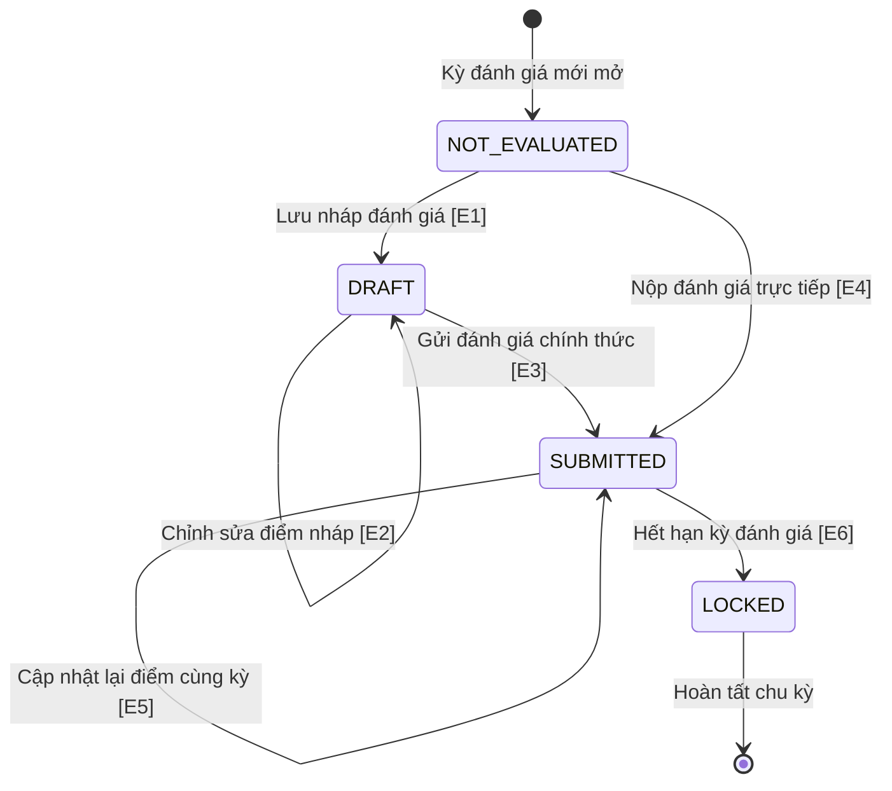

# Test Cases: FR-MEN-003 - Đánh giá Talent (Evaluate Talents)

**Module:** Mentor Portal  
**Chức năng:** Mentor đánh giá sinh viên (`POST /api/mentor/projects/{projectId}/evaluations`)  
**Người thực hiện:** Nguyễn Minh Hiển  
**Ngày tạo:** 08/11/2026  
**Ngày cập nhật:** 18/11/2026  
**Nguồn đặc tả:** `docs/SRS_LabOdc.md` - mục FR-MEN-003  
**Source code tham chiếu:** `labodc-backend/.../controller/MentorPortalController.java`, `MentorPortalService.java`

---

## Mô tả chức năng

Người hướng dẫn (Mentor) gửi đánh giá định kỳ về hiệu suất, kỹ năng lập trình, giải quyết vấn đề, tinh thần đồng đội và tác phong của từng sinh viên (Talent) tham gia trong dự án do mình phụ trách. Hệ thống kiểm tra quyền hạn của Mentor đối với dự án, kiểm tra sinh viên có thuộc dự án hay không, validate thang điểm và lưu kết quả đánh giá.

**Điều kiện hợp lệ:** Yêu cầu đánh giá được chấp nhận khi **tất cả** các điều kiện sau đồng thời thỏa mãn:

| Biến đầu vào | Ý nghĩa | Kiểu dữ liệu | Ràng buộc hợp lệ |
|---|---|---|---|
| `Role` | Quyền người dùng | Authentication | User là MENTOR phụ trách trực tiếp dự án này |
| `projectId` | ID dự án | Long | Dự án tồn tại ở trạng thái ACTIVE và do Mentor đang đăng nhập phụ trách |
| `talentId` | ID sinh viên | Long | Sinh viên tồn tại và đang là thành viên chính thức (`ACTIVE`) của dự án |
| `evaluationPeriod` | Kỳ đánh giá | String | Định dạng `YYYY-MM` (tháng 01..12), chưa từng đánh giá cho sinh viên này trong kỳ |
| `overallScore` | Điểm tổng thể | Double | Số thực trong thang điểm `[0.0, 10.0]` |
| `criteriaScores` | Điểm tiêu chí con | Object / Double | Điểm các tiêu chí (`technicalSkills`, `teamwork`...) đều thuộc `[0.0, 10.0]` |

**Giả định & Phạm vi:**

1. Request gửi qua API dưới định dạng `Content-Type: application/json`.
2. Validation tầng controller kiểm tra: `@NotNull`, `@Min(0)`, `@Max(10)`, format date `YYYY-MM`.
3. Kiểm tra phân quyền nghiệp vụ (Mentor phụ trách dự án, Talent thuộc dự án) do tầng Service `MentorPortalService.java` đảm nhiệm.
4. Trường hợp điểm ngoài khoảng `[0.0, 10.0]` phải trả lỗi `400 Bad Request` thay vì tự động ép/chuẩn hóa điểm (phát hiện hàm `normalizeScore()` đang làm tròn sai quy tắc).

---

## 1. Phân hoạch lớp tương đương (Equivalence Partitioning)

### 1.1 Quyền hạn & Phân công (Role & Assignment)

| Lớp | Mô tả | Tag | Giá trị đại diện |
|---|---|---|---|
| Hợp lệ | Mentor đang trực tiếp phụ trách dự án | V-RL1 | Token của Mentor dự án `projectId = 1` |
| Không hợp lệ (a) | Chưa đăng nhập (Không có token / Bearer rỗng) | X-RL1 | Không truyền Header `Authorization` |
| Không hợp lệ (b) | User có role TALENT tự chấm điểm cho mình | X-RL2 | Token của Talent |
| Không hợp lệ (c) | Mentor khác không phụ trách dự án này | X-RL3 | Token của Mentor dự án 2 gọi dự án 1 |

### 1.2 Sinh viên được đánh giá (talentId)

| Lớp | Mô tả | Tag | Giá trị đại diện |
|---|---|---|---|
| Hợp lệ | Talent ID tồn tại và đang tham gia dự án | V-TL1 | `456` |
| Không hợp lệ (a) | Talent ID không tồn tại trong hệ thống | X-TL1 | `99999` |
| Không hợp lệ (b) | Talent ID tồn tại nhưng thuộc dự án khác | X-TL2 | `888` |

### 1.3 Kỳ đánh giá (evaluationPeriod)

| Lớp | Mô tả | Tag | Giá trị đại diện |
|---|---|---|---|
| Hợp lệ | Format YYYY-MM hợp lệ và chưa đánh giá kỳ này | V-PR1 | `"2026-02"` |
| Không hợp lệ (a) | Sai định dạng YYYY-MM (có dấu gạch chéo hoặc sai năm) | X-PR1 | `"2026/02"` |
| Không hợp lệ (b) | Đã đánh giá cho sinh viên trong kỳ này (trùng lặp) | X-PR2 | `"2026-02"` (đã có bản ghi) |

### 1.4 Điểm tổng thể (overallScore)

| Lớp | Mô tả | Tag | Giá trị đại diện |
|---|---|---|---|
| Hợp lệ | Điểm số thực trong đoạn [0.0, 10.0] | V-SC1 | `7.5` |
| Không hợp lệ (a) | Điểm số nhỏ hơn 0.0 | X-SC1 | `-0.1` |
| Không hợp lệ (b) | Điểm số lớn hơn 10.0 | X-SC2 | `10.1` |
| Không hợp lệ (c) | Sai kiểu dữ liệu (chuỗi ký tự không parse được số) | X-SC3 | `"tam_diem"` |

### 1.5 Điểm tiêu chí con (Criteria Scores)

| Lớp | Mô tả | Tag | Giá trị đại diện |
|---|---|---|---|
| Hợp lệ | Tất cả điểm tiêu chí thành phần đều thuộc [0.0, 10.0] | V-CR1 | Các điểm 8.0, 8.5, 9.0 |
| Không hợp lệ | Có ít nhất một điểm tiêu chí âm hoặc vượt 10.0 | X-CR1 | `codeQuality = -1.0` |

### Tổng hợp tag lớp tương đương

| Loại | Tags | Số lượng |
|---|---|---|
| Hợp lệ | V-RL1, V-TL1, V-PR1, V-SC1, V-CR1 | 5 |
| Không hợp lệ | X-RL1, X-RL2, X-RL3, X-TL1, X-TL2, X-PR1, X-PR2, X-SC1, X-SC2, X-SC3, X-CR1 | 11 |
| **Tổng** | | **16 tag** |

---

## 2. Phân tích giá trị biên (Boundary Value Analysis)

Biến có miền giá trị số học liên tục là **`overallScore`** (từ 0.0 đến 10.0). Áp dụng kỹ thuật Standard Boundary Value Analysis (BVA) với 5 điểm giá trị: min, min+, nominal, max-, max.

### 2.1 Biên điểm overallScore

| Ký hiệu | Ý nghĩa | Giá trị | Mô tả | Tag |
|---|---|---:|---|---|
| `min` | Điểm sàn tối thiểu hợp lệ | 0.0 | Đánh giá mức thấp nhất | B-SC1 |
| `min+` | Ngay trên min | 0.1 | Điểm cận dưới | B-SC2 |
| `nominal` | Đại diện giữa miền | 7.5 | Điểm khá chuẩn | B-SC3 |
| `max-` | Ngay dưới max | 9.9 | Điểm cận trên | B-SC4 |
| `max` | Điểm trần tối đa hợp lệ | 10.0 | Điểm tuyệt đối xuất sắc | B-SC5 |

### 2.2 Biên kỳ đánh giá (evaluationPeriod)

| Ký hiệu | Giá trị | Mô tả | Tag |
|---|---|---|---|
| Đầu năm | `2026-01` | Kỳ tháng 1 đầu năm hợp lệ | B-PR1 |
| Cuối năm | `2026-12` | Kỳ tháng 12 cuối năm hợp lệ | B-PR2 |

### Tổng hợp tag biên

| Tags | Số lượng |
|---|---|
| B-SC1, B-SC2, B-SC3, B-SC4, B-SC5, B-PR1, B-PR2 | 7 tag |

---

## 3. Chuyển đổi trạng thái (State Transition Testing)

### 3.1 Sơ đồ trạng thái đánh giá sinh viên

### 3.2 Bảng chuyển đổi trạng thái

| Test Case | Start State | Event / Input | Expected End State | Expected Output |
|---|---|---|---|---|
| ST-01 | NOT_EVALUATED | Bấm "Lưu nháp" đánh giá | DRAFT | 200 - Lưu bản ghi nháp thành công |
| ST-02 | NOT_EVALUATED | Gửi đánh giá chính thức điểm hợp lệ | SUBMITTED | 200 - Đánh giá thành công |
| ST-03 | DRAFT | Cập nhật điểm tiêu chí trong nháp | DRAFT | 200 - Cập nhật nháp thành công |
| ST-04 | DRAFT | Nộp chính thức từ bản nháp | SUBMITTED | 200 - Bản ghi chuyển chính thức |
| ST-05 | SUBMITTED | Gửi lại đánh giá cùng kỳ (ghi đè) | SUBMITTED | 200 - Cập nhật điểm mới thành công |
| ST-06 | SUBMITTED | Hệ thống khóa kỳ đánh giá khi hết hạn | LOCKED | Tự động khóa kỳ đánh giá |
| ST-07 | LOCKED | Cố ý gửi request sửa điểm khi đã khóa | LOCKED | 400 - Bad Request: Kỳ đánh giá đã bị khóa |

---

## 4. Bảng quyết định (Decision Table)

### 4.1 Điều kiện và hành động

**Conditions:**
- C1: Người gọi là Mentor phụ trách trực tiếp dự án?
- C2: Sinh viên tồn tại và thuộc dự án?
- C3: Kỳ đánh giá chưa tồn tại (hoặc chấp nhận ghi đè)?
- C4: Tất cả điểm số (`overallScore` & tiêu chí con) thuộc `[0.0..10.0]`?

**Actions:**
- A1: 200 - Tạo/Lưu đánh giá thành công
- A2: 403 Forbidden - Không có quyền Mentor phụ trách dự án
- A3: 404 Not Found - Không tìm thấy dự án hoặc sinh viên
- A4: 409 Conflict - Kỳ đánh giá đã tồn tại
- A5: 400 Bad Request - Sai format hoặc điểm ngoài phạm vi hợp lệ

### 4.2 Bảng quyết định

| | R1 | R2 | R3 | R4 | R5 |
|---|:---:|:---:|:---:|:---:|:---:|
| **C1:** Mentor phụ trách dự án | Y | Y | Y | Y | N |
| **C2:** Sinh viên thuộc dự án | Y | Y | Y | N | - |
| **C3:** Kỳ đánh giá chưa tồn tại | Y | Y | N | - | - |
| **C4:** Điểm số thuộc [0.0..10.0] | Y | N | - | - | - |
| | | | | | |
| **A1:** 200 - Thành công | X | - | - | - | - |
| **A2:** 403 - Sai quyền Mentor | - | - | - | - | X |
| **A3:** 404 - Sai sinh viên/dự án | - | - | - | X | - |
| **A4:** 409 - Trùng kỳ đánh giá | - | - | X | - | - |
| **A5:** 400 - Sai khoảng điểm | - | X | - | - | - |

---

## 5. Bảng Test Cases

### Nguyên tắc thiết kế

- **Test case hợp lệ:** Mentor đúng, Talent đúng dự án, kỳ đánh giá đúng format, điểm số trong khoảng `[0.0, 10.0]`.
- **Test case không hợp lệ:** Tuân thủ nguyên tắc **single fault** - mỗi test chỉ có đúng **một** biến sai hoặc vi phạm điều kiện, các biến còn lại giữ hợp lệ.

### Preconditions (áp dụng cho tất cả test case)

- Hệ thống backend đang chạy và kết nối cơ sở dữ liệu.
- Dự án `projectId = 1` tồn tại ở trạng thái `ACTIVE` do Mentor đang test phụ trách.
- Sinh viên `talentId = 456` là thành viên chính thức của dự án `projectId = 1`.
- Sinh viên `talentId = 888` thuộc dự án khác (`projectId = 2`).

### Bảng test cases chi tiết

| STT | TC ID | Tên test case | Pre-condition | Role gọi API | projectId | talentId | evaluationPeriod | overallScore | Expected HTTP | Expected Result | Tag / ST / Rule |
|---:|---|---|---|---|---:|---:|---|---:|---:|---|---|
| 1 | TC-MEN003-01 | Đánh giá điểm nominal (7.5) | Dự án ACTIVE | ASSIGNED_MENTOR | 1 | 456 | `2026-02` | 7.5 | 200 | Đánh giá thành công mức khá | V-RL1, V-TL1, V-PR1, V-SC1, V-CR1, B-SC3, ST-02, R1 |
| 2 | TC-MEN003-02 | Đánh giá tại điểm min (0.0) | Dự án ACTIVE | ASSIGNED_MENTOR | 1 | 456 | `2026-01` | 0.0 | 200 | Đánh giá thành công mức sàn | V-RL1, V-TL1, V-PR1, V-SC1, V-CR1, B-SC1, B-PR1, R1 |
| 3 | TC-MEN003-03 | Đánh giá tại điểm max (10.0) | Dự án ACTIVE | ASSIGNED_MENTOR | 1 | 456 | `2026-12` | 10.0 | 200 | Đánh giá thành công tuyệt đối | V-RL1, V-TL1, V-PR1, V-SC1, V-CR1, B-SC5, B-PR2, R1 |
| 4 | TC-MEN003-04 | Đánh giá tại điểm min+ (0.1) | Dự án ACTIVE | ASSIGNED_MENTOR | 1 | 456 | `2026-02` | 0.1 | 200 | Đánh giá thành công cận min | V-RL1, V-TL1, V-PR1, V-SC1, V-CR1, B-SC2, R1 |
| 5 | TC-MEN003-05 | Đánh giá tại điểm max- (9.9) | Dự án ACTIVE | ASSIGNED_MENTOR | 1 | 456 | `2026-02` | 9.9 | 200 | Đánh giá thành công cận max | V-RL1, V-TL1, V-PR1, V-SC1, V-CR1, B-SC4, R1 |
| 6 | TC-MEN003-06 | overallScore âm (-0.1) (single fault) | Dự án ACTIVE | ASSIGNED_MENTOR | 1 | 456 | `2026-02` | -0.1 | 400 | Điểm không được nhỏ hơn 0.0 | X-SC1, R5 |
| 7 | TC-MEN003-07 | overallScore vượt 10 (10.1) (single fault) | Dự án ACTIVE | ASSIGNED_MENTOR | 1 | 456 | `2026-02` | 10.1 | 400 | Điểm không được lớn hơn 10.0 | X-SC2, R5 |
| 8 | TC-MEN003-08 | overallScore kiểu chữ | Dự án ACTIVE | ASSIGNED_MENTOR | 1 | 456 | `2026-02` | `"tam_diem"` | 400 | Lỗi kiểu dữ liệu điểm số | X-SC3, R5 |
| 9 | TC-MEN003-09 | Điểm tiêu chí codeQuality âm | Dự án ACTIVE | ASSIGNED_MENTOR | 1 | 456 | `2026-02` | 8.0 | 400 | Điểm tiêu chí không được âm | X-CR1, R5 |
| 10 | TC-MEN003-10 | Talent không tồn tại | Dự án ACTIVE | ASSIGNED_MENTOR | 1 | 99999 | `2026-02` | 8.5 | 404 | Sinh viên không tồn tại | X-TL1, R3 |
| 11 | TC-MEN003-11 | Talent thuộc dự án khác | Dự án ACTIVE | ASSIGNED_MENTOR | 1 | 888 | `2026-02` | 8.5 | 404 | Sinh viên không thuộc dự án | X-TL2, R3 |
| 12 | TC-MEN003-12 | Trùng kỳ đánh giá (Unique) | Đã nộp 2026-02 | ASSIGNED_MENTOR | 1 | 456 | `2026-02` | 8.5 | 409 | Kỳ đánh giá đã tồn tại | X-PR2, R4 |
| 13 | TC-MEN003-13 | Sai format kỳ đánh giá | Dự án ACTIVE | ASSIGNED_MENTOR | 1 | 456 | `2026/02` | 8.5 | 400 | Sai format YYYY-MM | X-PR1, R5 |
| 14 | TC-MEN003-14 | Chưa đăng nhập gọi API | Không token | UNAUTHENTICATED | 1 | 456 | `2026-02` | 8.5 | 401 | Yêu cầu xác thực token | X-RL1 |
| 15 | TC-MEN003-15 | User là Talent tự chấm điểm | Token Talent | TALENT_USER | 1 | 456 | `2026-02` | 8.5 | 403 | Chỉ Mentor mới có quyền | X-RL2, R2 |
| 16 | TC-MEN003-16 | Mentor dự án khác gọi API | Mentor dự án 2 | OTHER_MENTOR | 1 | 456 | `2026-02` | 8.5 | 403 | Không phụ trách dự án này | X-RL3, R2 |

---

## 6. Kiểm tra bao phủ tag

### Lớp tương đương

| Tag | Mô tả | Bao phủ bởi |
|---|---|---|
| V-RL1 | Token Mentor phụ trách hợp lệ | TC-MEN003-01, 02, 03, 04, 05, 06, 07, 08, 09, 10, 11, 12, 13 |
| V-TL1 | Talent ID hợp lệ thuộc dự án | TC-MEN003-01, 02, 03, 04, 05 |
| V-PR1 | Kỳ đánh giá hợp lệ YYYY-MM | TC-MEN003-01, 02, 03, 04, 05 |
| V-SC1 | overallScore hợp lệ [0.0..10.0] | TC-MEN003-01, 02, 03, 04, 05 |
| V-CR1 | Điểm tiêu chí con hợp lệ | TC-MEN003-01, 02, 03, 04, 05 |
| X-RL1 | Chưa đăng nhập (no token) | TC-MEN003-14 |
| X-RL2 | Talent tự chấm điểm | TC-MEN003-15 |
| X-RL3 | Mentor khác dự án | TC-MEN003-16 |
| X-TL1 | Talent ID không tồn tại | TC-MEN003-10 |
| X-TL2 | Talent thuộc dự án khác | TC-MEN003-11 |
| X-PR1 | Sai format kỳ YYYY-MM | TC-MEN003-13 |
| X-PR2 | Trùng kỳ đánh giá | TC-MEN003-12 |
| X-SC1 | overallScore < 0.0 | TC-MEN003-06 |
| X-SC2 | overallScore > 10.0 | TC-MEN003-07 |
| X-SC3 | overallScore sai kiểu dữ liệu | TC-MEN003-08 |
| X-CR1 | Điểm tiêu chí con âm | TC-MEN003-09 |

### Giá trị biên

| Tag | Giá trị | Bao phủ bởi |
|---|---|---|
| B-SC1 | min = 0.0 | TC-MEN003-02 |
| B-SC2 | min+ = 0.1 | TC-MEN003-04 |
| B-SC3 | nominal = 7.5 | TC-MEN003-01 |
| B-SC4 | max- = 9.9 | TC-MEN003-05 |
| B-SC5 | max = 10.0 | TC-MEN003-03 |
| B-PR1 | 2026-01 | TC-MEN003-02 |
| B-PR2 | 2026-12 | TC-MEN003-03 |

### Chuyển đổi trạng thái

| ST | Transition | Bao phủ bởi |
|---|---|---|
| ST-01 | NOT_EVALUATED → DRAFT | Quy trình lưu nháp |
| ST-02 | NOT_EVALUATED → SUBMITTED | TC-MEN003-01 |
| ST-03 | DRAFT → DRAFT | Cập nhật điểm nháp |
| ST-04 | DRAFT → SUBMITTED | Nộp chính thức từ nháp |
| ST-05 | SUBMITTED → SUBMITTED | TC-MEN003-12 (Cập nhật điểm cùng kỳ) |
| ST-06 | SUBMITTED → LOCKED | Hệ thống tự động khóa kỳ |
| ST-07 | LOCKED → Sửa điểm | Bị từ chối 400 |

### Bảng quyết định

| Rule | Mô tả | Bao phủ bởi |
|---|---|---|
| R1 | Tất cả hợp lệ → 200 OK | TC-MEN003-01, 02, 03, 04, 05 |
| R2 | Sai quyền Mentor → 403 Forbidden | TC-MEN003-15, 16 |
| R3 | Sai sinh viên / dự án → 404 Not Found | TC-MEN003-10, 11 |
| R4 | Trùng kỳ đánh giá → 409 Conflict | TC-MEN003-12 |
| R5 | Sai format hoặc điểm ngoài khoảng → 400 Bad Request | TC-MEN003-06, 07, 08, 09, 13 |

> **Kết luận:** 16/16 EP tags, 7/7 BVA tags, 7/7 state transitions, 5/5 decision rules - bao phủ **100%**.

---

### Các trường hợp chưa test (nằm ngoài scope hiện tại)

- XSS injection trong trường comment nhận xét sinh viên.
- Hiệu năng khi đánh giá đồng thời danh sách lớn sinh viên (Bulk Evaluation).
