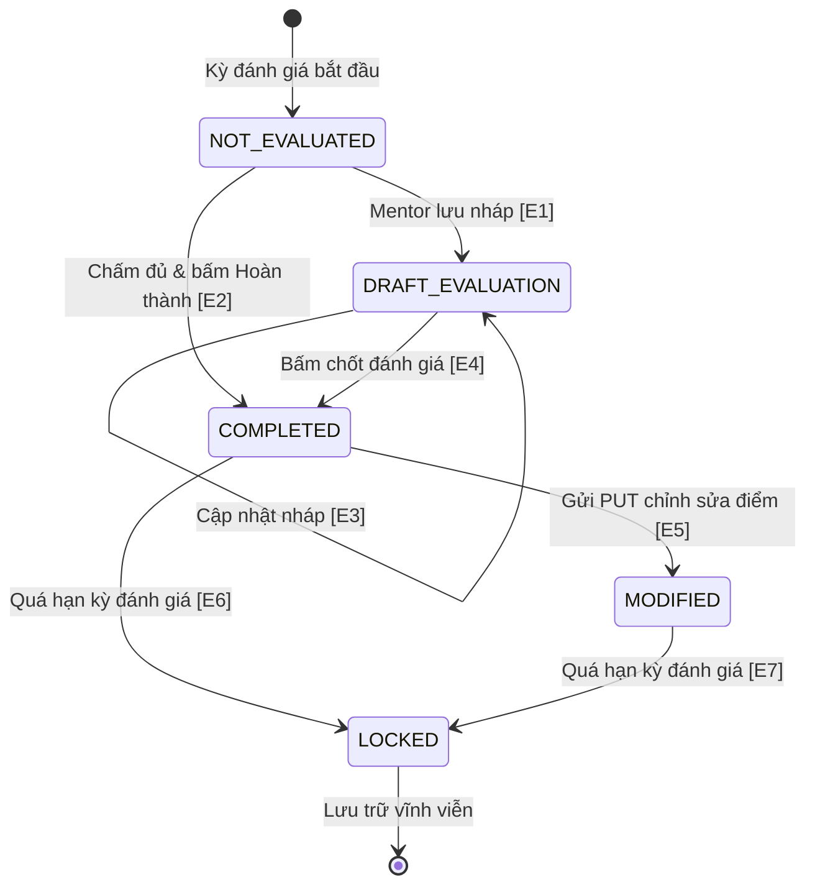

# Test Cases: FR-MEN-003 - Đánh giá Talent (Evaluate Talents)

**Module:** Mentor Portal  
**Chức năng:** Mentor đánh giá sinh viên (`POST /api/mentor/projects/{projectId}/evaluations`)  
**Người thực hiện:** Nguyễn Minh Hiển  
**Ngày tạo:** 08/11/2026  
**Ngày cập nhật:** 08/11/2026  
**Nguồn đặc tả:** `docs/SRS_LabOdc.md` - mục FR-MEN-003  
**Source code tham chiếu:** `MentorPortalController.java`, `MentorPortalService.java`

---

## Mô tả chức năng

Người hướng dẫn (Mentor) gửi đánh giá định kỳ về hiệu suất, kỹ năng lập trình, giải quyết vấn đề, tinh thần đồng đội và tác phong của từng sinh viên (Talent) tham gia trong dự án.

**Điều kiện hợp lệ:** Yêu cầu đánh giá được chấp nhận khi **tất cả** các điều kiện sau đồng thời thỏa mãn:

| Biến đầu vào | Ý nghĩa | Kiểu dữ liệu | Ràng buộc hợp lệ |
|---|---|---|---|
| `Role` | Quyền người dùng | Authentication | User là MENTOR phụ trách trực tiếp dự án này |
| `projectId` | ID dự án | Long | Dự án tồn tại và mentorId khớp với Mentor đang đăng nhập |
| `talentId` | ID sinh viên | Long | Sinh viên tồn tại và đang là thành viên (ACTIVE) của dự án |
| `evaluationPeriod` | Kỳ đánh giá | String | Định dạng `YYYY-MM` (chưa từng đánh giá trong kỳ này) |
| `overallScore` | Điểm tổng thể | Double | Số thực trong khoảng `[0.0, 10.0]` |
| `criteriaScores` | Điểm tiêu chí con | Double | Các điểm `technicalSkills`, `problemSolving`, `teamwork`... trong `[0.0, 10.0]` |

---

## 1. Phân hoạch lớp tương đương (Equivalence Partitioning)

### 1.1 Quyền hạn & Phân công (Role & Assignment)

| Lớp | Mô tả | Tag | Giá trị đại diện |
|---|---|---|---|
| Hợp lệ | Mentor đang phụ trách dự án | V-RL1 | Token của Mentor dự án 1 |
| Không hợp lệ (a) | Chưa đăng nhập (Không có token) | X-RL1 | Không truyền Header Authorization |
| Không hợp lệ (b) | User có role TALENT tự chấm điểm | X-RL2 | Token của Talent |
| Không hợp lệ (c) | Mentor khác không phụ trách dự án này | X-RL3 | Token của Mentor dự án khác |

### 1.2 Sinh viên được đánh giá (talentId)

| Lớp | Mô tả | Tag | Giá trị đại diện |
|---|---|---|---|
| Hợp lệ | Talent ID tồn tại và thuộc dự án | V-TL1 | `456` |
| Không hợp lệ (a) | Talent ID không tồn tại trong hệ thống | X-TL1 | `99999` |
| Không hợp lệ (b) | Talent ID thuộc dự án khác | X-TL2 | `888` |

### 1.3 Kỳ đánh giá (evaluationPeriod)

| Lớp | Mô tả | Tag | Giá trị đại diện |
|---|---|---|---|
| Hợp lệ | Format YYYY-MM và chưa đánh giá kỳ này | V-PR1 | `"2026-02"` |
| Không hợp lệ (a) | Sai định dạng YYYY-MM | X-PR1 | `"2026/02"` |
| Không hợp lệ (b) | Đã đánh giá trong kỳ này (trùng lặp) | X-PR2 | `"2026-02"` (đã tồn tại) |

### 1.4 Điểm tổng thể (overallScore)

| Lớp | Mô tả | Tag | Giá trị đại diện |
|---|---|---|---|
| Hợp lệ | Điểm trong đoạn [0.0, 10.0] | V-SC1 | `8.5` |
| Không hợp lệ (a) | Điểm nhỏ hơn 0.0 | X-SC1 | `-0.1` |
| Không hợp lệ (b) | Điểm lớn hơn 10.0 | X-SC2 | `10.1` |
| Không hợp lệ (c) | Điểm sai kiểu dữ liệu (chuỗi chữ) | X-SC3 | `"tam_diem"` |

### 1.5 Điểm tiêu chí con (Criteria Scores)

| Lớp | Mô tả | Tag | Giá trị đại diện |
|---|---|---|---|
| Hợp lệ | Tất cả điểm tiêu chí trong [0.0, 10.0] | V-CR1 | Các điểm 8.0..9.0 |
| Không hợp lệ | Có tiêu chí âm hoặc vượt 10.0 | X-CR1 | `codeQuality = -1.0` |

### Tổng hợp tag lớp tương đương

| Loại | Tags | Số lượng |
|---|---|---|
| Hợp lệ | V-RL1, V-TL1, V-PR1, V-SC1, V-CR1 | 5 |
| Không hợp lệ | X-RL1, X-RL2, X-RL3, X-TL1, X-TL2, X-PR1, X-PR2, X-SC1, X-SC2, X-SC3, X-CR1 | 11 |
| **Tổng** | | **16 tag** |

---

## 2. Phân tích giá trị biên (Boundary Value Analysis)

### 2.1 Biên điểm overallScore

| Ký hiệu | Ý nghĩa | Giá trị | Mô tả | Tag |
|---|---|---:|---|---|
| `min` | Giá trị nhỏ nhất | 0.0 | Điểm tối thiểu sàn | B-SC1 |
| `min+` | Ngay trên min | 0.1 | Điểm cận dưới | B-SC2 |
| `nominal` | Điểm giữa miền | 7.5 | Điểm khá chuẩn | B-SC3 |
| `max-` | Ngay dưới max | 9.9 | Điểm cận trên | B-SC4 |
| `max` | Giá trị lớn nhất | 10.0 | Điểm tuyệt đối trần | B-SC5 |

### 2.2 Biên kỳ đánh giá (evaluationPeriod)

| Ký hiệu | Giá trị | Mô tả | Tag |
|---|---|---|---|
| Đầu năm | `2026-01` | Kỳ tháng 1 đầu năm | B-PR1 |
| Cuối năm | `2026-12` | Kỳ tháng 12 cuối năm | B-PR2 |

> **Tổng hợp BVA:** 7 tag biên (B-SC1..B-SC5, B-PR1, B-PR2).

---

## 3. Bảng chuyển đổi trạng thái (State Transition Table)

### 3.1 Sơ đồ trạng thái

### 3.2 Bảng chuyển đổi trạng thái

| STT | Trạng thái ban đầu | Sự kiện / Hành động kích hoạt | Trạng thái đích | Kết quả mong đợi |
|---:|---|---|---|---|
| ST-01 | NOT_EVALUATED | Nhập một phần tiêu chí và bấm "Lưu nháp" | DRAFT_EVALUATION | Lưu bản nháp, chưa công bố |
| ST-02 | NOT_EVALUATED | Nhập đầy đủ tiêu chí và bấm "Hoàn thành" | COMPLETED | Lưu chính thức, công bố điểm |
| ST-03 | DRAFT_EVALUATION | Bổ sung nhận xét và lưu | DRAFT_EVALUATION | Giữ nguyên trạng thái nháp |
| ST-04 | DRAFT_EVALUATION | Bấm "Chốt đánh giá chính thức" | COMPLETED | Chuyển sang Hoàn thành |
| ST-05 | COMPLETED | Gửi request PUT để sửa lại điểm | MODIFIED | Cập nhật điểm thành công |
| ST-06 | COMPLETED / MODIFIED | Hết thời gian kỳ đánh giá | LOCKED | Tự động khóa kỳ đánh giá |
| ST-07 | LOCKED | Cố ý gửi request PUT sửa điểm đã khóa | LOCKED | 400 Bad Request: Đã khóa, không được sửa |

---

## 4. Bảng quyết định (Decision Table)

| Condition / Action | Rule 1 | Rule 2 | Rule 3 | Rule 4 | Rule 5 |
|---|:---:|:---:|:---:|:---:|:---:|
| **C1:** Là Mentor phụ trách dự án? | **Y** | **Y** | **Y** | **Y** | **N** |
| **C2:** Sinh viên thuộc dự án? | **Y** | **Y** | **Y** | **N** | **-** |
| **C3:** Kỳ đánh giá chưa tồn tại? | **Y** | **Y** | **N** | **-** | **-** |
| **C4:** Tất cả điểm số thuộc [0.0..10.0]? | **Y** | **N** | **-** | **-** | **-** |
| **A1:** Tạo đánh giá thành công (200/201) | **X** | - | - | - | - |
| **A2:** Báo lỗi 403 Forbidden (Sai quyền) | - | - | - | - | **X** |
| **A3:** Báo lỗi 404 Not Found (Sai sinh viên) | - | - | - | **X** | - |
| **A4:** Báo lỗi 409 Conflict (Trùng kỳ) | - | - | **X** | - | - |
| **A5:** Báo lỗi 400 Bad Request (Sai khoảng điểm) | - | **X** | - | - | - |

---

## 5. Bảng Test Cases

### Preconditions
- Hệ thống backend đang chạy.
- Dự án `projectId = 1` do Mentor đang test phụ trách.
- Sinh viên `talentId = 456` là thành viên chính thức của dự án.

### Bảng test cases chi tiết

| STT | TC ID | Tên test case | Role gọi API | talentId | evaluationPeriod | overallScore | Expected HTTP | Expected Result | Tag được bao phủ |
|---:|---|---|---|---:|---|---:|---:|---|---|
| 1 | TC-MEN003-01 | Đánh giá điểm nominal (7.5) | ASSIGNED_MENTOR | 456 | `2026-02` | 7.5 | 200 | Đánh giá thành công mức khá | V-RL1, V-TL1, V-PR1, V-SC1, V-CR1, B-SC3 |
| 2 | TC-MEN003-02 | Đánh giá tại điểm min (0.0) | ASSIGNED_MENTOR | 456 | `2026-01` | 0.0 | 200 | Đánh giá thành công mức sàn | V-RL1, V-TL1, V-PR1, V-SC1, V-CR1, B-SC1, B-PR1 |
| 3 | TC-MEN003-03 | Đánh giá tại điểm max (10.0) | ASSIGNED_MENTOR | 456 | `2026-12` | 10.0 | 200 | Đánh giá thành công tuyệt đối | V-RL1, V-TL1, V-PR1, V-SC1, V-CR1, B-SC5, B-PR2 |
| 4 | TC-MEN003-04 | Đánh giá tại điểm min+ (0.1) | ASSIGNED_MENTOR | 456 | `2026-02` | 0.1 | 200 | Đánh giá thành công cận min | V-RL1, V-TL1, V-PR1, V-SC1, V-CR1, B-SC2 |
| 5 | TC-MEN003-05 | Đánh giá tại điểm max- (9.9) | ASSIGNED_MENTOR | 456 | `2026-02` | 9.9 | 200 | Đánh giá thành công cận max | V-RL1, V-TL1, V-PR1, V-SC1, V-CR1, B-SC4 |
| 6 | TC-MEN003-06 | overallScore âm (-0.1) | ASSIGNED_MENTOR | 456 | `2026-02` | -0.1 | 400 | Điểm không được nhỏ hơn 0.0 | X-SC1 |
| 7 | TC-MEN003-07 | overallScore vượt 10 (10.1) | ASSIGNED_MENTOR | 456 | `2026-02` | 10.1 | 400 | Điểm không được lớn hơn 10.0 | X-SC2 |
| 8 | TC-MEN003-08 | overallScore kiểu chữ | ASSIGNED_MENTOR | 456 | `2026-02` | `"tam_diem"`| 400 | Lỗi kiểu dữ liệu điểm số | X-SC3 |
| 9 | TC-MEN003-09 | Điểm tiêu chí codeQuality âm | ASSIGNED_MENTOR | 456 | `2026-02` | 8.0 | 400 | Điểm tiêu chí không được âm | X-CR1 |
| 10 | TC-MEN003-10 | Talent không tồn tại | ASSIGNED_MENTOR | 99999 | `2026-02` | 8.5 | 404 | Sinh viên không tồn tại | X-TL1 |
| 11 | TC-MEN003-11 | Talent thuộc dự án khác | ASSIGNED_MENTOR | 888 | `2026-02` | 8.5 | 404 | Sinh viên không thuộc dự án | X-TL2 |
| 12 | TC-MEN003-12 | Trùng kỳ đánh giá (Unique) | ASSIGNED_MENTOR | 456 | `2026-02` | 8.5 | 409 | Kỳ đánh giá đã tồn tại | X-PR2 |
| 13 | TC-MEN003-13 | Sai format kỳ đánh giá | ASSIGNED_MENTOR | 456 | `2026/02` | 8.5 | 400 | Sai format YYYY-MM | X-PR1 |
| 14 | TC-MEN003-14 | Chưa đăng nhập gọi API | UNAUTHENTICATED | 456 | `2026-02` | 8.5 | 401 | Yêu cầu xác thực token | X-RL1 |
| 15 | TC-MEN003-15 | User là Talent tự chấm điểm | TALENT_USER | 456 | `2026-02` | 8.5 | 403 | Chỉ Mentor mới có quyền | X-RL2 |
| 16 | TC-MEN003-16 | Mentor dự án khác gọi API | OTHER_MENTOR | 456 | `2026-02` | 8.5 | 403 | Không phụ trách dự án này | X-RL3 |

---

## 6. Kiểm tra bao phủ tag

### Lớp tương đương

| Tag | Test bao phủ |
|---|---|
| V-RL1, V-TL1, V-PR1, V-SC1, V-CR1 | TC-MEN003-01, 02, 03, 04, 05 |
| X-RL1 | TC-MEN003-14 |
| X-RL2 | TC-MEN003-15 |
| X-RL3 | TC-MEN003-16 |
| X-TL1 | TC-MEN003-10 |
| X-TL2 | TC-MEN003-11 |
| X-PR1 | TC-MEN003-13 |
| X-PR2 | TC-MEN003-12 |
| X-SC1 | TC-MEN003-06 |
| X-SC2 | TC-MEN003-07 |
| X-SC3 | TC-MEN003-08 |
| X-CR1 | TC-MEN003-09 |

### Giá trị biên

| Tag | Giá trị | Test bao phủ |
|---|---|---|
| B-SC1 | 0.0 | TC-MEN003-02 |
| B-SC2 | 0.1 | TC-MEN003-04 |
| B-SC3 | 7.5 | TC-MEN003-01 |
| B-SC4 | 9.9 | TC-MEN003-05 |
| B-SC5 | 10.0 | TC-MEN003-03 |
| B-PR1 | 2026-01 | TC-MEN003-02 |
| B-PR2 | 2026-12 | TC-MEN003-03 |

> **Bao phủ:** 16/16 EP tags, 7/7 BVA tags - **100%**.
