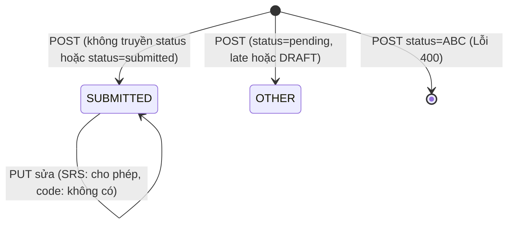

# Test Design - FR-MEN-004 (Mentor: Submit Report)

**Người thực hiện:** Nguyễn Duy Đức
**Module:** Mentor Portal
**Chức năng:** FR-MEN-004 Submit Report: `GET /api/mentor/reports`, `POST /api/mentor/reports`, `GET /api/mentor/reports/{id}/file`
**Ngày tạo:** 08/11/2026

## Giả định

1. Test case thiết kế theo SRS FR-MEN-004 để kiểm chứng hành vi mong đợi, nhưng code thật khác SRS nhiều chỗ (mục 6.5, G1 đến G13), nên input dùng endpoint thật của code và các lệch SRS có testcase riêng (TC-RPT-51, 53, 54).
2. Endpoint thật: `{{base_url}}/api/mentor/reports` (POST nhận multipart/form-data, không phải JSON). Cả 3 endpoint chỉ cho role MENTOR (`@PreAuthorize("hasRole('MENTOR')")`).
3. SRS FR-MEN-004 không có Business Rules và không ghi mã lỗi riêng, nên mã lỗi lấy theo bảng mã trạng thái chung (mục 9.2 của SRS) và chuẩn REST.
4. Cột **Nguồn Expected**: **Code** là suy ra từ code đã đọc (`MentorPortalController`, `MentorPortalService`, `MentorReport`, `MentorReportDTO`); **REST** là chuẩn chung vì code chưa cho biết rõ (chưa xem `parseLocalDate`, `storeReportFile`, `GlobalExceptionHandler`); **SRS** là theo đặc tả. Mã HTTP khi service ném exception phụ thuộc `GlobalExceptionHandler`, cần xác nhận khi chạy thật.
5. Cột Actual và Pass/Fail không nằm trong file này, được điền ở file Report sau khi chạy.
6. Giới hạn file lấy từ SRS (document: pdf, doc, docx, ppt, pptx, tối đa 20 MB). 20 MB hiểu là 20 x 1024 x 1024 byte (chờ xác nhận).
7. Ngoài phạm vi: thông báo gửi Mentor và Lab Admin (SRS), hồ sơ mentor không tồn tại (`requireMentor`), tên file chứa ký tự đường dẫn (khó tạo bằng Postman trên Windows), `POST /projects/{projectId}/progress` của Mentor Portal.

## 1. Phân hoạch lớp tương đương (Equivalence Partitioning)

### 1.1 Authentication & Authorization (áp dụng cho cả 3 endpoint)

| Lớp | Mô tả | Tag | Giá trị đại diện |
|---|---|---|---|
| Hợp lệ | Token hợp lệ, role MENTOR | V-AUTH1 | Bearer token MEN1 |
| Không hợp lệ (a) | Không gửi token | X-AUTH1 | Không có header Authorization |
| Không hợp lệ (b) | Token sai format | X-AUTH2 | `Bearer abc` |
| Không hợp lệ (c) | Role TALENT | X-AUTH3 | Token T-TALENT |
| Không hợp lệ (d) | Role LAB_ADMIN | X-AUTH4 | Token T-ADMIN |

### 1.2 projectId (POST, form-data)

| Lớp | Mô tả | Tag | Giá trị đại diện |
|---|---|---|---|
| Hợp lệ | Dự án được gán cho mentor | V-PJ1 | P1 |
| Không hợp lệ (a) | Dự án không tồn tại | X-PJ1 | `99999` |
| Không hợp lệ (b) | Không phải số | X-PJ2 | `abc` |
| Không hợp lệ (c) | Dự án của mentor khác | X-PJ3 | P-OTHER |
| Không hợp lệ (d) | Thiếu field | X-PJ4 | Bỏ key projectId |

### 1.3 student, studentId, reportName (bắt buộc)

| Lớp | Mô tả | Tag | Giá trị đại diện |
|---|---|---|---|
| Hợp lệ | Cả ba có nội dung | V-REQ1 | SV001, TEST Nguyen Van A, TEST Bao cao tuan 1 |
| Không hợp lệ (a) | Thiếu student | X-REQ1 | Bỏ key student |
| Không hợp lệ (b) | Thiếu studentId | X-REQ2 | Bỏ key studentId |
| Không hợp lệ (c) | Thiếu reportName | X-REQ3 | Bỏ key reportName |
| Không hợp lệ (d) | student rỗng | X-REQ4 | student = (rỗng) |
| Không hợp lệ (e) | reportName toàn khoảng trắng | X-REQ5 | reportName = 3 dấu cách |

### 1.4 dueDate (bắt buộc)

| Lớp | Mô tả | Tag | Giá trị đại diện |
|---|---|---|---|
| Hợp lệ | Định dạng yyyy-MM-dd | V-DATE1 | `2026-12-31` |
| Không hợp lệ (a) | Thiếu | X-DATE1 | Bỏ key dueDate |
| Không hợp lệ (b) | Sai định dạng | X-DATE2 | `31/12/2026` |
| Không hợp lệ (c) | Ngày không tồn tại | X-DATE3 | `2026-02-30` |

### 1.5 submittedDate (tùy chọn)

| Lớp | Mô tả | Tag | Giá trị đại diện |
|---|---|---|---|
| Hợp lệ (a) | Không truyền | V-SDT1 | Bỏ key submittedDate |
| Hợp lệ (b) | Có giá trị hợp lệ | V-SDT2 | `2026-11-08` |
| Không hợp lệ | Giá trị không phải ngày | X-SDT1 | `abc` |

### 1.6 status (tùy chọn)

| Lớp | Mô tả | Tag | Giá trị đại diện |
|---|---|---|---|
| Hợp lệ (a) | Không truyền | V-STS1 | Bỏ key status |
| Hợp lệ (b) | Giá trị trong danh sách của DTO (submitted, pending, late) | V-STS2 | `pending`, `submitted`, `late` |
| Hợp lệ (c) | Rỗng | V-STS3 | status = (rỗng) |
| Hợp lệ (d) | Giá trị DRAFT theo SRS | V-STS4 | `DRAFT` |
| Không hợp lệ | Giá trị lạ | X-STS1 | `ABC` |

### 1.7 summary (tùy chọn)

| Lớp | Mô tả | Tag | Giá trị đại diện |
|---|---|---|---|
| Hợp lệ (a) | Có nội dung | V-SUM1 | `Tom tat` |
| Hợp lệ (b) | Không truyền | V-SUM2 | Bỏ key summary |

### 1.8 file đính kèm (tùy chọn)

| Lớp | Mô tả | Tag | Giá trị đại diện |
|---|---|---|---|
| Hợp lệ (a) | Không đính file | V-FILE1 | Không có key file |
| Hợp lệ (b) | PDF nhỏ hợp lệ | V-FILE2 | F-PDF |
| Không hợp lệ (a) | File 0 byte (code bỏ qua file rỗng) | X-FILE1 | F-EMPTY |
| Không hợp lệ (b) | Sai định dạng (SRS: pdf, doc, docx, ppt, pptx) | X-FILE2 | F-EXE (`.exe`) |
| Không hợp lệ (c) | Quá dung lượng (SRS: tối đa 20 MB) | X-FILE3 | F-20MB+1 |

### 1.9 Content-Type và đường dẫn

| Lớp | Mô tả | Tag | Giá trị đại diện |
|---|---|---|---|
| Không hợp lệ (a) | Gửi JSON thay vì multipart | X-CT1 | raw JSON vào POST /reports |
| Không hợp lệ (b) | POST theo đường dẫn SRS | X-URL1 | `/api/mentor/projects/{projectId}/reports` |
| Không hợp lệ (c) | GET theo đường dẫn SRS | X-URL2 | `/api/mentor/projects/{projectId}/reports` |

### 1.10 Nộp trùng

| Lớp | Mô tả | Tag | Giá trị đại diện |
|---|---|---|---|
| Trạng thái | Gửi lại đúng dữ liệu đã nộp | S-DUP1 | POST 2 lần cùng body |

### 1.11 GET /reports (danh sách)

| Lớp | Mô tả | Tag | Giá trị đại diện |
|---|---|---|---|
| Hợp lệ (a) | Mentor có báo cáo | V-LST1 | MEN1 sau khi đã nộp |
| Hợp lệ (b) | Mentor chưa có báo cáo nào | V-LST2 | Mentor mới |
| Hợp lệ (c) | Cách ly dữ liệu giữa các mentor | V-LST3 | Đăng nhập MEN2 |

### 1.12 reportId (GET /reports/{id}/file)

| Lớp | Mô tả | Tag | Giá trị đại diện |
|---|---|---|---|
| Hợp lệ | Báo cáo của mentor, có file | V-RID1 | R-FILE |
| Không hợp lệ (a) | Không tồn tại | X-RID1 | `99999` |
| Không hợp lệ (b) | Báo cáo của mentor khác | X-RID2 | R-OTHER |
| Không hợp lệ (c) | Báo cáo không có file | X-RID3 | R-NOFILE |
| Không hợp lệ (d) | Không phải số | X-RID4 | `abc` |
| Không hợp lệ (e) | File đã bị xóa khỏi ổ đĩa | X-RID5 | R-FILE sau khi xóa file |

### Tổng hợp tag lớp tương đương

| Loại | Số lượng |
|---|---|
| Hợp lệ (V) | 18 |
| Không hợp lệ (X) | 29 |
| Trạng thái (S) | 1 |
| **Tổng** | **48 tag** |

## 2. Phân tích giá trị biên (Boundary Value Analysis)

### 2.1 projectId

| Ký hiệu | Ý nghĩa | Giá trị | Mô tả | Tag |
|---|---|---|---|---|
| id = 0 | Biên dưới | 0 | Không tồn tại | B-PJ1 |
| id < 0 | Giá trị âm | -1 | Không hợp lệ | B-PJ2 |

### 2.2 dueDate (tháng 2 năm 2026 không nhuận)

| Ký hiệu | Ý nghĩa | Giá trị | Mô tả | Tag |
|---|---|---|---|---|
| 28/02 | Ngày cuối hợp lệ | 2026-02-28 | VALID | B-DATE1 |
| 29/02 | Ngay sau ngày cuối | 2026-02-29 | INVALID (2026 không phải năm nhuận) | B-DATE2 |

### 2.3 Dung lượng file (SRS: tối đa 20 MB)

| Ký hiệu | Ý nghĩa | Giá trị | Mô tả | Tag |
|---|---|---|---|---|
| size = 0 | Rỗng | 0 byte | Code bỏ qua file rỗng | B-FIL0 |
| size = max | Đúng mức tối đa | 20 MB | VALID | B-FIL1 |
| size = max+1 | Ngay trên max | 20 MB + 1 byte | INVALID | B-FIL2 |

### Tổng hợp tag biên: 7 tag

## 3. Chuyển đổi trạng thái (State Transition Testing)

### 3.1 Sơ đồ trạng thái báo cáo

Trạng thái:

- **(chưa có)**: chưa có báo cáo.
- **SUBMITTED**: báo cáo đã nộp (code lưu chữ thường `submitted`).
- **OTHER**: các giá trị khác code nhận (`pending`, `late`); SRS chỉ có DRAFT và SUBMITTED.

### 3.2 Bảng chuyển đổi trạng thái (phạm vi FR-MEN-004: hành động của Mentor)

| Test Case | Start State | Event/Input | Expected End State | Expected Output | TC |
|---|---|---|---|---|---|
| ST-01 | (chưa có) | POST không truyền status | SUBMITTED | 200 | TC-RPT-15 |
| ST-02 | (chưa có) | POST status=submitted | SUBMITTED | 200 | TC-RPT-49 |
| ST-03 | (chưa có) | POST status=pending | SRS không quy định (code lưu pending) | 200 | TC-RPT-02 |
| ST-04 | (chưa có) | POST status=DRAFT | DRAFT (theo SRS) | 200 | TC-RPT-52 |
| ST-05 | (chưa có) | POST status=ABC | Không tạo | 400 | TC-RPT-16 |
| ST-06 | SUBMITTED | POST lại đúng dữ liệu đã nộp | Không đổi | Lỗi 409 hoặc 400 (SRS: UNIQUE) | TC-RPT-45 |
| ST-07 | SUBMITTED | PUT sửa báo cáo | SUBMITTED (đã cập nhật) | 200 (SRS) | TC-RPT-51 |

## 4. Bảng quyết định (Decision Table)

### 4.1 POST /reports (nộp báo cáo)

Conditions:

- C1: Token hợp lệ, role MENTOR?
- C2: `projectId` hợp lệ và dự án tồn tại?
- C3: Mentor thuộc dự án đó? (chờ xác nhận, G10)
- C4: `student`, `studentId`, `reportName` có nội dung?
- C5: `dueDate` và `submittedDate` hợp lệ?
- C6: `status` hợp lệ hoặc không truyền?
- C7: File hợp lệ hoặc không đính file?

Actions:

- A1: 200, tạo báo cáo
- A2: 401 hoặc 403
- A3: 404 hoặc 400, dự án không hợp lệ
- A4: 403, mentor không thuộc dự án
- A5: 400, thiếu hoặc rỗng field bắt buộc
- A6: 400, ngày không hợp lệ
- A7: 400, status không hợp lệ
- A8: 400, file không hợp lệ

| | R1 | R2 | R3 | R4 | R5 | R6 | R7 | R8 |
|---|---|---|---|---|---|---|---|---|
| C1 | Y | N | Y | Y | Y | Y | Y | Y |
| C2 | Y | - | N | Y | Y | Y | Y | Y |
| C3 | Y | - | - | N | Y | Y | Y | Y |
| C4 | Y | - | - | - | N | Y | Y | Y |
| C5 | Y | - | - | - | - | N | Y | Y |
| C6 | Y | - | - | - | - | - | N | Y |
| C7 | Y | - | - | - | - | - | - | N |
| Kết quả | A1 | A2 | A3 | A4 | A5 | A6 | A7 | A8 |
| TC | TC-RPT-01, TC-RPT-02, TC-RPT-03, TC-RPT-15, TC-RPT-49, TC-RPT-50 | TC-RPT-22, TC-RPT-23, TC-RPT-24, TC-RPT-40 | TC-RPT-08, TC-RPT-09, TC-RPT-17, TC-RPT-41, TC-RPT-42 | TC-RPT-18 | TC-RPT-04, TC-RPT-05, TC-RPT-06, TC-RPT-10, TC-RPT-11 | TC-RPT-07, TC-RPT-12, TC-RPT-13, TC-RPT-14, TC-RPT-48 | TC-RPT-16 | TC-RPT-20, TC-RPT-21 |

### 4.2 GET /reports/{id}/file (tải file)

Conditions: C1 token MENTOR, C2 báo cáo tồn tại, C3 báo cáo thuộc mentor đang đăng nhập, C4 báo cáo có file, C5 file còn trên ổ đĩa.

| | DL-R1 | DL-R2 | DL-R3 | DL-R4 | DL-R5 | DL-R6 |
|---|---|---|---|---|---|---|
| C1 | Y | N | Y | Y | Y | Y |
| C2 | Y | - | N | Y | Y | Y |
| C3 | Y | - | - | N | Y | Y |
| C4 | Y | - | - | - | N | Y |
| C5 | Y | - | - | - | - | N |
| Kết quả | 200 | 401/403 | 404 hoặc 400 | 404 hoặc 403 | 404 | 404 |
| TC | TC-RPT-32 | TC-RPT-37, TC-RPT-38 | TC-RPT-33, TC-RPT-36 | TC-RPT-34 | TC-RPT-35 | TC-RPT-39 |

## 5. Bảng Test Cases

### Dữ liệu chuẩn bị (Seed data)

| Mã | Nội dung |
|---|---|
| MEN1 | Tài khoản mentor chính, có Bearer token (tài khoản seed, xem collection Postman) |
| MEN2 | Tài khoản mentor thứ hai (test cách ly dữ liệu) |
| T-TALENT / T-ADMIN | Token TALENT / LAB_ADMIN (test sai role) |
| P1 | Dự án được gán cho MEN1 (lấy ID từ `GET /api/mentor/projects`) |
| P-OTHER | Dự án được gán cho MEN2 |
| R-FILE | Báo cáo của MEN1, có file (tạo từ TC-RPT-03) |
| R-NOFILE | Báo cáo của MEN1, không có file (tạo từ TC-RPT-01) |
| R-OTHER | Báo cáo của MEN2 |
| F-PDF / F-EMPTY / F-EXE | File PDF nhỏ / file 0 byte / file `.exe` |
| F-20MB / F-20MB+1 | File đúng 20 MB / 20 MB + 1 byte |

Lưu ý: code không có endpoint xóa báo cáo, mỗi lần POST thành công tạo một dòng thật trong DB. Dùng tiền tố `TEST` trong `reportName` và `student`.

### Bảng test case

| TC ID | Endpoint | Mô tả | Precondition | Input | Expected | Nguồn Expected | Tag |
|---|---|---|---|---|---|---|---|
| TC-RPT-01 | POST /reports | Nộp báo cáo hợp lệ, không file | MEN1 đăng nhập; P1 | projectId=P1; student; studentId=SV001; reportName; dueDate=2026-12-31; summary | 200; success=true; data.id có; data.status = "submitted"; không có file | Code | V-AUTH1, V-PJ1, V-REQ1, V-DATE1, V-SDT1, V-STS1, V-SUM1, V-FILE1, G7, R1 |
| TC-RPT-02 | POST /reports | Có submittedDate và status=pending | MEN1; P1 | projectId=P1; student; studentId=SV001; reportName; dueDate=2026-12-31; summary; submittedDate=2026-11-08; status=pending | 200; status = "pending"; submittedDate khớp giá trị gửi | Code | V-SDT2, V-STS2, ST-03, R1 |
| TC-RPT-03 | POST /reports | Đính kèm file PDF | MEN1; P1; F-PDF | projectId=P1; student; studentId=SV001; reportName; dueDate=2026-12-31; summary; file=F-PDF | 200; fileName và fileSize có giá trị | Code | V-FILE2, R1 |
| TC-RPT-04 | POST /reports | Thiếu student | MEN1; P1 | Bỏ key student | 400 (@RequestParam bắt buộc) | Code | X-REQ1, R5 |
| TC-RPT-05 | POST /reports | Thiếu studentId | MEN1; P1 | Bỏ key studentId | 400 | Code | X-REQ2, R5 |
| TC-RPT-06 | POST /reports | Thiếu reportName | MEN1; P1 | Bỏ key reportName | 400 | Code | X-REQ3, R5 |
| TC-RPT-07 | POST /reports | Thiếu dueDate | MEN1; P1 | Bỏ key dueDate | 400 | Code | X-DATE1, R6 |
| TC-RPT-08 | POST /reports | Thiếu projectId | MEN1 | Bỏ key projectId | 400 | Code | X-PJ4, R3 |
| TC-RPT-09 | POST /reports | projectId không phải số | MEN1 | projectId=abc | 400 (kiểu Long) | Code | X-PJ2, R3 |
| TC-RPT-10 | POST /reports | student rỗng | MEN1; P1 | student = (rỗng) | 400 (requireNonBlank) | Code | X-REQ4, R5 |
| TC-RPT-11 | POST /reports | reportName toàn khoảng trắng | MEN1; P1 | reportName = 3 dấu cách | 400 (requireNonBlank) | Code | X-REQ5, R5 |
| TC-RPT-12 | POST /reports | dueDate sai định dạng | MEN1; P1 | dueDate=31/12/2026 | 400 | REST | X-DATE2, R6 |
| TC-RPT-13 | POST /reports | dueDate là ngày không tồn tại | MEN1; P1 | dueDate=2026-02-30 | 400 | REST | X-DATE3, R6 |
| TC-RPT-14 | POST /reports | submittedDate không phải ngày | MEN1; P1 | submittedDate=abc | 400 | REST | X-SDT1, R6 |
| TC-RPT-15 | POST /reports | Không truyền status | MEN1; P1 | projectId=P1; student; studentId=SV001; reportName; dueDate=2026-12-31; summary (không có key status) | 200; status = "submitted" (service đặt mặc định) | Code | V-STS1, ST-01, G4, G13, R1 |
| TC-RPT-16 | POST /reports | status giá trị lạ | MEN1; P1 | projectId=P1; student; studentId=SV001; reportName; dueDate=2026-12-31; summary; status=ABC | 400, không tạo báo cáo | REST | X-STS1, ST-05, G11, R7 |
| TC-RPT-17 | POST /reports | Dự án không tồn tại | MEN1 | projectId=99999 | 404 hoặc 400 | REST | X-PJ1, G10, R3 |
| TC-RPT-18 | POST /reports | Dự án của mentor khác | MEN1; P-OTHER | projectId=P-OTHER | 403 | REST | X-PJ3, G10, R4 |
| TC-RPT-19 | POST /reports | File 0 byte | MEN1; P1; F-EMPTY | projectId=P1; student; studentId=SV001; reportName; dueDate=2026-12-31; summary; file=F-EMPTY | 200, báo cáo tạo không có file (code chỉ lưu file có dữ liệu); SRS không quy định | Code | X-FILE1, B-FIL0 |
| TC-RPT-20 | POST /reports | File sai định dạng | MEN1; P1; F-EXE | projectId=P1; student; studentId=SV001; reportName; dueDate=2026-12-31; summary; file=F-EXE | 400 | SRS | X-FILE2, G12, R8 |
| TC-RPT-21 | POST /reports | File vượt 20 MB | MEN1; P1; F-20MB+1 | projectId=P1; student; studentId=SV001; reportName; dueDate=2026-12-31; summary; file=F-20MB+1 | 400 hoặc 413 | SRS | X-FILE3, B-FIL2, G12, R8 |
| TC-RPT-22 | POST /reports | Không gửi token | P1 | Authorization = No Auth | 401 | REST | X-AUTH1, R2 |
| TC-RPT-23 | POST /reports | Token TALENT | T-TALENT; P1 | Bearer T-TALENT | 403 | Code | X-AUTH3, R2 |
| TC-RPT-24 | POST /reports | Token LAB_ADMIN | T-ADMIN; P1 | Bearer T-ADMIN | 403 | Code | X-AUTH4, R2 |
| TC-RPT-25 | POST /reports | Gửi JSON thay vì form-data | MEN1; P1 | Body raw JSON | 415 (consumes multipart/form-data) | Code | X-CT1 |
| TC-RPT-26 | GET /reports | Danh sách khi mentor đã có báo cáo | MEN1; đã có báo cáo | Không có tham số | 200; data là mảng; mỗi phần tử có id, student, studentId, reportName, status, submittedDate, dueDate, score, fileSize, fileName | Code | V-AUTH1, V-LST1, G7 |
| TC-RPT-27 | GET /reports | Thứ tự danh sách | MEN1; có từ 2 báo cáo dueDate khác nhau | Không có tham số | dueDate giảm dần | Code | V-LST1 |
| TC-RPT-28 | GET /reports | Mentor chưa có báo cáo | Mentor mới | Không có tham số | 200; data = [] | Code | V-LST2 |
| TC-RPT-29 | GET /reports | Cách ly giữa các mentor | MEN2 đăng nhập; MEN1 đã có báo cáo | Không có tham số | Không thấy báo cáo của MEN1 | Code | V-LST3 |
| TC-RPT-30 | GET /reports | Không gửi token | — | No Auth | 401 | REST | X-AUTH1 |
| TC-RPT-31 | GET /reports | Token TALENT | T-TALENT | Bearer T-TALENT | 403 | Code | X-AUTH3 |
| TC-RPT-32 | GET /reports/{id}/file | Tải file báo cáo có file | MEN1; R-FILE | id=R-FILE | 200; header Content-Disposition chứa "attachment" | Code | V-RID1, G6, DL-R1 |
| TC-RPT-33 | GET /reports/{id}/file | Báo cáo không tồn tại | MEN1 | id=99999 | 404 ("Report not found") | Code | X-RID1, DL-R3 |
| TC-RPT-34 | GET /reports/{id}/file | Báo cáo của mentor khác | MEN1; R-OTHER | id=R-OTHER | 404 hoặc 403 (code trả "Report not found"); SRS không quy định | Code | X-RID2, DL-R4 |
| TC-RPT-35 | GET /reports/{id}/file | Báo cáo không có file | MEN1; R-NOFILE | id=R-NOFILE | 404 ("File not found") | Code | X-RID3, DL-R5 |
| TC-RPT-36 | GET /reports/{id}/file | id không phải số | MEN1 | id=abc | 400 (kiểu long) | Code | X-RID4, DL-R3 |
| TC-RPT-37 | GET /reports/{id}/file | Không gửi token | R-FILE | No Auth | 401 | REST | X-AUTH1, DL-R2 |
| TC-RPT-38 | GET /reports/{id}/file | Token TALENT | T-TALENT; R-FILE | Bearer T-TALENT | 403 | Code | X-AUTH3, DL-R2 |
| TC-RPT-39 | GET /reports/{id}/file | File đã bị xóa khỏi ổ đĩa | MEN1; R-FILE; xóa file trong %TEMP%\labodc\mentor-reports\{mentorId}\ | id=R-FILE | 404 ("File not found") | Code | X-RID5, DL-R6 |
| TC-RPT-40 | POST /reports | Token sai format | P1 | Authorization = Bearer abc | 401 | REST | X-AUTH2, R2 |
| TC-RPT-41 | POST /reports | projectId = 0 | MEN1 | projectId=0 | 404 hoặc 400 | REST | B-PJ1, G10, R3 |
| TC-RPT-42 | POST /reports | projectId âm | MEN1 | projectId=-1 | 404 hoặc 400 | REST | B-PJ2, G10, R3 |
| TC-RPT-43 | POST /reports | status rỗng | MEN1; P1 | projectId=P1; student; studentId=SV001; reportName; dueDate=2026-12-31; summary; status = (rỗng) | 200; status = "submitted" (code coi rỗng như không truyền) | Code | V-STS3 |
| TC-RPT-44 | POST /reports | File đúng 20 MB | MEN1; P1; F-20MB | projectId=P1; student; studentId=SV001; reportName; dueDate=2026-12-31; summary; file=F-20MB | 200 | SRS | B-FIL1 |
| TC-RPT-45 | POST /reports | Nộp lại đúng dữ liệu đã nộp | MEN1; P1; đã nộp TC-RPT-01 | projectId=P1; student; studentId=SV001; reportName; dueDate=2026-12-31; summary | SRS: không cho nộp trùng (UNIQUE project_id + reporting_period), mã lỗi 409 hoặc 400; code không có reportingPeriod, ghi nhận thực tế | SRS | S-DUP1, ST-06, G9 |
| TC-RPT-46 | GET /reports/{id}/file | Tải file với token sai format | R-FILE | Authorization = Bearer abc | 401 | REST | X-AUTH2 |
| TC-RPT-47 | POST /reports | dueDate = 28/02/2026 | MEN1; P1 | dueDate=2026-02-28 | 200 | Code | B-DATE1 |
| TC-RPT-48 | POST /reports | dueDate = 29/02/2026 | MEN1; P1 | dueDate=2026-02-29 | 400 | REST | B-DATE2, R6 |
| TC-RPT-49 | POST /reports | status = submitted tường minh | MEN1; P1 | projectId=P1; student; studentId=SV001; reportName; dueDate=2026-12-31; summary; status=submitted | 200; status = "submitted" | Code | V-STS2, ST-02, R1 |
| TC-RPT-50 | POST /reports | status = late | MEN1; P1 | projectId=P1; student; studentId=SV001; reportName; dueDate=2026-12-31; summary; status=late | 200; status = "late" | Code | V-STS2, R1 |
| TC-RPT-51 | PUT /reports/{id} | Sửa báo cáo đã nộp | MEN1; R-FILE | PUT /api/mentor/reports/{id} | SRS: 200, báo cáo được cập nhật; code không có endpoint sửa báo cáo (dự kiến 404 hoặc 405) | SRS | ST-07, G8 |
| TC-RPT-52 | POST /reports | status = DRAFT theo SRS | MEN1; P1 | projectId=P1; student; studentId=SV001; reportName; dueDate=2026-12-31; summary; status=DRAFT | SRS: 200, status = DRAFT; code dùng giá trị chữ thường, ghi nhận thực tế | SRS | V-STS4, ST-04, G4 |
| TC-RPT-53 | POST /reports | POST theo đường dẫn SRS | MEN1; P1 | POST /api/mentor/projects/{projectId}/reports, body JSON theo SRS (reportType, reportingPeriod...) | SRS: 200, status SUBMITTED; code không có đường dẫn này (dự kiến 404 hoặc 405) | SRS | X-URL1, G1, G2, G3 |
| TC-RPT-54 | GET /reports | GET theo đường dẫn SRS | MEN1; P1 | GET /api/mentor/projects/{projectId}/reports | SRS: 200, danh sách báo cáo của dự án; code không có đường dẫn này (dự kiến 404 hoặc 405) | SRS | X-URL2, G5 |
| TC-RPT-55 | POST /reports | Không truyền summary | MEN1; P1 | Bỏ key summary | 200 | Code | V-SUM2 |

## 6. Kiểm tra bao phủ

### 6.1 Lớp tương đương

| Tag | TC |
|---|---|
| V-AUTH1 | TC-RPT-01, TC-RPT-26 |
| X-AUTH1 | TC-RPT-22, TC-RPT-30, TC-RPT-37 |
| X-AUTH2 | TC-RPT-40, TC-RPT-46 |
| X-AUTH3 | TC-RPT-23, TC-RPT-31, TC-RPT-38 |
| X-AUTH4 | TC-RPT-24 |
| V-PJ1 | TC-RPT-01 |
| X-PJ1 | TC-RPT-17 |
| X-PJ2 | TC-RPT-09 |
| X-PJ3 | TC-RPT-18 |
| X-PJ4 | TC-RPT-08 |
| V-REQ1 | TC-RPT-01 |
| X-REQ1 | TC-RPT-04 |
| X-REQ2 | TC-RPT-05 |
| X-REQ3 | TC-RPT-06 |
| X-REQ4 | TC-RPT-10 |
| X-REQ5 | TC-RPT-11 |
| V-DATE1 | TC-RPT-01 |
| X-DATE1 | TC-RPT-07 |
| X-DATE2 | TC-RPT-12 |
| X-DATE3 | TC-RPT-13 |
| V-SDT1 | TC-RPT-01 |
| V-SDT2 | TC-RPT-02 |
| X-SDT1 | TC-RPT-14 |
| V-STS1 | TC-RPT-01, TC-RPT-15 |
| V-STS2 | TC-RPT-02, TC-RPT-49, TC-RPT-50 |
| V-STS3 | TC-RPT-43 |
| V-STS4 | TC-RPT-52 |
| X-STS1 | TC-RPT-16 |
| V-SUM1 | TC-RPT-01 |
| V-SUM2 | TC-RPT-55 |
| V-FILE1 | TC-RPT-01 |
| V-FILE2 | TC-RPT-03 |
| X-FILE1 | TC-RPT-19 |
| X-FILE2 | TC-RPT-20 |
| X-FILE3 | TC-RPT-21 |
| X-CT1 | TC-RPT-25 |
| X-URL1 | TC-RPT-53 |
| X-URL2 | TC-RPT-54 |
| S-DUP1 | TC-RPT-45 |
| V-LST1 | TC-RPT-26, TC-RPT-27 |
| V-LST2 | TC-RPT-28 |
| V-LST3 | TC-RPT-29 |
| V-RID1 | TC-RPT-32 |
| X-RID1 | TC-RPT-33 |
| X-RID2 | TC-RPT-34 |
| X-RID3 | TC-RPT-35 |
| X-RID4 | TC-RPT-36 |
| X-RID5 | TC-RPT-39 |

### 6.2 Giá trị biên

| Tag | TC |
|---|---|
| B-PJ1 | TC-RPT-41 |
| B-PJ2 | TC-RPT-42 |
| B-DATE1 | TC-RPT-47 |
| B-DATE2 | TC-RPT-48 |
| B-FIL0 | TC-RPT-19 |
| B-FIL1 | TC-RPT-44 |
| B-FIL2 | TC-RPT-21 |

### 6.3 Chuyển đổi trạng thái

| Tag | TC |
|---|---|
| ST-01 | TC-RPT-15 |
| ST-02 | TC-RPT-49 |
| ST-03 | TC-RPT-02 |
| ST-04 | TC-RPT-52 |
| ST-05 | TC-RPT-16 |
| ST-06 | TC-RPT-45 |
| ST-07 | TC-RPT-51 |

### 6.4 Bảng quyết định

| Tag | TC |
|---|---|
| R1 | TC-RPT-01, TC-RPT-02, TC-RPT-03, TC-RPT-15, TC-RPT-49, TC-RPT-50 |
| R2 | TC-RPT-22, TC-RPT-23, TC-RPT-24, TC-RPT-40 |
| R3 | TC-RPT-08, TC-RPT-09, TC-RPT-17, TC-RPT-41, TC-RPT-42 |
| R4 | TC-RPT-18 |
| R5 | TC-RPT-04, TC-RPT-05, TC-RPT-06, TC-RPT-10, TC-RPT-11 |
| R6 | TC-RPT-07, TC-RPT-12, TC-RPT-13, TC-RPT-14, TC-RPT-48 |
| R7 | TC-RPT-16 |
| R8 | TC-RPT-20, TC-RPT-21 |
| DL-R1 | TC-RPT-32 |
| DL-R2 | TC-RPT-37, TC-RPT-38 |
| DL-R3 | TC-RPT-33, TC-RPT-36 |
| DL-R4 | TC-RPT-34 |
| DL-R5 | TC-RPT-35 |
| DL-R6 | TC-RPT-39 |

### 6.5 Gap SRS vs Code

| Gap | Nội dung | TC |
|---|---|---|
| G1 | Đường dẫn: SRS `POST /api/mentor/projects/{projectId}/reports`, code `POST /api/mentor/reports`, `projectId` nằm trong form | TC-RPT-53 |
| G2 | Định dạng body: SRS JSON, code multipart/form-data | TC-RPT-53 |
| G3 | Field khác hẳn: code không có `reportType`, `reportingPeriod`, `projectProgress`, `tasksCompleted`...; code thêm `student`, `studentId`, `reportName`, `dueDate`, `summary`, `file` | TC-RPT-53 |
| G4 | `status` do client gửi lên, giá trị chữ thường (submitted, pending, late); SRS để server quản lý, giá trị DRAFT và SUBMITTED viết hoa | TC-RPT-15, TC-RPT-52 |
| G5 | `GET /reports` trả mọi báo cáo của mentor, SRS lọc theo `projectId` | TC-RPT-54 |
| G6 | `GET /reports/{id}/file` có trong code, không có trong SRS | TC-RPT-32 |
| G7 | Response là `MentorReportDTO` (id, student, studentId, reportName, status, submittedDate, dueDate, score, fileSize, fileName); SRS trả reportId, projectId, reportType, reportingPeriod, submittedAt, status, recipients | TC-RPT-01, TC-RPT-26 |
| G8 | `PUT /reports/{id}` của SRS: không tìm thấy trong code (kết quả tìm `@PutMapping`, `@DeleteMapping`, `@PatchMapping` chỉ ra endpoint của Task) | TC-RPT-51 |
| G9 | Không có ràng buộc chống nộp trùng (SRS: UNIQUE project_id + reporting_period); code không có `reportingPeriod` | TC-RPT-45 |
| G10 | Nghi: code không thấy kiểm tra `projectId` tồn tại hoặc mentor thuộc dự án (xác nhận khi chạy) | TC-RPT-17, TC-RPT-18, TC-RPT-41, TC-RPT-42 |
| G11 | Nghi: `status` không được validate (xác nhận khi chạy) | TC-RPT-16 |
| G12 | Nghi: không thấy kiểm tra loại và dung lượng file ở bước nộp (xác nhận khi chạy) | TC-RPT-20, TC-RPT-21 |
| G13 | Nội bộ code: entity mặc định `status = "pending"`, service mặc định `"submitted"` | TC-RPT-15 |

### 6.6 Thống kê

- Tổng số testcase: 55.
- 48/48 EP tags, 7/7 BVA tags, 7/7 state transitions, 14/14 decision rules.
- Gap có ít nhất một TC: 13/13.
- Nguồn Expected: Code 33, REST 14, SRS 8. Các case REST và SRS cần đối chiếu lại khi chạy, đặc biệt mã HTTP.
