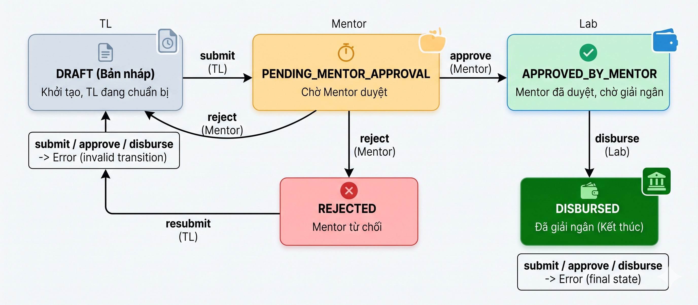

# Test Cases: FR-TL-001 - Quản lý Phân phối Quỹ (Manage Fund Distribution)

**Module:** Talent Leader Dashboard  
**Chức năng:** Tạo phân phối quỹ team (`POST /api/talent-leader/projects/{projectId}/fund-distribution`)  
**Người thực hiện:** Đặng Thành Đình Phát  
**Ngày tạo:** 05/11/2026  
**Nguồn đặc tả:** `docs/SRS_LabOdc.md` - mục FR-TL-001  
**Source code tham chiếu:** `FundAllocationController.java` (Lab Admin), `FundAllocationService.java`, `TeamFundDistribution.java`, `TeamMemberAllocation.java`  
**Kỹ thuật:** EP + BVA + State Transition Testing + Decision Table Testing

---

## Mô tả chức năng

Talent Leader (trưởng nhóm) gửi request `POST /api/talent-leader/projects/{projectId}/fund-distribution` để tạo bản phân phối phần quỹ 70% của team cho từng thành viên. Hệ thống xác thực quyền, validate dữ liệu phân phối, tạo bản ghi với status PENDING_MENTOR_APPROVAL, và thông báo cho Mentor.

**Request body (theo SRS):**
```json
{
  "distributions": [
    {"talentId": 456, "percentage": 35, "reason": "Team lead, handled architecture"},
    {"talentId": 457, "percentage": 40, "reason": "Main developer"},
    {"talentId": 458, "percentage": 25, "reason": "Documentation and testing"}
  ],
  "note": "Phân phối dựa trên đóng góp Sprint 1-3"
}
```

**Điều kiện hợp lệ:** Yêu cầu phân phối được chấp nhận khi **tất cả** các điều kiện sau đồng thời thỏa mãn:

| Biến / Điều kiện | Ý nghĩa | Kiểu | Ràng buộc hợp lệ |
|---|---|---|---|
| `Authorization` | Bearer token của Talent Leader | Header | Token hợp lệ, role = TALENT, user là Talent Leader của project |
| `{projectId}` | ID dự án | Path variable (long) | Tồn tại trong DB, user là Talent Leader của project này |
| `distributions` | Danh sách phân phối | Request body (array) | Không rỗng, bao gồm **tất cả** thành viên team |
| `distributions[].talentId` | ID thành viên | Body field (long) | Tồn tại, là thành viên của project |
| `distributions[].percentage` | Tỷ lệ phần trăm | Body field (decimal) | Min 5%, tổng tất cả = 100% |
| `distributions[].reason` | Lý do phân phối | Body field (string) | Bắt buộc (theo SRS) |
| `note` | Ghi chú tổng quát | Body field (string) | Tùy chọn |
| Distribution status | Trạng thái hiện tại | State | Chưa có distribution PENDING hoặc APPROVED cho project |

**Giả định:**

1. Chỉ xét endpoint `POST` tạo mới distribution. Các endpoint GET (xem), PUT (sửa), GET history nằm ngoài scope test case này.
2. **Phát hiện quan trọng - SRS vs Code:** SRS định nghĩa endpoint `/api/talent-leader/projects/{projectId}/fund-distribution` nhưng **code hiện tại KHÔNG có controller cho Talent Leader**. Chức năng phân phối quỹ team chỉ có trong `FundAllocationController` dưới quyền Lab Admin (`/api/lab-admin/fund-allocation/allocations/{projectId}/disburse-team`). Đây là **gap lớn** - endpoint Talent Leader chưa được implement.
3. Test cases được thiết kế **theo SRS** (đặc tả yêu cầu) để kiểm chứng đúng behaviour mong đợi. Các gap so với code thực tế được ghi nhận tại mục 8.

---

## 1. Phân hoạch lớp tương đương (Equivalence Partitioning)

### 1.1 Authentication & Authorization

| Lớp | Mô tả | Tag | Giá trị đại diện |
|---|---|---|---|
| Hợp lệ | Token hợp lệ, role = TALENT, user là Talent Leader của project | V-AUTH1 | Bearer token của Talent Leader test |
| Không hợp lệ (a) | Không gửi token | X-AUTH1 | Không có header Authorization |
| Không hợp lệ (b) | Token hết hạn / sai format | X-AUTH2 | JWT không hợp lệ |
| Không hợp lệ (c) | Role không phải TALENT (MENTOR) | X-AUTH3 | Token của tài khoản MENTOR |
| Không hợp lệ (d) | Role TALENT nhưng không phải Talent Leader của project | X-AUTH4 | Token của talent thường (không phải leader) |

### 1.2 Project ID (Path Variable)

| Lớp | Mô tả | Tag | Giá trị đại diện |
|---|---|---|---|
| Hợp lệ | Project tồn tại, user là Talent Leader | V-PJ1 | ID project mà user là leader |
| Không hợp lệ (a) | Project ID không tồn tại | X-PJ1 | `99999` |
| Không hợp lệ (b) | ID không phải số | X-PJ2 | `abc` |

### 1.3 Distributions Array

| Lớp | Mô tả | Tag | Giá trị đại diện |
|---|---|---|---|
| Hợp lệ | Danh sách bao gồm tất cả thành viên, tổng % = 100, mỗi người ≥ 5% | V-DIST1 | 3 members: 35% + 40% + 25% |
| Không hợp lệ (a) | Distributions rỗng (`[]`) | X-DIST1 | `"distributions": []` |
| Không hợp lệ (b) | Distributions null / không gửi | X-DIST2 | Không có field `distributions` |
| Không hợp lệ (c) | Thiếu thành viên (không bao gồm tất cả) | X-DIST3 | Chỉ gửi 2/3 members |
| Không hợp lệ (d) | Trùng talentId (cùng 1 member xuất hiện 2 lần) | X-DIST4 | `[{talentId:456, ...}, {talentId:456, ...}]` |

### 1.4 Percentage (Tỷ lệ phần trăm)

| Lớp | Mô tả | Tag | Giá trị đại diện |
|---|---|---|---|
| Hợp lệ | Tổng = 100%, mỗi member ≥ 5% | V-PCT1 | 35 + 40 + 25 = 100 |
| Không hợp lệ (a) | Tổng < 100% | X-PCT1 | 30 + 30 + 30 = 90 |
| Không hợp lệ (b) | Tổng > 100% | X-PCT2 | 40 + 40 + 30 = 110 |
| Không hợp lệ (c) | Một member có percentage < 5% (min) | X-PCT3 | 4 + 46 + 50 = 100 (member 1 chỉ 4%) |
| Không hợp lệ (d) | Percentage = 0 | X-PCT4 | 0 + 50 + 50 = 100 |
| Không hợp lệ (e) | Percentage âm | X-PCT5 | -10 + 60 + 50 = 100 |

### 1.5 TalentId (ID thành viên)

| Lớp | Mô tả | Tag | Giá trị đại diện |
|---|---|---|---|
| Hợp lệ | Tất cả talentId tồn tại, là thành viên project | V-TID1 | IDs thành viên thực tế |
| Không hợp lệ (a) | talentId không tồn tại trong DB | X-TID1 | `99999` |
| Không hợp lệ (b) | talentId tồn tại nhưng không thuộc project | X-TID2 | Talent từ project khác |

### 1.6 Reason (Lý do phân phối)

| Lớp | Mô tả | Tag | Giá trị đại diện |
|---|---|---|---|
| Hợp lệ | Reason có nội dung | V-RSN1 | `"Team lead, handled architecture"` |
| Không hợp lệ (a) | Reason rỗng hoặc null | X-RSN1 | `""` hoặc `null` |

### 1.7 Distribution State (Trạng thái hiện tại)

| Lớp | Mô tả | Tag | Giá trị đại diện |
|---|---|---|---|
| Hợp lệ | Chưa có distribution nào đang PENDING/APPROVED cho project | V-STATE1 | Project chưa có bản phân phối team nào |
| Không hợp lệ (a) | Đã có distribution PENDING_MENTOR_APPROVAL | X-STATE1 | Đã submit, chờ mentor duyệt |
| Không hợp lệ (b) | Đã có distribution APPROVED_BY_MENTOR | X-STATE2 | Mentor đã duyệt, chờ giải ngân |

### Tổng hợp tag lớp tương đương

| Loại | Tags | Số lượng |
|---|---|---|
| Hợp lệ | V-AUTH1, V-PJ1, V-DIST1, V-PCT1, V-TID1, V-RSN1, V-STATE1 | 7 |
| Không hợp lệ | X-AUTH1..4, X-PJ1..2, X-DIST1..4, X-PCT1..5, X-TID1..2, X-RSN1, X-STATE1..2 | 20 |
| **Tổng** | | **27 tag** |

---

## 2. Phân tích giá trị biên (Boundary Value Analysis)

### 2.1 Percentage - Giá trị biên (ràng buộc: min 5%, max phụ thuộc vào tổng = 100%)

| Ký hiệu | Ý nghĩa | Giá trị | Mô tả | Tag |
|---|---|---:|---|---|
| `pct = 4` | Ngay dưới min | 4 | Dưới ngưỡng tối thiểu 5% → INVALID (DB CHECK constraint) | B-PCT1 |
| `pct = 5` | Biên dưới (min) | 5 | Chính xác mức tối thiểu → VALID | B-PCT2 |
| `pct = 6` | Ngay trên min | 6 | Trên mức tối thiểu → VALID | B-PCT3 |

> **Ghi chú:** Biên trên phụ thuộc vào số thành viên. Với 3 thành viên, nếu 2 người nhận 5% thì người thứ 3 nhận tối đa 90%. Không có constraint cố định cho max nên BVA tập trung vào biên dưới.

### 2.2 Tổng Percentage - Giá trị biên (ràng buộc: phải = 100%)

| Ký hiệu | Ý nghĩa | Giá trị | Mô tả | Tag |
|---|---|---:|---|---|
| `sum = 99` | Ngay dưới 100 | 99 | Tổng thiếu 1% → INVALID | B-SUM1 |
| `sum = 100` | Đúng biên | 100 | Chính xác 100% → VALID | B-SUM2 |
| `sum = 101` | Ngay trên 100 | 101 | Tổng dư 1% → INVALID | B-SUM3 |

### 2.3 Distributions Array - Kích thước

| Ký hiệu | Ý nghĩa | Giá trị | Mô tả | Tag |
|---|---|---:|---|---|
| `size = 0` | Mảng rỗng | 0 | Không có phân phối → INVALID | B-ARR1 |
| `size = N-1` | Thiếu 1 member | N-1 | Thiếu thành viên → INVALID | B-ARR2 |
| `size = N` | Đủ member | N | Tất cả thành viên → VALID | B-ARR3 |

### 2.4 Project ID - Edge Cases

| Ký hiệu | Ý nghĩa | Giá trị | Mô tả | Tag |
|---|---|---:|---|---|
| `id = 0` | Biên dưới | 0 | ID = 0, không tồn tại | B-PJ1 |
| `id < 0` | Giá trị âm | -1 | ID âm, không hợp lệ | B-PJ2 |

### Tổng hợp tag biên

| Tags | Số lượng |
|---|---|
| B-PCT1, B-PCT2, B-PCT3, B-SUM1, B-SUM2, B-SUM3, B-ARR1, B-ARR2, B-ARR3, B-PJ1, B-PJ2 | 11 tag |

---

## 3. Chuyển đổi trạng thái (State Transition Testing)

### 3.1 Sơ đồ trạng thái Distribution



**Trạng thái:**
- **DRAFT** - Bản nháp, Talent Leader đang chuẩn bị (trạng thái khởi tạo)
- **PENDING_MENTOR_APPROVAL** - Đã submit, chờ Mentor duyệt
- **APPROVED_BY_MENTOR** - Mentor đã duyệt, chờ Lab giải ngân
- **REJECTED** - Mentor từ chối (có thể resubmit → DRAFT)
- **DISBURSED** - Đã giải ngân xong (trạng thái kết thúc)

### 3.2 Bảng chuyển đổi trạng thái (phạm vi FR-TL-001: chỉ hành động của Talent Leader)

| Test Case | Start State | Event/Input | Expected End State | Expected Output |
|---|---|---|---|---|
| ST-01 | (chưa có) | Talent leader tạo mới distribution (POST) | PENDING_MENTOR_APPROVAL | 201 - Tạo distribution thành công, gửi notification cho Mentor |
| ST-02 | PENDING_MENTOR_APPROVAL | Talent leader tạo mới distribution (POST) | Không đổi | Lỗi - Đã có distribution đang chờ duyệt |
| ST-03 | APPROVED_BY_MENTOR | Talent leader tạo mới distribution (POST) | Không đổi | Lỗi - Đã có distribution được duyệt |
| ST-04 | DISBURSED | Talent leader tạo mới distribution (POST) | Không đổi | Lỗi - Quỹ đã được giải ngân |
| ST-05 | REJECTED | Talent leader tạo mới distribution (POST) | PENDING_MENTOR_APPROVAL | 201 - Resubmit thành công (tạo distribution mới sau khi bị reject) |


---

## 4. Bảng quyết định (Decision Table)

### 4.1 Điều kiện và hành động

**Conditions (điều kiện đầu vào):**
- C1: Token hợp lệ, role = TALENT?
- C2: User là Talent Leader của project?
- C3: Project tồn tại (theo projectId)?
- C4: Distributions không rỗng, bao gồm tất cả member?
- C5: Tất cả talentId hợp lệ (tồn tại + thuộc project)?
- C6: Tổng percentage = 100%, mỗi member ≥ 5%?
- C7: Reason bắt buộc cho mỗi distribution?
- C8: Chưa có distribution PENDING/APPROVED cho project?

**Actions (kết quả):**
- A1: Tạo thành công - 201, status = PENDING_MENTOR_APPROVAL, notify Mentor
- A2: 401 Unauthorized - thiếu hoặc sai token
- A3: 403 Forbidden - không phải Talent Leader của project
- A4: 404 Not Found - project không tồn tại
- A5: 400 Bad Request - distributions rỗng hoặc thiếu member
- A6: 400 Bad Request - talentId không hợp lệ
- A7: 400 Bad Request - percentage vi phạm constraint
- A8: 400 Bad Request - reason rỗng
- A9: 409 Conflict - đã có distribution đang active

### 4.2 Bảng quyết định (rút gọn)

| | R1 | R2 | R3 | R4 | R5 | R6 | R7 | R8 | R9 |
|---|:---:|:---:|:---:|:---:|:---:|:---:|:---:|:---:|:---:|
| **C1:** Token valid, role TALENT | Y | N | Y | Y | Y | Y | Y | Y | Y |
| **C2:** Là Talent Leader của project | Y | - | N | Y | Y | Y | Y | Y | Y |
| **C3:** Project tồn tại | Y | - | - | N | Y | Y | Y | Y | Y |
| **C4:** Distributions hợp lệ (không rỗng, đủ member) | Y | - | - | - | N | Y | Y | Y | Y |
| **C5:** TalentId hợp lệ | Y | - | - | - | - | N | Y | Y | Y |
| **C6:** Percentage hợp lệ (tổng=100, mỗi ≥5%) | Y | - | - | - | - | - | N | Y | Y |
| **C7:** Reason bắt buộc | Y | - | - | - | - | - | - | N | Y |
| **C8:** Chưa có distribution active | Y | - | - | - | - | - | - | - | N |
| | | | | | | | | | |
| **A1:** Tạo thành công (201) | X | - | - | - | - | - | - | - | - |
| **A2:** 401 Unauthorized | - | X | - | - | - | - | - | - | - |
| **A3:** 403 Forbidden | - | - | X | - | - | - | - | - | - |
| **A4:** 404 Not Found | - | - | - | X | - | - | - | - | - |
| **A5:** 400 - Distribution rỗng/thiếu | - | - | - | - | X | - | - | - | - |
| **A6:** 400 - TalentId không hợp lệ | - | - | - | - | - | X | - | - | - |
| **A7:** 400 - Percentage sai | - | - | - | - | - | - | X | - | - |
| **A8:** 400 - Reason rỗng | - | - | - | - | - | - | - | X | - |
| **A9:** 409 Conflict | - | - | - | - | - | - | - | - | X |


---

## 5. Bảng Test Cases

### Dữ liệu chuẩn bị (Seed data)

| Ký hiệu | Mô tả |
|---|---|
| TL1 | Talent Leader test chính, đã đăng nhập, có Bearer token hợp lệ |
| T2 | Thành viên team thứ 2 của project P1 |
| T3 | Thành viên team thứ 3 của project P1 |
| T-OTHER | Talent thuộc project khác (không phải P1) |
| T-NORMAL | Talent thường (không phải leader) của P1 |
| MEN1 | Tài khoản MENTOR (để test sai role) |
| P1 | Project test, fund allocation active, team_amount = 7,000,000 VNĐ |
| P-NONE | Project ID không tồn tại (99999) |
| DIST-PENDING | Distribution đã submit (PENDING_MENTOR_APPROVAL) cho P1 |
| DIST-APPROVED | Distribution đã approved (APPROVED_BY_MENTOR) cho P1 |
| DIST-REJECTED | Distribution đã bị reject cho P1 |

### Bảng test case

| STT | TC ID | Tên test case | Pre-condition | Input | Expected HTTP | Expected Result | Tag được bao phủ | Decision Rule |
|---:|---|---|---|---|---:|---|---|---|
| 1 | TC-FUND-01 | Tạo distribution thành công - happy path | TL1 đăng nhập; P1 có 3 members; chưa có distribution | `projectId=P1`, distributions: TL1=35%, T2=40%, T3=25%, mỗi entry có reason | 201 | Tạo thành công, status=PENDING_MENTOR_APPROVAL, 3 allocations, notify Mentor | V-AUTH1, V-PJ1, V-DIST1, V-PCT1, V-TID1, V-RSN1, V-STATE1, B-SUM2, B-ARR3 | R1 |
| 2 | TC-FUND-02 | Tạo distribution - biên dưới percentage (5%) | TL1 đăng nhập; P1 chưa có distribution | `projectId=P1`, distributions: TL1=5%, T2=5%, T3=90% | 201 | Tạo thành công, member TL1 và T2 nhận đúng 5% (min) | B-PCT2, V-PCT1 | R1 |
| 3 | TC-FUND-03 | Không gửi token (single fault) | P1 chưa có distribution | Không có header Authorization | 401 | Unauthorized - thiếu authentication | X-AUTH1 | R2 |
| 4 | TC-FUND-04 | Token hết hạn / sai format (single fault) | Token JWT không hợp lệ | Token expired / malformed | 401 | Unauthorized - token không xác thực được | X-AUTH2 | R2 |
| 5 | TC-FUND-05 | Role MENTOR - sai quyền (single fault) | MEN1 đăng nhập (role MENTOR) | `projectId=P1`, distributions hợp lệ | 403 | Forbidden - không có quyền TALENT | X-AUTH3 | R2 |
| 6 | TC-FUND-06 | Talent thường - không phải leader (single fault) | T-NORMAL đăng nhập (talent thường của P1) | `projectId=P1`, distributions hợp lệ | 403 | Forbidden - không phải Talent Leader của project | X-AUTH4 | R3 |
| 7 | TC-FUND-07 | Project không tồn tại (single fault) | TL1 đăng nhập | `projectId=99999`, distributions hợp lệ | 404 | Project not found | X-PJ1, B-PJ1 | R4 |
| 8 | TC-FUND-08 | Project ID không phải số (single fault) | TL1 đăng nhập | `projectId=abc` | 400 | Bad Request - path variable không parse được | X-PJ2 | - |
| 9 | TC-FUND-09 | Project ID = 0 - edge case | TL1 đăng nhập | `projectId=0` | 404 | Project not found | B-PJ1 | R4 |
| 10 | TC-FUND-10 | Project ID âm - edge case | TL1 đăng nhập | `projectId=-1` | 404 | Project not found | B-PJ2 | R4 |
| 11 | TC-FUND-11 | Distributions rỗng (single fault) | TL1 đăng nhập | `projectId=P1`, `"distributions": []` | 400 | Danh sách phân phối không được rỗng | X-DIST1, B-ARR1 | R5 |
| 12 | TC-FUND-12 | Distributions null (single fault) | TL1 đăng nhập | `projectId=P1`, không có field `distributions` | 400 | Danh sách phân phối bắt buộc | X-DIST2 | R5 |
| 13 | TC-FUND-13 | Thiếu thành viên (single fault) | TL1 đăng nhập; P1 có 3 members | `projectId=P1`, chỉ gửi TL1=50%, T2=50% (thiếu T3) | 400 | Phải bao gồm tất cả thành viên team | X-DIST3, B-ARR2 | R5 |
| 14 | TC-FUND-14 | Trùng talentId (single fault) | TL1 đăng nhập | `projectId=P1`, TL1=35%, TL1=40%, T3=25% (TL1 xuất hiện 2 lần, thiếu T2) | 400 | TalentId không được trùng lặp | X-DIST4 | R5 |
| 15 | TC-FUND-15 | TalentId không tồn tại (single fault) | TL1 đăng nhập | `projectId=P1`, id=99999 thay cho T2 | 400 | Talent không tồn tại | X-TID1 | R6 |
| 16 | TC-FUND-16 | TalentId thuộc project khác (single fault) | TL1 đăng nhập | `projectId=P1`, id=T-OTHER thay cho T2 | 400 | Talent không thuộc project này | X-TID2 | R6 |
| 17 | TC-FUND-17 | Tổng percentage < 100% (single fault) | TL1 đăng nhập | `projectId=P1`, TL1=30%, T2=30%, T3=30% (tổng=90%) | 400 | Tổng phần trăm phải bằng 100% | X-PCT1, B-SUM1 | R7 |
| 18 | TC-FUND-18 | Tổng percentage > 100% (single fault) | TL1 đăng nhập | `projectId=P1`, TL1=40%, T2=40%, T3=30% (tổng=110%) | 400 | Tổng phần trăm phải bằng 100% | X-PCT2, B-SUM3 | R7 |
| 19 | TC-FUND-19 | Percentage dưới min 5% (single fault) | TL1 đăng nhập | `projectId=P1`, TL1=4%, T2=46%, T3=50% (tổng=100%) | 400 | Mỗi thành viên phải nhận tối thiểu 5% | X-PCT3, B-PCT1 | R7 |
| 20 | TC-FUND-20 | Percentage = 0 (single fault) | TL1 đăng nhập | `projectId=P1`, TL1=0%, T2=50%, T3=50% (tổng=100%) | 400 | Percentage phải lớn hơn 0 / tối thiểu 5% | X-PCT4 | R7 |
| 21 | TC-FUND-21 | Percentage âm (single fault) | TL1 đăng nhập | `projectId=P1`, TL1=-10%, T2=60%, T3=50% (tổng=100%) | 400 | Percentage không được âm | X-PCT5 | R7 |
| 22 | TC-FUND-22 | Tổng = 99% - biên dưới (single fault) | TL1 đăng nhập | `projectId=P1`, TL1=33%, T2=33%, T3=33% (tổng=99%) | 400 | Tổng phần trăm phải bằng 100% | B-SUM1 | R7 |
| 23 | TC-FUND-23 | Tổng = 101% - biên trên (single fault) | TL1 đăng nhập | `projectId=P1`, TL1=34%, T2=34%, T3=33% (tổng=101%) | 400 | Tổng phần trăm phải bằng 100% | B-SUM3 | R7 |
| 24 | TC-FUND-24 | Percentage = 6% - ngay trên min (biên) | TL1 đăng nhập | `projectId=P1`, TL1=6%, T2=6%, T3=88% (tổng=100%) | 201 | Tạo thành công - 6% > 5% min → hợp lệ | B-PCT3 | R1 |
| 25 | TC-FUND-25 | Reason rỗng (single fault) | TL1 đăng nhập | `projectId=P1`, distributions hợp lệ nhưng TL1 có `reason: ""` | 400 | Lý do phân phối bắt buộc cho mỗi thành viên | X-RSN1 | R8 |
| 26 | TC-FUND-26 | **[ST-02]** Tạo khi đã có PENDING (state transition) | TL1 đăng nhập; P1 đã có DIST-PENDING | `projectId=P1`, distributions hợp lệ | 409 | Conflict - đã có distribution đang chờ duyệt | X-STATE1 | R9 |
| 27 | TC-FUND-27 | **[ST-03]** Tạo khi đã có APPROVED (state transition) | TL1 đăng nhập; P1 đã có DIST-APPROVED | `projectId=P1`, distributions hợp lệ | 409 | Conflict - đã có distribution được duyệt | X-STATE2 | R9 |
| 28 | TC-FUND-28 | **[ST-05]** Resubmit sau khi REJECTED (state transition) | TL1 đăng nhập; P1 có DIST-REJECTED (không block) | `projectId=P1`, distributions hợp lệ (có thể khác lần trước) | 201 | Tạo distribution mới thành công (bản ghi mới, bản cũ vẫn REJECTED) | V-STATE1 | R1 |

---

## 6. Kiểm tra bao phủ

### 6.1 Lớp tương đương

| Tag | Mô tả | Bao phủ bởi |
|---|---|---|
| V-AUTH1 | Token TALENT hợp lệ + Talent Leader | TC-FUND-01, 02, 24, 28 |
| V-PJ1 | Project tồn tại, user là leader | TC-FUND-01, 02, 24, 28 |
| V-DIST1 | Distributions đầy đủ, tất cả member | TC-FUND-01, 02, 24, 28 |
| V-PCT1 | Tổng=100%, mỗi ≥5% | TC-FUND-01, 02, 24, 28 |
| V-TID1 | TalentId hợp lệ | TC-FUND-01, 02, 24, 28 |
| V-RSN1 | Reason có nội dung | TC-FUND-01, 02, 24, 28 |
| V-STATE1 | Chưa có distribution active | TC-FUND-01, 02, 24, 28 |
| X-AUTH1 | Không gửi token | TC-FUND-03 |
| X-AUTH2 | Token không hợp lệ | TC-FUND-04 |
| X-AUTH3 | Role MENTOR | TC-FUND-05 |
| X-AUTH4 | Không phải leader | TC-FUND-06 |
| X-PJ1 | Project không tồn tại | TC-FUND-07 |
| X-PJ2 | Project ID không phải số | TC-FUND-08 |
| X-DIST1 | Distributions rỗng | TC-FUND-11 |
| X-DIST2 | Distributions null | TC-FUND-12 |
| X-DIST3 | Thiếu thành viên | TC-FUND-13 |
| X-DIST4 | Trùng talentId | TC-FUND-14 |
| X-PCT1 | Tổng < 100% | TC-FUND-17 |
| X-PCT2 | Tổng > 100% | TC-FUND-18 |
| X-PCT3 | Percentage < 5% | TC-FUND-19 |
| X-PCT4 | Percentage = 0 | TC-FUND-20 |
| X-PCT5 | Percentage âm | TC-FUND-21 |
| X-TID1 | TalentId không tồn tại | TC-FUND-15 |
| X-TID2 | TalentId thuộc project khác | TC-FUND-16 |
| X-RSN1 | Reason rỗng | TC-FUND-25 |
| X-STATE1 | Đã có PENDING | TC-FUND-26 |
| X-STATE2 | Đã có APPROVED | TC-FUND-27 |

### 6.2 Giá trị biên

| Tag | Giá trị | Bao phủ bởi |
|---|---|---|
| B-PCT1 | percentage = 4 (dưới min) | TC-FUND-19 |
| B-PCT2 | percentage = 5 (min) | TC-FUND-02 |
| B-PCT3 | percentage = 6 (trên min) | TC-FUND-24 |
| B-SUM1 | tổng = 99 (dưới 100) | TC-FUND-17, 22 |
| B-SUM2 | tổng = 100 (đúng) | TC-FUND-01 |
| B-SUM3 | tổng = 101 (trên 100) | TC-FUND-18, 23 |
| B-ARR1 | size = 0 (rỗng) | TC-FUND-11 |
| B-ARR2 | size = N-1 (thiếu 1) | TC-FUND-13 |
| B-ARR3 | size = N (đủ) | TC-FUND-01 |
| B-PJ1 | projectId = 0 | TC-FUND-09 |
| B-PJ2 | projectId = -1 | TC-FUND-10 |

### 6.3 Chuyển đổi trạng thái

| ST | Transition | Bao phủ bởi |
|---|---|---|
| ST-01 | (chưa có) → PENDING_MENTOR_APPROVAL | TC-FUND-01 |
| ST-02 | PENDING → submit lại → Lỗi | TC-FUND-26 |
| ST-03 | APPROVED → submit lại → Lỗi | TC-FUND-27 |
| ST-04 | DISBURSED → submit lại → Lỗi | *Thuộc scope FR-LAB-003* |
| ST-05 | REJECTED → resubmit → PENDING | TC-FUND-28 |

### 6.4 Bảng quyết định

| Rule | Mô tả | Bao phủ bởi |
|---|---|---|
| R1 | Tất cả hợp lệ → Tạo thành công | TC-FUND-01, 02, 24, 28 |
| R2 | Token/role sai → 401/403 | TC-FUND-03, 04, 05 |
| R3 | Không phải leader → 403 | TC-FUND-06 |
| R4 | Project không tồn tại → 404 | TC-FUND-07, 09, 10 |
| R5 | Distributions rỗng/thiếu → 400 | TC-FUND-11, 12, 13, 14 |
| R6 | TalentId sai → 400 | TC-FUND-15, 16 |
| R7 | Percentage sai → 400 | TC-FUND-17, 18, 19, 20, 21, 22, 23 |
| R8 | Reason rỗng → 400 | TC-FUND-25 |
| R9 | Đã có distribution active → 409 | TC-FUND-26, 27 |

> 27/27 EP tags, 11/11 BVA tags, 4/4 state transitions (phía TL), 9/9 decision rules đã được bao phủ đầy đủ.