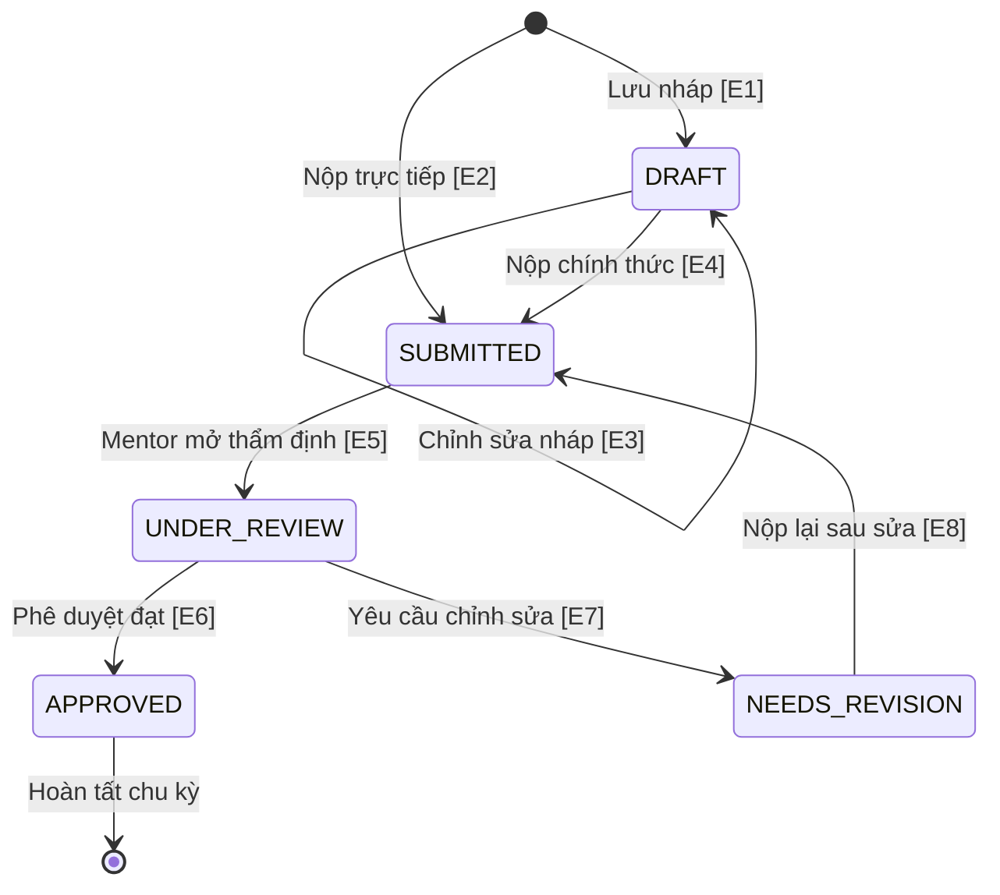

# Test Cases: FR-TL-002 - Nộp Báo cáo Nhóm (Submit Team Report)

**Module:** Talent Leader / Project Management  
**Chức năng:** Nộp Báo cáo Tiến độ Nhóm (`POST /api/talent-leader/projects/{projectId}/reports`)  
**Người thực hiện:** Nguyễn Minh Hiển  
**Ngày tạo:** 08/11/2026  
**Ngày cập nhật:** 18/11/2026  
**Nguồn đặc tả:** `docs/SRS_LabOdc.md` - mục FR-TL-002  
**Source code tham chiếu:** `labodc-backend/.../controller/TalentController.java`, `docs/SRS_LabOdc.md`

---

## Mô tả chức năng

Trưởng nhóm sinh viên (Talent Leader) gửi báo cáo định kỳ (tuần, tháng, tổng kết) về tiến độ công việc, các nhiệm vụ hoàn thành, nhiệm vụ đang triển khai và các vấn đề phát sinh của nhóm dự án. Hệ thống validate thông tin đầu vào, kiểm tra quyền hạn của Leader đối với dự án, kiểm tra tính duy nhất của kỳ báo cáo, và ghi nhận tiến độ vào hệ thống.

**Điều kiện hợp lệ:** Yêu cầu nộp báo cáo được chấp nhận khi **tất cả** các điều kiện sau đồng thời thỏa mãn:

| Biến đầu vào | Ý nghĩa | Kiểu dữ liệu | Ràng buộc hợp lệ |
|---|---|---|---|
| `Role` | Quyền người dùng | Authentication | User có role `TALENT` và đang giữ vai trò `TEAM_LEADER` của dự án |
| `projectId` | ID dự án | Long | Số nguyên dương, dự án tồn tại và ở trạng thái `ACTIVE` trong DB |
| `reportType` | Loại kỳ báo cáo | String / Enum | Không rỗng, thuộc danh mục: `WEEKLY`, `MONTHLY`, `FINAL` |
| `reportingPeriod` | Kỳ báo cáo | String | Đúng định dạng `YYYY-MM` (tháng 01..12, năm 2020..2030) |
| `overallProgress` | Tiến độ tổng thể | Integer / Double | Số nguyên hoặc số thực trong khoảng `[0, 100]` (%) |
| `tasksCompleted` | Công việc đã xong | Array (JSON) | Mảng JSON hợp lệ, tối thiểu 0 phần tử |

**Giả định & Phạm vi:**

1. Request gửi qua API dưới định dạng `Content-Type: application/json`.
2. Trưởng nhóm có thể nộp chính thức (`SUBMITTED`) hoặc lưu nháp (`DRAFT`).
3. Validation tầng controller xử lý các ràng buộc cơ bản: `@NotNull`, `@NotBlank`, `@Pattern(regexp = "^\\d{4}-(0[1-9]|1[0-2])$")`, `@Min(0)`, `@Max(100)`.
4. Logic nghiệp vụ (kiểm tra quyền Leader của dự án, kiểm tra trùng kỳ báo cáo) do tầng Service xử lý.
5. Backend hiện tại chưa triển khai route `/api/talent-leader/**`, các ca kiểm thử được thiết kế hoàn chỉnh theo SRS làm cơ sở kiểm thử tự động, Postman và đối soát khi backend triển khai.

---

## 1. Phân hoạch lớp tương đương (Equivalence Partitioning)

### 1.1 Vai trò người gọi API (Role / Permission)

| Lớp | Mô tả | Tag | Giá trị đại diện |
|---|---|---|---|
| Hợp lệ | User có role TALENT và là Leader của dự án | V-RL1 | Token của Team Leader dự án `projectId = 1` |
| Không hợp lệ (a) | Chưa đăng nhập (Không có token / Bearer rỗng) | X-RL1 | Không truyền Header `Authorization` |
| Không hợp lệ (b) | Là thành viên TALENT thông thường (không phải Leader) | X-RL2 | Token của Member dự án `projectId = 1` |
| Không hợp lệ (c) | Là Leader nhưng của một dự án khác | X-RL3 | Token của Leader dự án `projectId = 2` gọi `projectId = 1` |

### 1.2 Loại báo cáo (reportType)

| Lớp | Mô tả | Tag | Giá trị đại diện |
|---|---|---|---|
| Hợp lệ | Thuộc tập danh mục hợp lệ {`WEEKLY`, `MONTHLY`, `FINAL`} | V-TY1 | `"MONTHLY"` |
| Không hợp lệ (a) | Bỏ trống / chuỗi rỗng | X-TY1 | `""` |
| Không hợp lệ (b) | Giá trị không thuộc danh mục enum | X-TY2 | `"DAILY"` |

### 1.3 Kỳ báo cáo (reportingPeriod)

| Lớp | Mô tả | Tag | Giá trị đại diện |
|---|---|---|---|
| Hợp lệ | Định dạng YYYY-MM hợp lệ (tháng 01..12) | V-PR1 | `"2026-02"` |
| Không hợp lệ (a) | Sai định dạng (DD-MM-YYYY hoặc có dấu gạch chéo) | X-PR1 | `"15-02-2026"` |
| Không hợp lệ (b) | Tháng không hợp lệ (> 12 hoặc = 00) | X-PR2 | `"2026-13"` |

### 1.4 Tiến độ tổng thể (overallProgress)

| Lớp | Mô tả | Tag | Giá trị đại diện |
|---|---|---|---|
| Hợp lệ | Giá trị số trong đoạn [0, 100] | V-PG1 | `50` |
| Không hợp lệ (a) | Giá trị nhỏ hơn 0 | X-PG1 | `-1` |
| Không hợp lệ (b) | Giá trị lớn hơn 100 | X-PG2 | `101` |
| Không hợp lệ (c) | Sai kiểu dữ liệu (chuỗi ký tự không parse được số) | X-PG3 | `"nam_muoi"` |

### 1.5 Tính duy nhất của kỳ báo cáo (Uniqueness)

| Lớp | Mô tả | Tag | Giá trị đại diện |
|---|---|---|---|
| Hợp lệ | Kỳ báo cáo chưa tồn tại báo cáo chính thức | V-UQ1 | Kỳ `"2026-11"` nộp lần đầu |
| Không hợp lệ (a) | Trùng kỳ báo cáo đã nộp chính thức trong dự án | X-UQ1 | Kỳ `"2026-02"` đã nộp trước đó |

### Tổng hợp tag lớp tương đương

| Loại | Tags | Số lượng |
|---|---|---|
| Hợp lệ | V-RL1, V-TY1, V-PR1, V-PG1, V-UQ1 | 5 |
| Không hợp lệ | X-RL1, X-RL2, X-RL3, X-TY1, X-TY2, X-PR1, X-PR2, X-PG1, X-PG2, X-PG3, X-UQ1 | 11 |
| **Tổng** | | **16 tag** |

---

## 2. Phân tích giá trị biên (Boundary Value Analysis)

Biến có miền số học liên tục là **`overallProgress`** (phạm vi từ 0% đến 100%). Áp dụng kỹ thuật Standard Boundary Value Analysis (BVA) với 5 điểm giá trị: min, min+, nominal, max-, max.

### 2.1 Biên của overallProgress

| Ký hiệu | Ý nghĩa | Giá trị | Mô tả | Tag |
|---|---|---:|---|---|
| `min` | Giá trị nhỏ nhất hợp lệ | 0 | Báo cáo bắt đầu dự án, tiến độ 0% | B-PG1 |
| `min+` | Ngay trên min | 1 | Tiến độ 1% | B-PG2 |
| `nominal` | Đại diện giữa miền | 50 | Tiến độ 50% | B-PG3 |
| `max-` | Ngay dưới max | 99 | Tiến độ 99% | B-PG4 |
| `max` | Giá trị lớn nhất hợp lệ | 100 | Báo cáo nghiệm thu hoàn thành 100% | B-PG5 |

### 2.2 Biên của reportType & reportingPeriod

| Ký hiệu | Giá trị | Mô tả | Tag |
|---|---|---|---|
| Biên loại báo cáo | `WEEKLY`, `FINAL` | Điểm đầu và cuối danh mục enum | B-TY1 |
| Biên kỳ báo cáo | `2026-01`, `2026-12` | Tháng đầu tiên và cuối cùng trong năm | B-PR1 |

### Tổng hợp tag biên

| Tags | Số lượng |
|---|---|
| B-PG1, B-PG2, B-PG3, B-PG4, B-PG5, B-TY1, B-PR1 | 7 tag |

---

## 3. Chuyển đổi trạng thái (State Transition Testing)

### 3.1 Sơ đồ trạng thái Team Report

### 3.2 Bảng chuyển đổi trạng thái

| Test Case | Start State | Event / Input | Expected End State | Expected Output |
|---|---|---|---|---|
| ST-01 | Non-Existent | Bấm "Lưu nháp" với dữ liệu hợp lệ | DRAFT | 201 - Lưu bản ghi nháp thành công |
| ST-02 | Non-Existent | Bấm "Nộp chính thức" trực tiếp | SUBMITTED | 201 - Nộp thành công, chờ Mentor duyệt |
| ST-03 | DRAFT | Cập nhật nội dung nhiệm vụ và bấm Lưu | DRAFT | 200 - Cập nhật nháp, giữ nguyên trạng thái |
| ST-04 | DRAFT | Bấm "Nộp chính thức" | SUBMITTED | 200 - Khóa sửa tạm thời, chuyển SUBMITTED |
| ST-05 | SUBMITTED | Mentor mở chi tiết báo cáo thẩm định | UNDER_REVIEW | 200 - Chuyển sang Đang xem xét |
| ST-06 | UNDER_REVIEW | Mentor xác nhận đạt và bấm Duyệt | APPROVED | 200 - Tiến độ ghi nhận chính thức |
| ST-07 | UNDER_REVIEW | Mentor bấm "Yêu cầu chỉnh sửa" | NEEDS_REVISION | 200 - Báo cáo gửi trả về Leader kèm phản hồi |
| ST-08 | NEEDS_REVISION | Leader bổ sung nội dung và nộp lại | SUBMITTED | 200 - Nộp lại thành công, chờ thẩm định |
| ST-09 | APPROVED | Gửi request PUT sửa báo cáo đã duyệt | APPROVED | 400 - Bad Request: Không được sửa báo cáo đã duyệt |

---

## 4. Bảng quyết định (Decision Table)

### 4.1 Điều kiện và hành động

**Conditions:**
- C1: Người gọi có quyền Team Leader của dự án?
- C2: reportType hợp lệ? (`WEEKLY`, `MONTHLY`, `FINAL`)
- C3: reportingPeriod hợp lệ (`YYYY-MM`) và chưa trùng kỳ đã nộp?
- C4: overallProgress thuộc đoạn [0..100]?
- C5: Hành động gửi lên là SUBMIT (Y) hay DRAFT (N)?

**Actions:**
- A1: 201 - Lưu thành công ở trạng thái `SUBMITTED`
- A2: 201 - Lưu thành công ở trạng thái `DRAFT`
- A3: 403 Forbidden - Không có quyền Leader của dự án
- A4: 400 Bad Request - Sai reportType
- A5: 400 Bad Request - Sai format kỳ hoặc trùng kỳ báo cáo
- A6: 400 Bad Request - Sai khoảng tiến độ

### 4.2 Bảng quyết định

| | R1 | R2 | R3 | R4 | R5 | R6 |
|---|:---:|:---:|:---:|:---:|:---:|:---:|
| **C1:** Là Team Leader của dự án | Y | Y | Y | Y | Y | N |
| **C2:** reportType hợp lệ | Y | Y | Y | N | - | - |
| **C3:** reportingPeriod hợp lệ & chưa trùng | Y | Y | Y | - | N | - |
| **C4:** overallProgress thuộc [0..100] | Y | Y | N | - | - | - |
| **C5:** Hành động là SUBMIT (Y) | Y | N | - | - | - | - |
| | | | | | | |
| **A1:** 201 - Tạo thành công SUBMITTED | X | - | - | - | - | - |
| **A2:** 201 - Tạo thành công DRAFT | - | X | - | - | - | - |
| **A3:** 403 - Sai quyền Leader | - | - | - | - | - | X |
| **A4:** 400 - Sai reportType | - | - | - | X | - | - |
| **A5:** 400 - Sai kỳ hoặc trùng kỳ | - | - | - | - | X | - |
| **A6:** 400 - Sai khoảng tiến độ | - | - | X | - | - | - |

---

## 5. Bảng Test Cases

### Nguyên tắc thiết kế

- **Test case hợp lệ:** Tất cả các biến đều hợp lệ (Leader token đúng, projectId đúng, reportType chuẩn, reportingPeriod đúng format và chưa nộp, overallProgress thuộc miền [0..100]).
- **Test case không hợp lệ:** Tuân thủ nguyên tắc **single fault** - mỗi test chỉ có đúng **một** biến sai hoặc vi phạm điều kiện, các biến còn lại giữ hợp lệ để cô lập chính xác nguyên nhân lỗi.

### Preconditions (áp dụng cho tất cả test case)

- Hệ thống backend đang chạy và kết nối cơ sở dữ liệu.
- Dự án `projectId = 1` tồn tại ở trạng thái `ACTIVE`.
- Tài khoản Team Leader hợp lệ: `nguyenvana@student.uth.edu.vn` (Role TALENT, chức vụ Team Leader dự án 1).
- Tài khoản Member thông thường: `tranthib@student.uth.edu.vn` (Role TALENT, thành viên dự án 1).
- Tài khoản Team Leader dự án khác: `lethanhc@student.uth.edu.vn` (Team Leader dự án 2).

### Bảng test cases chi tiết

| STT | TC ID | Tên test case | Pre-condition | Role gọi API | projectId | reportType | reportingPeriod | overallProgress | Expected HTTP | Expected Result | Tag / ST / Rule |
|---:|---|---|---|---|---:|---|---|---:|---:|---|---|
| 1 | TC-TL002-01 | Nộp báo cáo nominal (50%) | Project ACTIVE | TEAM_LEADER | 1 | `MONTHLY` | `2026-02` | 50 | 201 | Tạo báo cáo tiến độ 50% | V-RL1, V-TY1, V-PR1, V-PG1, V-UQ1, B-PG3, ST-02, R1 |
| 2 | TC-TL002-02 | Nộp báo cáo tại min (0%) | Project ACTIVE | TEAM_LEADER | 1 | `WEEKLY` | `2026-01` | 0 | 201 | Báo cáo tiến độ 0% | V-RL1, V-TY1, V-PR1, V-PG1, B-PG1, B-TY1, B-PR1, R1 |
| 3 | TC-TL002-03 | Nộp báo cáo tại max (100%) | Project ACTIVE | TEAM_LEADER | 1 | `FINAL` | `2026-12` | 100 | 201 | Báo cáo hoàn tất 100% | V-RL1, V-TY1, V-PR1, V-PG1, B-PG5, B-TY1, B-PR1, R1 |
| 4 | TC-TL002-04 | Nộp báo cáo tại min+ (1%) | Project ACTIVE | TEAM_LEADER | 1 | `MONTHLY` | `2026-02` | 1 | 201 | Báo cáo tiến độ 1% | V-RL1, V-TY1, V-PR1, V-PG1, B-PG2, R1 |
| 5 | TC-TL002-05 | Nộp báo cáo tại max- (99%) | Project ACTIVE | TEAM_LEADER | 1 | `MONTHLY` | `2026-02` | 99 | 201 | Báo cáo tiến độ 99% | V-RL1, V-TY1, V-PR1, V-PG1, B-PG4, R1 |
| 6 | TC-TL002-06 | overallProgress âm (-1) (single fault) | Project ACTIVE | TEAM_LEADER | 1 | `MONTHLY` | `2026-02` | -1 | 400 | Tiến độ không được nhỏ hơn 0 | X-PG1, R6 |
| 7 | TC-TL002-07 | overallProgress vượt 100 (101) (single fault) | Project ACTIVE | TEAM_LEADER | 1 | `MONTHLY` | `2026-02` | 101 | 400 | Tiến độ không được vượt quá 100 | X-PG2, R6 |
| 8 | TC-TL002-08 | overallProgress kiểu chữ | Project ACTIVE | TEAM_LEADER | 1 | `MONTHLY` | `2026-02` | `"nam_muoi"` | 400 | Lỗi kiểu dữ liệu tiến độ | X-PG3, R6 |
| 9 | TC-TL002-09 | reportType sai danh mục | Project ACTIVE | TEAM_LEADER | 1 | `DAILY` | `2026-02` | 50 | 400 | Loại báo cáo không hợp lệ | X-TY2, R4 |
| 10 | TC-TL002-10 | reportType rỗng | Project ACTIVE | TEAM_LEADER | 1 | `""` | `2026-02` | 50 | 400 | Loại báo cáo là bắt buộc | X-TY1, R4 |
| 11 | TC-TL002-11 | reportingPeriod tháng 13 | Project ACTIVE | TEAM_LEADER | 1 | `MONTHLY` | `2026-13` | 50 | 400 | Tháng không hợp lệ | X-PR2, R5 |
| 12 | TC-TL002-12 | reportingPeriod sai định dạng | Project ACTIVE | TEAM_LEADER | 1 | `MONTHLY` | `15-02-2026` | 50 | 400 | Sai format YYYY-MM | X-PR1, R5 |
| 13 | TC-TL002-13 | Chưa đăng nhập gọi API | Không có token | UNAUTHENTICATED | 1 | `MONTHLY` | `2026-02` | 50 | 401 | Yêu cầu xác thực token | X-RL1 |
| 14 | TC-TL002-14 | Member thường gọi nộp | Member token | TALENT_MEMBER | 1 | `MONTHLY` | `2026-02` | 50 | 403 | Chỉ Leader mới có quyền | X-RL2, R3 |
| 15 | TC-TL002-15 | Leader dự án khác gọi nộp | Leader dự án 2 | TALENT_OTHER_PRJ | 1 | `MONTHLY` | `2026-02` | 50 | 403 | Không thuộc dự án này | X-RL3, R3 |
| 16 | TC-TL002-16 | Trùng kỳ báo cáo đã nộp | Đã nộp 2026-02 | TEAM_LEADER | 1 | `MONTHLY` | `2026-02` | 70 | 400 / 409 | Báo kỳ báo cáo đã tồn tại | X-UQ1, R5 |

---

## 6. Kiểm tra bao phủ tag

### Lớp tương đương

| Tag | Mô tả | Bao phủ bởi |
|---|---|---|
| V-RL1 | Token Team Leader hợp lệ | TC-TL002-01, 02, 03, 04, 05, 06, 07, 08, 09, 10, 11, 12, 16 |
| V-TY1 | reportType hợp lệ | TC-TL002-01, 02, 03, 04, 05 |
| V-PR1 | reportingPeriod đúng định dạng | TC-TL002-01, 02, 03, 04, 05 |
| V-PG1 | overallProgress hợp lệ [0..100] | TC-TL002-01, 02, 03, 04, 05 |
| V-UQ1 | Kỳ báo cáo mới, chưa trùng | TC-TL002-01 |
| X-RL1 | Không có token | TC-TL002-13 |
| X-RL2 | Talent Member thường | TC-TL002-14 |
| X-RL3 | Leader dự án khác | TC-TL002-15 |
| X-TY1 | reportType rỗng | TC-TL002-10 |
| X-TY2 | reportType sai enum | TC-TL002-09 |
| X-PR1 | reportingPeriod sai format | TC-TL002-12 |
| X-PR2 | reportingPeriod tháng sai | TC-TL002-11 |
| X-PG1 | overallProgress âm | TC-TL002-06 |
| X-PG2 | overallProgress > 100 | TC-TL002-07 |
| X-PG3 | overallProgress kiểu chuỗi | TC-TL002-08 |
| X-UQ1 | Trùng kỳ báo cáo | TC-TL002-16 |

### Giá trị biên

| Tag | Giá trị | Bao phủ bởi |
|---|---|---|
| B-PG1 | min = 0% | TC-TL002-02 |
| B-PG2 | min+ = 1% | TC-TL002-04 |
| B-PG3 | nominal = 50% | TC-TL002-01 |
| B-PG4 | max- = 99% | TC-TL002-05 |
| B-PG5 | max = 100% | TC-TL002-03 |
| B-TY1 | WEEKLY, FINAL | TC-TL002-02, 03 |
| B-PR1 | 2026-01, 2026-12 | TC-TL002-02, 03 |

### Chuyển đổi trạng thái

| ST | Transition | Bao phủ bởi |
|---|---|---|
| ST-01 | Non-Existent → DRAFT | Quy trình nộp nháp |
| ST-02 | Non-Existent → SUBMITTED | TC-TL002-01 |
| ST-03 | DRAFT → DRAFT | Cập nhật nháp |
| ST-04 | DRAFT → SUBMITTED | Nộp chính thức từ nháp |
| ST-05 | SUBMITTED → UNDER_REVIEW | Quy trình duyệt Mentor |
| ST-06 | UNDER_REVIEW → APPROVED | Phê duyệt đạt |
| ST-07 | UNDER_REVIEW → NEEDS_REVISION | Yêu cầu chỉnh sửa |
| ST-08 | NEEDS_REVISION → SUBMITTED | Nộp lại sau sửa |
| ST-09 | APPROVED → sửa báo cáo | Bị từ chối 400 |

### Bảng quyết định

| Rule | Mô tả | Bao phủ bởi |
|---|---|---|
| R1 | Tất cả hợp lệ (SUBMITTED) → 201 Created | TC-TL002-01, 02, 03, 04, 05 |
| R2 | Tất cả hợp lệ (DRAFT) → 201 Created | ST-01 (Lưu nháp) |
| R3 | Sai quyền Leader → 403 Forbidden | TC-TL002-14, 15 |
| R4 | Sai reportType → 400 Bad Request | TC-TL002-09, 10 |
| R5 | Sai kỳ hoặc trùng kỳ → 400 Bad Request | TC-TL002-11, 12, 16 |
| R6 | Sai khoảng tiến độ → 400 Bad Request | TC-TL002-06, 07, 08 |

> **Kết luận:** 16/16 EP tags, 7/7 BVA tags, 9/9 state transitions, 6/6 decision rules - bao phủ **100%**.

---

### Các trường hợp chưa test (nằm ngoài scope hiện tại)

- Đính kèm file báo cáo dung lượng lớn / quá giới hạn (file upload validation thuộc multipart request).
- Kiểm tra concurrency khi 2 user cùng nộp báo cáo tại cùng một mili-giây.
- SQL injection / XSS trong trường mô tả công việc (thuộc security testing chuyên sâu).
