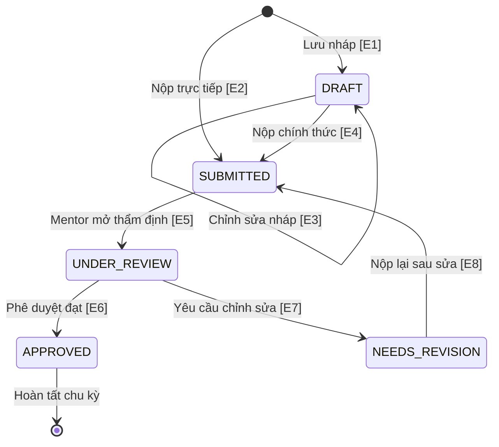

# Test Cases: FR-TL-002 - Nộp Báo cáo Nhóm (Submit Team Report)

**Module:** Talent Leader / Project Management  
**Chức năng:** Nộp Báo cáo Tiến độ Nhóm (`POST /api/talent-leader/projects/{projectId}/reports`)  
**Người thực hiện:** Nguyễn Minh Hiển  
**Ngày tạo:** 08/11/2026  
**Ngày cập nhật:** 08/11/2026  
**Nguồn đặc tả:** `docs/SRS_LabOdc.md` - mục FR-TL-002  
**Source code tham chiếu:** `labodc-backend/.../controller/TalentController.java`, `docs/SRS_LabOdc.md`

---

## Mô tả chức năng

Trưởng nhóm sinh viên (Talent Leader) gửi báo cáo định kỳ (tuần, tháng, tổng kết) về tiến độ công việc, các nhiệm vụ hoàn thành, nhiệm vụ đang triển khai và các vấn đề phát sinh của nhóm dự án.

**Điều kiện hợp lệ:** Yêu cầu nộp báo cáo được chấp nhận khi **tất cả** các điều kiện sau đồng thời thỏa mãn:

| Biến đầu vào | Ý nghĩa | Kiểu dữ liệu | Ràng buộc hợp lệ |
|---|---|---|---|
| `Role` | Quyền người dùng | Authentication | User là TALENT giữ vai trò TEAM_LEADER của dự án |
| `projectId` | ID dự án | Long | Số nguyên dương, dự án đang ACTIVE và tồn tại trong DB |
| `reportType` | Loại kỳ báo cáo | String / Enum | Không rỗng, thuộc danh mục: `WEEKLY`, `MONTHLY`, `FINAL` |
| `reportingPeriod`| Kỳ báo cáo | String | Đúng định dạng `YYYY-MM` (tháng 01..12, năm 2020..2030) |
| `overallProgress`| Tiến độ tổng thể | Integer / Double | Số thực hoặc số nguyên trong khoảng `[0, 100]` (%) |
| `tasksCompleted` | Công việc đã xong | Array (JSON) | Mảng hợp lệ, tối thiểu 0 phần tử |

**Giả định & Phạm vi:**
1. Request gửi qua API dưới định dạng `Content-Type: application/json`.
2. Trưởng nhóm có thể nộp chính thức hoặc lưu nháp (Draft).
3. Backend hiện tại chưa triển khai route `/api/talent-leader/**`, các ca kiểm thử được thiết kế để kiểm chứng yêu cầu nghiệp vụ theo SRS và làm cơ sở đối soát lỗi.

---

## 1. Phân hoạch lớp tương đương (Equivalence Partitioning)

### 1.1 Vai trò người gọi API (Role / Permission)

| Lớp | Mô tả | Tag | Giá trị đại diện |
|---|---|---|---|
| Hợp lệ | User có role TALENT và là Leader của dự án | V-RL1 | Token của Team Leader dự án 1 |
| Không hợp lệ (a) | Chưa đăng nhập (Không có token) | X-RL1 | Không truyền Header Authorization |
| Không hợp lệ (b) | Là thành viên TALENT thông thường (không phải Leader) | X-RL2 | Token của Member dự án 1 |
| Không hợp lệ (c) | Là Leader nhưng của một dự án khác | X-RL3 | Token của Leader dự án 2 |

### 1.2 Loại báo cáo (reportType)

| Lớp | Mô tả | Tag | Giá trị đại diện |
|---|---|---|---|
| Hợp lệ | Thuộc tập {`WEEKLY`, `MONTHLY`, `FINAL`} | V-TY1 | `"MONTHLY"` |
| Không hợp lệ (a) | Bỏ trống / rỗng | X-TY1 | `""` |
| Không hợp lệ (b) | Giá trị không thuộc danh mục | X-TY2 | `"DAILY"` |

### 1.3 Kỳ báo cáo (reportingPeriod)

| Lớp | Mô tả | Tag | Giá trị đại diện |
|---|---|---|---|
| Hợp lệ | Định dạng YYYY-MM hợp lệ (tháng 01..12) | V-PR1 | `"2026-02"` |
| Không hợp lệ (a) | Sai định dạng (DD-MM-YYYY hoặc có dấu gạch chéo) | X-PR1 | `"15-02-2026"` |
| Không hợp lệ (b) | Tháng không hợp lệ (> 12 hoặc = 00) | X-PR2 | `"2026-13"` |

### 1.4 Tiến độ tổng thể (overallProgress)

| Lớp | Mô tả | Tag | Giá trị đại diện |
|---|---|---|---|
| Hợp lệ | Giá trị số trong đoạn [0, 100] | V-PG1 | `50` |
| Không hợp lệ (a) | Giá trị nhỏ hơn 0 | X-PG1 | `-1` |
| Không hợp lệ (b) | Giá trị lớn hơn 100 | X-PG2 | `101` |
| Không hợp lệ (c) | Sai kiểu dữ liệu (chuỗi ký tự) | X-PG3 | `"nam_muoi"` |

### Tổng hợp tag lớp tương đương

| Loại | Tags | Số lượng |
|---|---|---|
| Hợp lệ | V-RL1, V-TY1, V-PR1, V-PG1 | 4 |
| Không hợp lệ | X-RL1, X-RL2, X-RL3, X-TY1, X-TY2, X-PR1, X-PR2, X-PG1, X-PG2, X-PG3 | 10 |
| **Tổng** | | **14 tag** |

---

## 2. Phân tích giá trị biên (Boundary Value Analysis)

Biến có miền số học liên tục là **`overallProgress`** (phạm vi từ 0 đến 100%). Áp dụng kỹ thuật Standard BVA với 5 giá trị:

### 2.1 Biên của overallProgress

| Ký hiệu | Ý nghĩa | Giá trị | Mô tả | Tag |
|---|---|---:|---|---|
| `min` | Giá trị nhỏ nhất hợp lệ | 0 | Báo cáo bắt đầu dự án, tiến độ 0% | B-PG1 |
| `min+` | Ngay trên min | 1 | Tiến độ 1% | B-PG2 |
| `nominal` | Đại diện giữa miền | 50 | Tiến độ 50% | B-PG3 |
| `max-` | Ngay dưới max | 99 | Tiến độ 99% | B-PG4 |
| `max` | Giá trị lớn nhất hợp lệ | 100 | Báo cáo nghiệm thu hoàn thành 100% | B-PG5 |

### 2.2 Biên của reportType & reportingPeriod

| Ký hiệu | Giá trị | Mô tả | Tag |
|---|---|---|---|
| Biên loại báo cáo | `WEEKLY`, `FINAL` | Điểm đầu và cuối danh mục enum | B-TY1 |
| Biên kỳ báo cáo | `2026-01`, `2026-12` | Tháng đầu tiên và cuối cùng trong năm | B-PR1 |

> **Tổng hợp BVA:** 7 tag biên (B-PG1..B-PG5, B-TY1, B-PR1).

---

## 3. Bảng chuyển đổi trạng thái (State Transition Table)

### 3.1 Sơ đồ trạng thái (State Diagram)

### 3.2 Bảng chuyển đổi trạng thái

| STT | Trạng thái ban đầu | Sự kiện / Hành động kích hoạt | Trạng thái đích | Kết quả mong đợi |
|---:|---|---|---|---|
| ST-01 | Non-Existent | Bấm "Lưu nháp" với dữ liệu hợp lệ | DRAFT | Lưu bản ghi nháp thành công |
| ST-02 | Non-Existent | Bấm "Nộp chính thức" trực tiếp | SUBMITTED | Nộp thành công, chờ Mentor duyệt |
| ST-03 | DRAFT | Cập nhật nội dung nhiệm vụ và bấm Lưu | DRAFT | Cập nhật nháp, giữ nguyên trạng thái |
| ST-04 | DRAFT | Bấm "Nộp chính thức" | SUBMITTED | Khóa sửa tạm thời, chuyển SUBMITTED |
| ST-05 | SUBMITTED | Mentor mở chi tiết báo cáo thẩm định | UNDER_REVIEW | Chuyển sang Đang xem xét |
| ST-06 | UNDER_REVIEW | Mentor xác nhận đạt và bấm Duyệt | APPROVED | Tiến độ ghi nhận chính thức |
| ST-07 | UNDER_REVIEW | Mentor bấm "Yêu cầu chỉnh sửa" | NEEDS_REVISION | Báo cáo gửi trả về Leader kèm phản hồi |
| ST-08 | NEEDS_REVISION | Leader bổ sung nội dung và nộp lại | SUBMITTED | Nộp lại thành công, chờ thẩm định |
| ST-09 | APPROVED | Cố ý gửi request PUT sửa báo cáo đã duyệt | APPROVED | 400 Bad Request: Không được sửa báo cáo đã duyệt |

---

## 4. Bảng quyết định (Decision Table)

| Condition / Action | Rule 1 | Rule 2 | Rule 3 | Rule 4 | Rule 5 | Rule 6 |
|---|:---:|:---:|:---:|:---:|:---:|:---:|
| **C1:** Là Team Leader của dự án? | **Y** | **Y** | **Y** | **Y** | **Y** | **N** |
| **C2:** reportType hợp lệ? | **Y** | **Y** | **Y** | **N** | **-** | **-** |
| **C3:** reportingPeriod hợp lệ (YYYY-MM)? | **Y** | **Y** | **Y** | **-** | **N** | **-** |
| **C4:** overallProgress thuộc [0..100]? | **Y** | **Y** | **N** | **-** | **-** | **-** |
| **C5:** Hành động là SUBMIT (Y) hay DRAFT (N)? | **Y** | **N** | **-** | **-** | **-** | **-** |
| **A1:** Lưu thành công trạng thái SUBMITTED | **X** | - | - | - | - | - |
| **A2:** Lưu thành công trạng thái DRAFT | - | **X** | - | - | - | - |
| **A3:** Báo lỗi 403 Forbidden (Sai quyền) | - | - | - | - | - | **X** |
| **A4:** Báo lỗi 400 Bad Request (Sai reportType)| - | - | - | **X** | - | - |
| **A5:** Báo lỗi 400 Bad Request (Sai kỳ báo cáo)| - | - | - | - | **X** | - |
| **A6:** Báo lỗi 400 Bad Request (Sai tiến độ) | - | - | **X** | - | - | - |

---

## 5. Bảng Test Cases

### Preconditions
- Hệ thống backend đang chạy.
- Dự án `projectId = 1` tồn tại ở trạng thái ACTIVE.
- User test là Team Leader của dự án `projectId = 1`.

### Bảng test cases chi tiết

| STT | TC ID | Tên test case | Role gọi API | reportType | reportingPeriod | overallProgress | Expected HTTP | Expected Result | Tag được bao phủ |
|---:|---|---|---|---|---|---:|---:|---|---|
| 1 | TC-TL002-01 | Nộp báo cáo nominal (50%) | TEAM_LEADER | `MONTHLY` | `2026-02` | 50 | 201 | Tạo báo cáo tiến độ 50% | V-RL1, V-TY1, V-PR1, V-PG1, B-PG3 |
| 2 | TC-TL002-02 | Nộp báo cáo tại min (0%) | TEAM_LEADER | `WEEKLY` | `2026-01` | 0 | 201 | Báo cáo tiến độ 0% | V-RL1, V-TY1, V-PR1, V-PG1, B-PG1, B-TY1, B-PR1 |
| 3 | TC-TL002-03 | Nộp báo cáo tại max (100%) | TEAM_LEADER | `FINAL` | `2026-12` | 100 | 201 | Báo cáo hoàn tất 100% | V-RL1, V-TY1, V-PR1, V-PG1, B-PG5, B-TY1, B-PR1 |
| 4 | TC-TL002-04 | Nộp báo cáo tại min+ (1%) | TEAM_LEADER | `MONTHLY` | `2026-02` | 1 | 201 | Báo cáo tiến độ 1% | V-RL1, V-TY1, V-PR1, V-PG1, B-PG2 |
| 5 | TC-TL002-05 | Nộp báo cáo tại max- (99%) | TEAM_LEADER | `MONTHLY` | `2026-02` | 99 | 201 | Báo cáo tiến độ 99% | V-RL1, V-TY1, V-PR1, V-PG1, B-PG4 |
| 6 | TC-TL002-06 | overallProgress âm (-1) | TEAM_LEADER | `MONTHLY` | `2026-02` | -1 | 400 | Tiến độ không được nhỏ hơn 0 | X-PG1 |
| 7 | TC-TL002-07 | overallProgress vượt 100 (101) | TEAM_LEADER | `MONTHLY` | `2026-02` | 101 | 400 | Tiến độ không được vượt quá 100 | X-PG2 |
| 8 | TC-TL002-08 | overallProgress kiểu chữ | TEAM_LEADER | `MONTHLY` | `2026-02` | `"nam_muoi"` | 400 | Lỗi kiểu dữ liệu tiến độ | X-PG3 |
| 9 | TC-TL002-09 | reportType sai danh mục | TEAM_LEADER | `DAILY` | `2026-02` | 50 | 400 | Loại báo cáo không hợp lệ | X-TY2 |
| 10 | TC-TL002-10 | reportType rỗng | TEAM_LEADER | `""` | `2026-02` | 50 | 400 | Loại báo cáo là bắt buộc | X-TY1 |
| 11 | TC-TL002-11 | reportingPeriod tháng 13 | TEAM_LEADER | `MONTHLY` | `2026-13` | 50 | 400 | Tháng không hợp lệ | X-PR2 |
| 12 | TC-TL002-12 | reportingPeriod sai định dạng | TEAM_LEADER | `MONTHLY` | `15-02-2026` | 50 | 400 | Sai format YYYY-MM | X-PR1 |
| 13 | TC-TL002-13 | Chưa đăng nhập gọi API | UNAUTHENTICATED | `MONTHLY` | `2026-02` | 50 | 401 | Yêu cầu xác thực token | X-RL1 |
| 14 | TC-TL002-14 | Member thường gọi nộp | TALENT_MEMBER | `MONTHLY` | `2026-02` | 50 | 403 | Chỉ Leader mới có quyền | X-RL2 |
| 15 | TC-TL002-15 | Leader dự án khác gọi nộp | TALENT_OTHER_PRJ | `MONTHLY` | `2026-02` | 50 | 403 | Không thuộc dự án này | X-RL3 |

---

## 6. Kiểm tra bao phủ tag

### Lớp tương đương

| Tag | Test bao phủ |
|---|---|
| V-RL1, V-TY1, V-PR1, V-PG1 | TC-TL002-01, 02, 03, 04, 05 |
| X-RL1 | TC-TL002-13 |
| X-RL2 | TC-TL002-14 |
| X-RL3 | TC-TL002-15 |
| X-TY1 | TC-TL002-10 |
| X-TY2 | TC-TL002-09 |
| X-PR1 | TC-TL002-12 |
| X-PR2 | TC-TL002-11 |
| X-PG1 | TC-TL002-06 |
| X-PG2 | TC-TL002-07 |
| X-PG3 | TC-TL002-08 |

### Giá trị biên

| Tag | Giá trị | Test bao phủ |
|---|---|---|
| B-PG1 | 0% | TC-TL002-02 |
| B-PG2 | 1% | TC-TL002-04 |
| B-PG3 | 50% | TC-TL002-01 |
| B-PG4 | 99% | TC-TL002-05 |
| B-PG5 | 100% | TC-TL002-03 |
| B-TY1 | WEEKLY, FINAL | TC-TL002-02, 03 |
| B-PR1 | 2026-01, 2026-12 | TC-TL002-02, 03 |

> **Bao phủ:** 14/14 EP tags, 7/7 BVA tags - **100%**.
